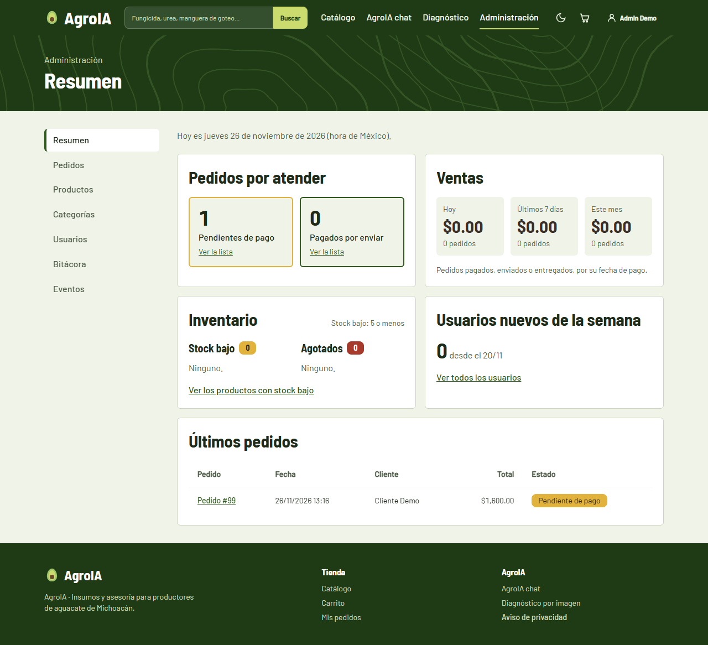
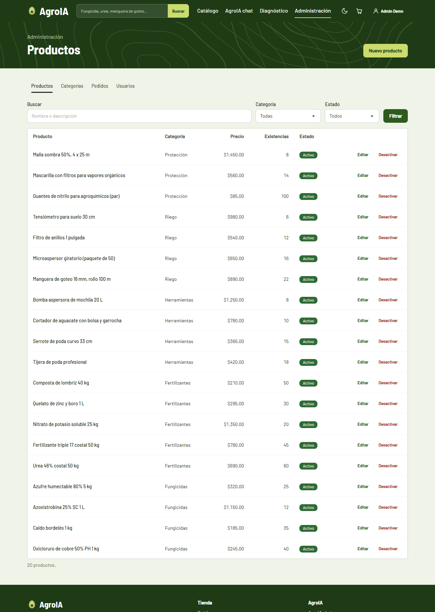
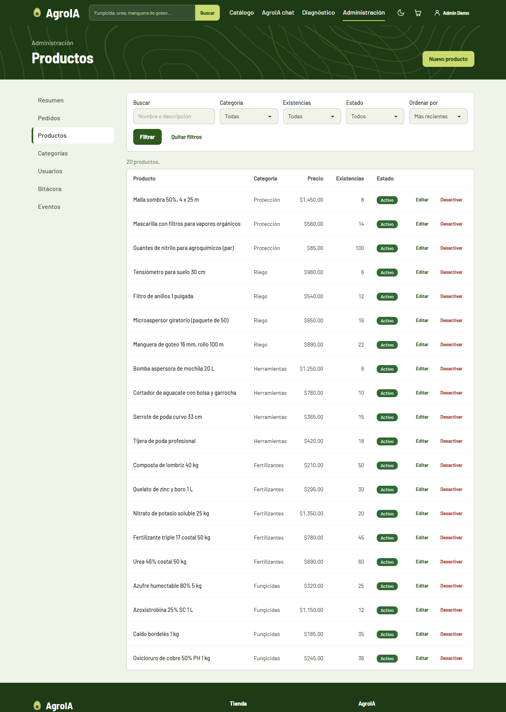
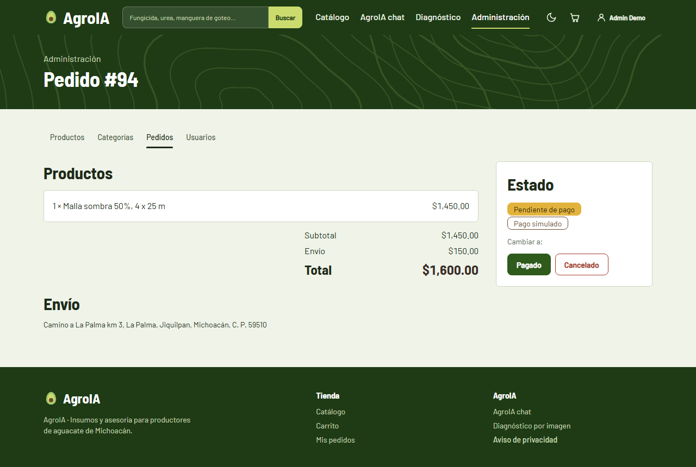
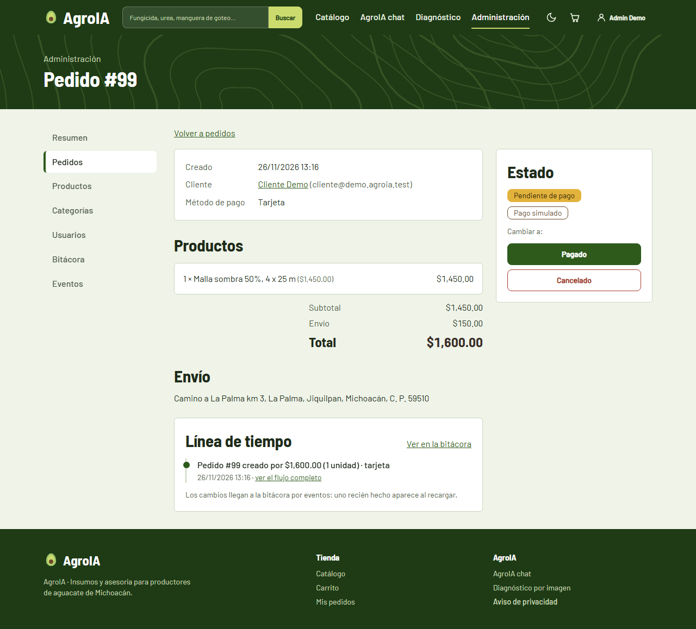
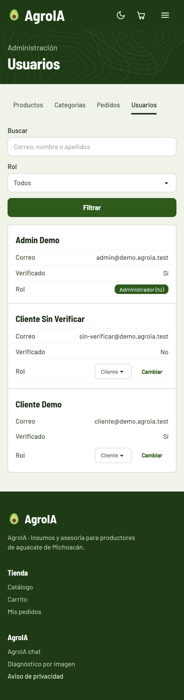
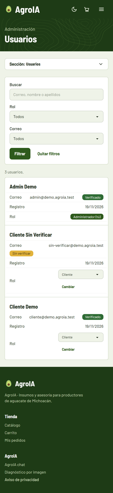
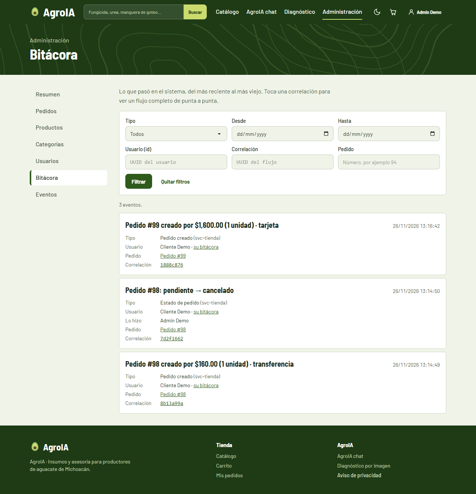
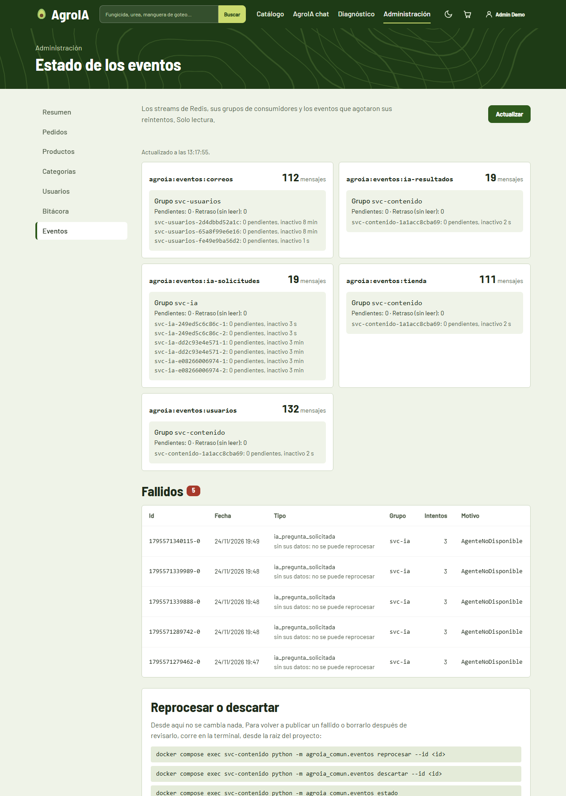

# Entrega 4 · Panel de administración ampliado

**Fecha:** 26 de noviembre de 2026 · **Entregable:** Entrega 4 · **Responsable:** Bryan Gael Esquivel Pérez

## Resumen

El panel de administración pasó de cuatro listas (productos, categorías, pedidos, usuarios) a un panel completo con la dirección visual «Altura». Lo nuevo:

- **Resumen** al entrar: pedidos por atender, ventas, inventario, usuarios nuevos y últimos pedidos.
- **Bitácora** legible, con filtros y seguimiento de un flujo por su correlación.
- **Estado de los eventos** de Redis, de solo lectura.
- **Detalle de usuario**, y **línea de tiempo** en el detalle de cada pedido.
- **Filtros nuevos**, confirmaciones propias y barra lateral de navegación.

Se cumplen las reglas de siempre: el navegador solo habla con web, y web no toca bases ni Redis, solo las APIs de los servicios.

En los servicios hay **cuatro endpoints nuevos de administrador**:

| Endpoint | Servicio |
| --- | --- |
| `GET /resumen/` | svc-tienda |
| `GET /usuarios/<id>/` | svc-usuarios |
| `GET /eventos/estado/` | svc-contenido |
| `pedido_id` en `GET /bitacora/` | svc-contenido (filtro nuevo de un endpoint existente) |

También hay **filtros nuevos** en endpoints existentes, el **campo `pagado_en`** en el pedido (con su migración) y el conteo de productos por categoría.

**Sin dependencias nuevas.**

**Verificación:**

| Prueba | Resultado |
| --- | --- |
| Pytest | web 359, svc-usuarios 194, svc-tienda 185, svc-contenido 150, svc-ia 87 e `infra` 12 |
| ruff | Sin observaciones |
| Postman | 258 de 258 aserciones |
| Prueba de punta a punta | 62 de 62 |
| Matriz de accesos | 186 de 186 |
| Playwright del panel | 60 revisiones con 0 observaciones y 20 de 20 comprobaciones de interacción |

Nada falló por la cuota de Groq.

## Diagnóstico de partida

Capturas en escritorio y móvil del panel tal como estaba, antes de cambiarlo:

| Pantalla | Qué le faltaba |
| --- | --- |
| `/administracion/` | Redirigía a Productos: no había inicio. |
| Productos | Filtro y marca de stock bajo o agotado, orden y número de página. «Desactivar» confirmaba con el `confirm()` nativo. |
| Producto (formulario) | Vista previa de la foto nueva; la foto actual solo se veía a un lado. La ficha técnica se editaba como JSON a mano. |
| Categorías | Cuántos productos tiene cada una. Confirmación nativa. |
| Pedidos | Solo filtraba por estado. Faltaban fechas, búsqueda por número, columna de cliente y número de página. |
| Pedido | Fecha, cliente y línea de tiempo. «Cancelado» confirmaba con el diálogo nativo y «Pagado» no confirmaba. |
| Usuarios | Filtro de verificación, fecha de alta y detalle. El rol cambiaba sin confirmación (quitarse el propio rol ya estaba protegido con un 409 `auto_degradacion`). |
| Bitácora y eventos | No existían. |
| Navegación | Pestañas arriba, sin contexto en móvil. |

## Qué se construyó

### Servicios

**svc-tienda**

- **`pagado_en`** (nullable) en `Pedido`, migración `0004_pagado_en` e índice `estado` + `pagado_en`.
  - Lo pone `_cambiar_estado_bloqueado`, el punto único de las transiciones, al pasar a pagado: dentro de la misma transacción y solo si estaba vacío.
  - Ninguna otra transición lo toca.
  - Viaja en el detalle y el listado del pedido.
  - **No se agregó al evento `pedido_estado_cambiado`:** cambiaría el contrato del catálogo de eventos. Una prueba lo comprueba.
- **`GET /api/v1/resumen/?umbral=5`** (solo administrador):
  - pedidos pendientes y pagados por enviar;
  - ventas de hoy, de los últimos 7 días y del mes, con Decimal en la base y texto decimal en la respuesta;
  - productos activos con stock bajo y agotados (total y hasta 10 de cada uno);
  - los 5 últimos pedidos.
- **Cómo se cuentan las ventas:**
  - Son los pedidos pagados, enviados o entregados, por `Coalesce(pagado_en, creado_en)`. Así, los pedidos viejos sin `pagado_en` cuentan por su fecha de creación.
  - La respuesta trae `respaldo`: cuántos pedidos se contaron así y la fecha del primer `pagado_en`, para avisarlo en la tarjeta.
  - «Hoy», «7 días» y «mes» se calculan en America/Mexico_City (`TIME_ZONE` de svc-tienda y de web), aunque la base guarde en UTC.
- **Filtros nuevos:**
  - pedidos: `id`, `usuario_id`, `desde` y `hasta` (día completo en hora de México, con `agroia_comun.filtros`);
  - productos: `stock_max`, y orden por `stock`.
- **Categorías:** campo `productos` (conteo anotado en la consulta).

**svc-usuarios**

- **`GET /api/v1/usuarios/<id>/`**: detalle de administrador. Un id que no es UUID responde 404, no 500.
- **Filtros nuevos:**
  - `email_verificado`;
  - `desde`: fecha de registro, en hora de México;
  - `ids`: hasta 20 UUID. Cada uno se valida y responde 400 si alguno no es UUID o si pasan de 20. Sirve para poner nombre a los usuarios de una página de pedidos o de la bitácora con una sola llamada.
- **No hizo falta un endpoint de resumen:** «usuarios nuevos de la semana» sale de `?desde=…` (el `count` y la primera página).

**svc-contenido**

- **Filtro `pedido_id` en la bitácora**, con el índice `datos.pedido_id` + `fecha`. Lo crea `crear_indices`.
- **`GET /api/v1/eventos/estado/`**:
  - envuelve `operacion.estado()` de `agroia_comun.eventos`;
  - agrega la fecha de cada fallido, tomada del id del mensaje en Redis;
  - deja el `motivo` solo con el nombre de la excepción (`ConnectionError`), porque el texto puede traer datos del evento;
  - nunca devuelve el sobre;
  - si Redis no responde, 503 `eventos_no_disponible`.

  Sale de svc-contenido porque ya tiene la librería, la conexión a Redis y la bitácora.

### Gateway (web)

| Pantalla | Qué tiene |
| --- | --- |
| Marco del panel | Banda Bosque con el título; barra lateral con la sección activa marcada (en móvil, un menú desplegable `
` que funciona sin JavaScript). |
| Resumen (`/administracion/`) | Cinco tarjetas. svc-tienda llena pedidos, ventas, inventario y últimos pedidos; svc-usuarios, la de usuarios nuevos. Si uno no responde, solo sus tarjetas muestran «No pudimos cargar esta parte» con «Intentar de nuevo». |
| Pedidos | Número, estado y fechas; columna de cliente (con `ids`); número de página. |
| Pedido | Fecha de creación y de pago, cliente con enlace a su detalle. La **línea de tiempo** sale de la bitácora (`pedido_id`); si svc-contenido no responde, solo esa tarjeta muestra el error. Transiciones con confirmación. |
| Productos | Búsqueda, categoría, existencias (stock bajo o agotados), estado y orden; marcas «Stock bajo» y «Agotado». |
| Producto | Foto actual y **vista previa** de la nueva. **Editor de la ficha técnica** por filas «característica / valor», que escribe el JSON. Sin JavaScript, o si la ficha tiene listas u objetos, queda el JSON a mano, con «Editar como JSON» y «Volver a la lista». |
| Categorías | Número de productos con enlace a la lista filtrada; estado vacío con acción. |
| Usuarios | Búsqueda, rol y verificación; fecha de alta; enlace al detalle. No ofrece cambiarte tu propio rol. |
| Usuario (nuevo) | Datos, rol con confirmación (no en tu propia cuenta), sus pedidos y el enlace a su bitácora. |
| Bitácora (nueva) | Filtros por tipo, fechas, usuario, correlación y pedido, con HTMX; plegados en móvil. Cada evento muestra fecha, tipo, servicio de origen, usuario (con nombre) y un **resumen legible**, por ejemplo «Pedido #12: pendiente → pagado» o «Rol: cliente → administrador». Tocar la correlación filtra el flujo completo. |
| Eventos (nueva) | Streams, grupos y consumidores con su tiempo inactivo, y los fallidos. «Actualizar» con HTMX, sin polling. Nota con los comandos para reprocesar y descartar, y con el aviso de que el motivo completo se ve con el comando. |

**El resumen legible de la bitácora** (`apps/panel/bitacora.py`) solo usa los campos que el evento ya trae (catálogo de `docs/eventos.md`). Un tipo desconocido muestra solo su nombre, nunca sus datos.

**Confirmaciones:**

- Las hace un `<dialog>` propio: el componente Alpine `confirmar` y `componentes/confirmar.html`.
- En formularios normales intercepta el envío; en los de HTMX usa el evento `htmx:confirm`.
- El foco entra al diálogo y Esc lo cierra; al cerrarse, vuelve al botón que lo abrió.
- **Sin JavaScript el formulario se envía sin confirmar**, como antes, sin quedar roto.
- Sustituyen a todos los `hx-confirm` del panel.

**Configuración nueva:** `PANEL_UMBRAL_STOCK_BAJO` (web, 5 por omisión), en `.env.example` y en `docker-compose.yml`. Web lo manda como `umbral` al resumen y como `stock_max` a la lista de productos: un solo lugar para cambiarlo.

**El enlace «Administración» del encabezado** ahora lleva al resumen (`/administracion/`).

## Contratos nuevos

Están en la [definición técnica](../definicion-tecnica.md#contratos-de-api), en Swagger de cada servicio (`@extend_schema` con ejemplos) y en Postman.

| Servicio | Método y ruta | Acceso |
| --- | --- | --- |
| svc-tienda | `GET /api/v1/resumen/?umbral=` | administrador (401 sin token, 403 otro rol, 400 umbral fuera de 0–1000) |
| svc-tienda | `GET /pedidos/?id=&usuario_id=&desde=&hasta=` | dueño o administrador (filtros nuevos) |
| svc-tienda | `GET /productos/?stock_max=&ordering=stock` | público; el panel lo usa como administrador |
| svc-tienda | Campos nuevos `pagado_en` (pedido) y `productos` (categoría) | solo lectura |
| svc-usuarios | `GET /api/v1/usuarios/<id>/` | administrador (404 si no existe) |
| svc-usuarios | `GET /usuarios/?email_verificado=&desde=&ids=` | administrador |
| svc-contenido | `GET /bitacora/?pedido_id=` | administrador |
| svc-contenido | `GET /api/v1/eventos/estado/` | administrador (503 `eventos_no_disponible` sin Redis) |

## Decisiones técnicas

- **Las páginas del panel conservan su comportamiento:** sin sesión van al login; con rol cliente, al inicio con «No tienes permiso». Hay pruebas de las cuatro rutas nuevas. Los 401 y 403 se comprueban en los endpoints de los servicios y en el proxy `/api/`, con filas en la matriz y casos en Postman.
- **`pagado_en` y no la fecha de creación** para las ventas. El respaldo en `creado_en` es solo para los pedidos pagados antes de la migración, y la tarjeta lo dice.
- **Los filtros de fecha usan días completos en hora de México** y viven en `comun` (`agroia_comun.filtros`, extra `[django]`, que ahora incluye `django-filter==26.2`, la misma versión de los servicios). El núcleo de `comun` sigue sin Django: svc-ia no instala el extra, y su prueba comprueba que no tiene Django, DRF ni django-filter. svc-contenido ya validaba sus fechas con su serializer.
- **Un solo lugar para el umbral (web)**, y svc-tienda lo recibe como parámetro. Así el resumen y la lista de productos siempre coinciden.
- **El motivo de los fallidos se recorta a la clase de la excepción** en el endpoint, no en la plantilla: así el texto nunca sale del servicio.
- **Las tarjetas del resumen se arman en el servidor**, no con HTMX diferido. La página funciona sin JavaScript, y cada servicio tiene su propio `try`, así que una caída no tumba la página. Llamar a dos servicios es rápido; si uno tarda, aplica el `SERVICIOS_TIMEOUT` de siempre.

## Verificación

### Playwright (Chromium), panel completo

- **60 revisiones:** 15 pantallas en escritorio y en móvil, con tema claro y oscuro. Las pantallas:
  - resumen;
  - pedidos (todos y pendientes) y un pedido;
  - productos (todos y con stock bajo), producto nuevo y producto en edición;
  - categorías, usuarios y detalle de usuario;
  - bitácora (toda, por pedido y por correlación) y eventos.
- **En cada una se revisó:** contraste AA de todo el texto, foco visible en los primeros 35 elementos al tabular, sin desbordamiento horizontal, imágenes con alt, ancho y alto, sin texto de plantilla a la vista, y errores de consola y de la CSP.
- **Resultado: 0 observaciones, 0 errores de consola y 0 de la CSP.**
- **20 de 20 comprobaciones de interacción:**
  - en escritorio y móvil, el diálogo se abre con el teclado, el foco queda dentro, Esc lo cierra, el foco vuelve al botón y cancelar no envía nada;
  - «Actualizar» de los eventos reemplaza el estado con HTMX;
  - el editor de la ficha empieza en filas y escribe el JSON;
  - con HTMX, cancelar no cambia el estado del pedido y aceptar sí («Estado actualizado.»);
  - **sin JavaScript**, el diálogo no aparece y la transición se aplica sin confirmar.

### Corridas completas

| Prueba | Resultado |
| --- | --- |
| pytest web | 359 de 359 |
| pytest svc-usuarios | 194 de 194 |
| pytest svc-tienda | 185 de 185 |
| pytest svc-contenido | 150 de 150 |
| pytest svc-ia | 87 de 87 (sin cambios) |
| pytest `infra/tests` | 12 de 12 |
| `ruff check` y `ruff format --check` | Sin observaciones (355 archivos) |
| Postman (Newman) | 162 peticiones, 258 de 258 aserciones. 20 peticiones nuevas para los endpoints del panel |
| Prueba de punta a punta (`infra/prueba_eventos.py`) | 62 de 62 |
| Matriz de accesos ([`docs/entregable-4/matriz-accesos.md`](../entregable-4/matriz-accesos.md)) | 186 de 186. Filas nuevas: resumen, ver un usuario, bitácora de un pedido y estado de los eventos (8 actores cada una). Nada marcado por la cuota de Groq |

**Pruebas nuevas:**

- **svc-tienda:**
  - pagar pone `pagado_en` una sola vez, y enviar y entregar no lo tocan;
  - cancelar un pendiente no lo pone;
  - el evento no lleva `pagado_en`;
  - las ventas se cuentan bien con pedidos viejos y nuevos;
  - **un pedido pagado a las 23:30 hora de México cuenta para ese día y no para el siguiente;**
  - stock por umbral, filtros de fecha en hora de México, número y usuario;
  - 400, 401 y 403.
- **svc-usuarios:** detalle (200, 404, 401 y 403), filtro de verificación, `desde` en hora de México, e `ids` (correcto, inválido y más de 20).
- **svc-contenido:**
  - filtro `pedido_id` (correcto e inválido) y su índice;
  - el estado de los eventos sin el sobre y con el motivo solo con el nombre;
  - 503 sin Redis, 401 y 403.
- **web:**
  - acceso a las rutas nuevas;
  - resumen completo y con cada servicio caído;
  - resumen legible de cada tipo de evento;
  - bitácora, eventos, detalle de usuario y de pedido (también con svc-contenido caído);
  - filtros, y confirmaciones en lugar de `hx-confirm`.

**Prueba existente que cambió:** `test_el_menu_muestra_administracion_solo_al_administrador` buscaba el enlace del menú a `/administracion/productos/`. El enlace ahora lleva al resumen (`/administracion/`) y la prueba busca ese `href`. Sigue comprobando lo mismo: que el cliente no ve el enlace y el administrador sí. Ninguna otra prueba se modificó.

**Datos:** el pedido de prueba #94 del diagnóstico, el #99 de las capturas y lo que dejaron las corridas se borraron con `limpiar_datos_prueba`, y el stock se restableció con `cargar_datos_demo`.

## Capturas

Antes y después, en escritorio y móvil:

- `img/panel-productos-*`
- `img/panel-producto-*`
- `img/panel-categorias-*`
- `img/panel-pedidos-*`
- `img/panel-pedido-*`
- `img/panel-usuarios-*`

Pantallas nuevas:

- `img/panel-resumen-*`
- `img/panel-usuario-*`
- `img/panel-bitacora-*`
- `img/panel-eventos-*`
- `img/panel-confirmar-*` (el diálogo)
- `img/panel-ficha-*` (el editor de la ficha)

| Pantalla | Antes | Después |
| --- | --- | --- |
| Inicio del panel | (redirigía a Productos) |  |
| Productos |  |  |
| Pedido |  |  |
| Usuarios |  |  |
| Bitácora | — |  |
| Eventos | — |  |

## Problemas encontrados

- **Heredocs de Git Bash:** algunos scripts largos de edición se cortaban; se escribieron como archivos en el scratchpad.
- **El detalle de pedido suponía `usuario_id`.** Los datos falsos de las pruebas viejas no lo traían; la vista ahora lo trata como opcional y muestra «—» en vez de fallar.
- **Formato de fecha en español:** `date:"l j de F"` daba «Jueves 26 de Noviembre»; se pasó a minúsculas.

## Commits y Pull Requests

Rama `feat/panel-admin` desde `develop` (05873fa). Los commits los hace el equipo.

## Pendientes y siguiente paso

- Reprocesar y descartar fallidos desde el panel (hoy, comandos), si el equipo lo decide, con confirmación y registro en la bitácora.
- Que la línea de tiempo del pedido se refresque sola después de un cambio de estado: hoy el evento llega por Redis y aparece al recargar.
- Productos relacionados y otras métricas de ventas (por categoría o por producto) necesitarían nuevos endpoints de resumen.
