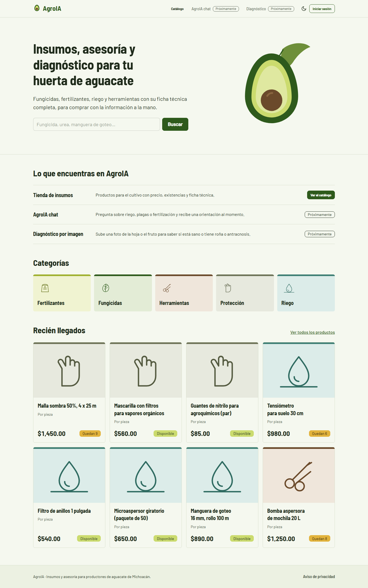
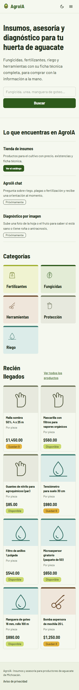
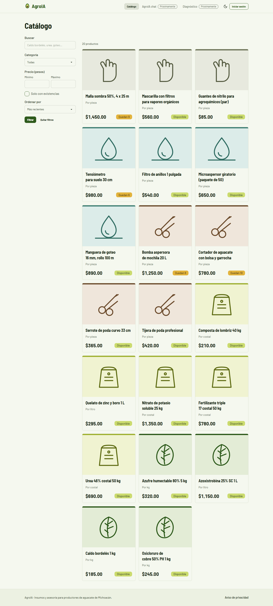
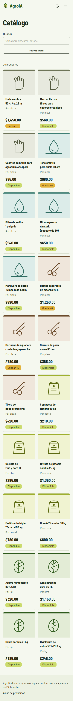
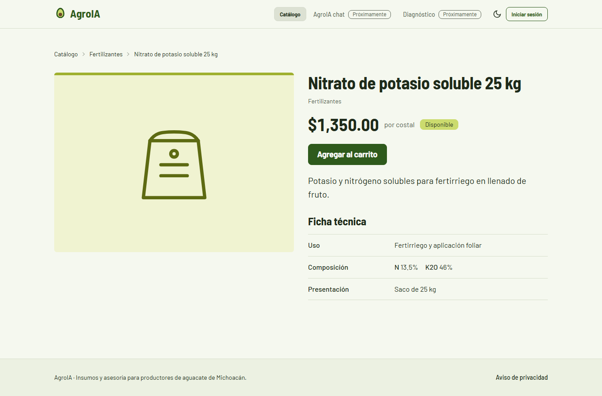
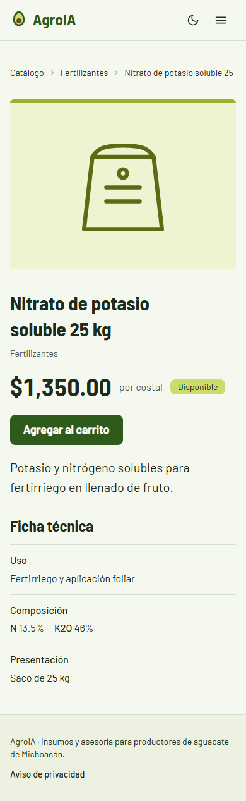

# Base del gateway web y catálogo público

**Fecha:** 22 de octubre de 2026 · **Entregable:** Entrega 2 · **Responsable:** Bryan Gael Esquivel Pérez

## Resumen

Se construyó la primera parte visual de AgroIA-Web en el gateway `web`: la base de diseño (Tailwind 4 + daisyUI 5 sin Node, tema propio claro y oscuro, HTMX y Alpine locales), la plantilla base con sus componentes, y las páginas públicas de inicio, catálogo con filtros, detalle de producto y aviso de privacidad. El gateway pide los datos a svc-tienda por HTTP y reenvía las imágenes sin exponer el servicio. Los filtros funcionan con HTMX y también sin JavaScript. Se verificó dentro de Docker y en un navegador real en tres anchos el mismo día: 45 pruebas en `web`, sin regresiones en los demás servicios. No hay login: llega en la Entrega 3.

## Qué se construyó

### Base visual

| Pieza | Detalle |
| --- | --- |
| Tailwind + daisyUI | `django-tailwind-cli` 4.8.1 con tailwind-cli-extra 2.10.32 (Tailwind 4.3.3 + daisyUI 5.7.47). Entrada `static/css/fuente.css`, salida generada `static/css/agroia.css`. El ejecutable se descarga al construir la imagen y el contenedor compila el CSS al arrancar. |
| Temas | `agroia` (claro) y `agroia-oscuro` (sigue la preferencia del sistema). Selector con Alpine `$persist` que recuerda la elección; un script mínimo en el `<head>` la aplica antes de pintar para que no parpadee. |
| Recursos locales | HTMX 2.0.11, Alpine 3.17.4 con su plugin persist y las fuentes Barlow y Barlow Semi Condensed (OFL), sin CDN. |
| `base.html` | Enlace para saltar al contenido, navbar responsive (Catálogo; AgroIA chat, Diagnóstico e Iniciar sesión como "Próximamente"; menú plegable en celular que funciona sin JavaScript), mensajes de Django como `alert`, pie con el aviso de privacidad y CSRF para HTMX en el `<body>`. |
| Componentes | Tarjeta de producto, paginador (conserva los filtros con ``), estado vacío, indicador de carga, error, ilustración SVG por categoría, disponibilidad y selector de tema. |

### Páginas

| Ruta | Contenido |
| --- | --- |
| `/` | Buscador que lleva al catálogo, los tres servicios con su estado, categorías y productos recién llegados de svc-tienda. Si svc-tienda no responde, la página se muestra igual sin esas secciones. |
| `/catalogo/` | Cuadrícula de productos (2 columnas en celular, 3 en escritorio) con filtros por categoría, precio mínimo y máximo, solo con existencias, búsqueda y orden; paginación de 20. |
| `/catalogo/<slug>/` | Imagen o ilustración, precio en pesos, unidad, existencias, descripción y ficha técnica como tabla legible. "Agregar al carrito" avisa que hace falta iniciar sesión. |
| `/aviso-de-privacidad/` | Estructura de la sección 14 (responsable, datos, finalidades, terceros, derechos ARCO, fecha) y la aclaración de que es un proyecto académico. |

### Integración con svc-tienda

- `web/clientes/tienda.py`: cliente httpx hacia `URL_SVC_TIENDA` con timeout (`TIENDA_TIMEOUT`, 5 s), sin token porque catálogo y detalle son públicos. Distingue "no encontrado" (404 amable) de "no disponible" (503 amable, con el error solo en el log).
- **Imágenes:** el cliente reescribe las URLs internas (`http://svc-tienda:8000/media/...`) a `/media/tienda/...`, y esa ruta del gateway reenvía el archivo (solo `productos/` e `image/*`, con caché de una hora). Los productos sin imagen muestran la ilustración de su categoría.
- Precios con el filtro `|pesos` ($1,250.00) a partir del `Decimal` que devuelve la API.

## Diseño

| Token | Valor | Uso |
| --- | --- | --- |
| Cáscara | `#2E5A1C` | primario |
| Hueso | `#6B4A2B` | secundario (café tierra) |
| Pulpa | `#CBDB6E` | acento: insignia "Disponible" |
| Fondo | `#F5F8EF` | claro, con tono verde pálido |
| Tinta | `#1F2B1B` | texto |

- **Tipografía:** Barlow Semi Condensed para títulos y nombres de producto (los nombres largos caben en el celular) y Barlow para el texto, en escala 1.25.
- **Elemento distintivo:** la tarjeta-etiqueta, inspirada en las etiquetas de los insumos agrícolas. Lleva una franja y un panel con el tinte de su categoría (fungicidas verde, fertilizantes pulpa, herramientas tierra, riego verde agua, protección olivo) y, sin foto, una ilustración de la categoría. El resto es sobrio: sin sombras y sin animaciones decorativas.
- **Contraste (WCAG):** texto 13.8:1 (claro) y 14.8:1 (oscuro); botón primario 8.1:1 y 8.5:1; insignias 8.2 a 9.8:1; texto secundario al 70% 5.4:1 y 7.7:1; los trazos de las ilustraciones, más de 5:1 sobre su panel. Todos los pares pasan AA.

## Decisiones técnicas

| Decisión | Por qué |
| --- | --- |
| Reenvío de imágenes por `/media/tienda/` | El navegador no alcanza `svc-tienda:8000` y el servicio no debe publicarse. Solo pasan rutas bajo `productos/` e `image/*`. |
| El catálogo es un formulario `GET` mejorado con HTMX | Funciona igual sin JavaScript; con HTMX solo cambia `#resultados`, la URL se puede compartir y el botón atrás funciona. |
| Fragmento solo si `request.htmx` y no es reconstrucción del historial; `Vary: HX-Request` | Si HTMX pide la página para restaurar el historial, o el navegador tiene en caché la otra versión, no se muestra un fragmento suelto. |
| Campos vacíos fuera de la URL (HTMX los quita antes de enviar; sin JavaScript, el servidor redirige) | La URL compartida queda limpia: `/catalogo/?categoria=riego`. |
| Búsqueda con el evento `input`, no `keyup` | `keyup` no detecta pegar texto ni el autocompletado del celular. |
| Filtros validados con un `Form` de Django antes de llamar a svc-tienda | Un precio mínimo mayor que el máximo o una categoría inventada se explican en el formulario y no se envían. |
| Mensajes de Django en cookie | Las páginas públicas no necesitan `web_db`; las pruebas tampoco. La sesión llegará con el login. |
| CSS compilado no se sube; el contenedor lo compila al arrancar | Nadie ve la página sin estilos y no hay archivos generados en el repo. |
| `fuente.css` dentro de `static/` con el aviso W001 silenciado | CLAUDE.md fija esa ruta; el aviso solo importa con un storage de manifiesto, que no se usa. |
| Elementos "Próximamente" como texto al 70% y no como botones deshabilitados de daisyUI | daisyUI los dejaba al 20% de opacidad (ilegibles en el tema oscuro) y sin eventos de puntero, así que el aviso tampoco se veía. |
| Sin lenguaje del proyecto escolar en la interfaz | "Próximamente" en lugar de "Entrega 3"; hay una prueba que lo revisa en cada página. |

## Verificación

Se hizo el 22 de octubre de 2026 dentro de Docker y con Playwright 1.64.1 (Chromium) en un entorno temporal fuera del repo.

| Prueba | Resultado |
| --- | --- |
| Compilación del CSS | El contenedor descargó el ejecutable al construir la imagen y compiló `agroia.css` (96 KB) al arrancar; `python manage.py check` sin avisos |
| Páginas con los datos de demostración | Inicio, catálogo, detalle, aviso y 404 respondieron 200/404 con los 20 productos de svc-tienda; CSS, HTMX y fuentes se sirven desde `/static/` |
| Filtros con HTMX (navegador) | Al elegir "Riego" la lista pasó de 20 a 4 productos sin recargar la página; la búsqueda "manguera" dejó un producto; la URL quedó `?categoria=riego`, el botón atrás la restauró y abrir esa URL directamente dio la página con el filtro aplicado |
| Filtros sin JavaScript (navegador con JS apagado) | El formulario filtró por "Herramientas" + "Solo con existencias" con el botón Filtrar y la URL quedó limpia; los filtros se ven abiertos en celular |
| Parcial HTMX (petición directa) | Con `HX-Request` la respuesta no trae `<html>` y sí los resultados |
| Imágenes | Con una imagen de prueba subida a un producto: la página usó `/media/tienda/productos/caldo.png` sin mencionar svc-tienda, el gateway la sirvió (200, `image/png`, caché de 1 h) y el navegador la cargó; rutas no válidas → 404. La imagen de prueba se quitó después |
| Anchos | Celular (390 px), tableta (820 px) y escritorio (1366 px): sin desborde horizontal ni errores en la consola |
| Tema | La elección del tema oscuro se recordó al recargar; sin elección, el tema sigue la preferencia del sistema |
| Teclado | El primer Tab enfoca "Saltar al contenido", con anillo de foco visible |
| Revisión con web-design-guidelines | Se agregaron `width`/`height` a las imágenes, `theme-color`, `touch-action`, `text-wrap: balance`, números tabulares en precios, `translate="no"` en la marca, foco al pasar el cursor en las tarjetas y un placeholder con ejemplo |
| `pytest` en web | 45 pruebas pasan: vistas del catálogo 26, formato 8, páginas 7 y salud 4 |
| `ruff check` y `ruff format --check` | Pasan |
| Sin regresiones | svc-usuarios 71, svc-tienda 144, svc-contenido 69, svc-ia 55 y `comun` 26 pruebas siguen pasando |

### Capturas

| Página | Escritorio | Celular |
| --- | --- | --- |
| Inicio |  |  |
| Catálogo |  |  |
| Detalle |  |  |

También: [catálogo en tableta](img/web-catalogo-tableta.png) y [catálogo con el tema oscuro](img/web-catalogo-oscuro-escritorio.png).

## Problemas encontrados

| Problema | Solución |
| --- | --- |
| Un comentario de plantilla aparecía como texto en la navbar | En Django `{# #}` solo funciona en una línea; los comentarios largos pasaron a `` y hay una prueba que revisa que ninguna página muestre `{#`. |
| La franja de color no se veía en las tarjetas | El `border-base-300` de Tailwind pisaba el color del borde superior; la franja ahora es un elemento propio. |
| La búsqueda no se disparaba al pegar texto | Se cambió el disparador de `keyup` a `input`. |
| La URL compartida llevaba campos vacíos (`?q=&precio_min=…`) | HTMX los quita antes de enviar y, sin JavaScript, el servidor redirige a la URL limpia. |
| Los "Próximamente" y el botón Iniciar sesión eran casi invisibles en el tema oscuro | Se dejaron de usar los estilos de deshabilitado de daisyUI (20% de opacidad). |
| El catálogo en celular era una sola columna muy larga | Dos columnas compactas desde el ancho más chico. |
| La casilla "Solo con existencias" se veía redonda | daisyUI usa `--radius-selector` para las casillas; se bajó de 2rem a 0.5rem. |
| Una etiqueta de la ficha técnica salía en minúsculas ("uso") | La regla conservaba tal cual las claves cortas; ahora solo conserva las que tienen mayúsculas o números (N, K2O, P2O5). |

## Commits y Pull Requests

Rama `feat/web-base-catalogo` → `develop`. Los commits los hace el integrante a mano; esta sección se completa con los hashes al hacer el PR.

## Pendientes y siguiente paso

- **Entrega 3:** inicio de sesión y sesión en el gateway, carrito y checkout, mis pedidos, chat con AgroIA, diagnóstico por imagen y panel de administrador; "Agregar al carrito" dejará de ser solo un aviso.
- Los productos de demostración no tienen fotos; se ven con la ilustración de su categoría.
- **Siguiente:** revisión final de calidad de la Entrega 2 (Swagger y Postman de todos los servicios) y documentar los sprints en Jira.
