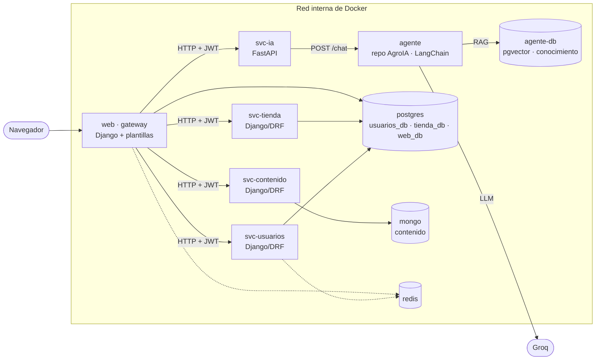
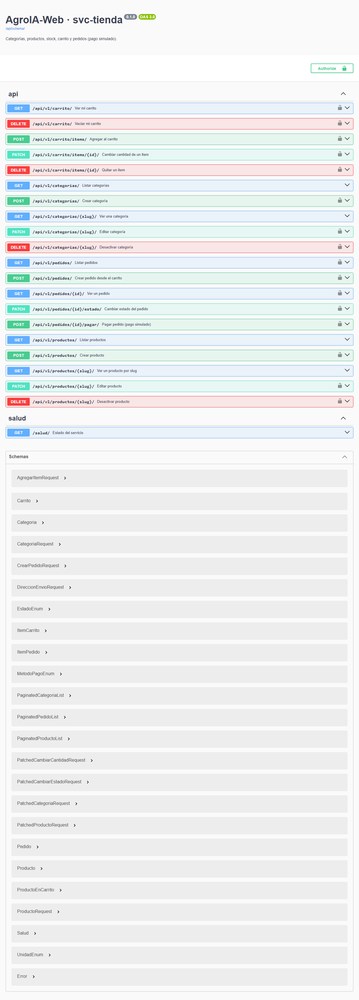
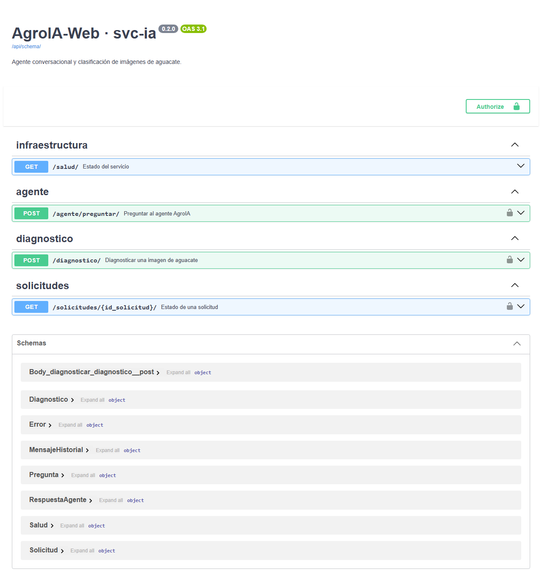
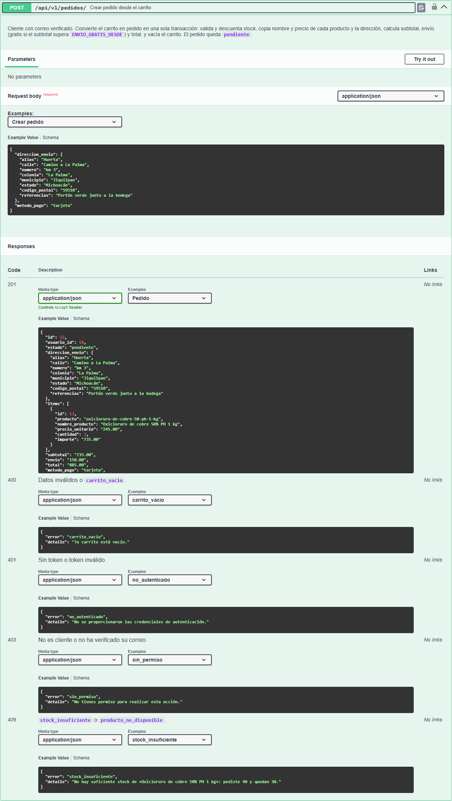
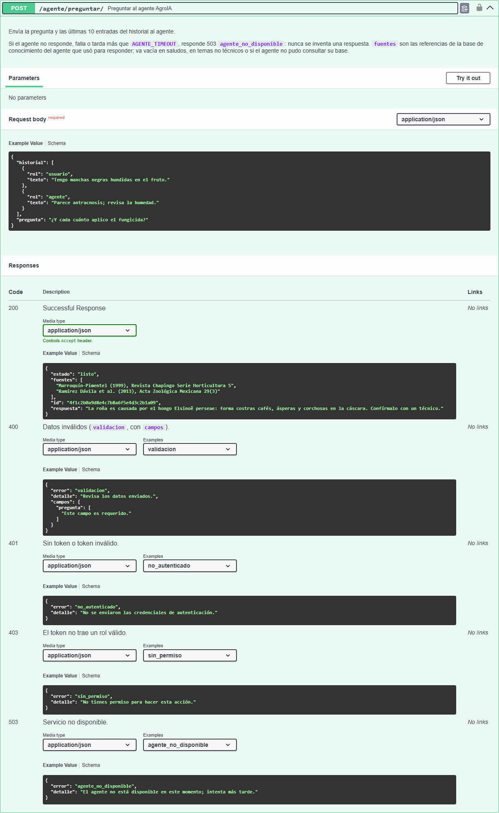

# AgroIA-Web · Entregable 2

**Microservicios con Django/DRF y FastAPI, persistencia relacional y de documentos, e integración con IA**

Ingeniería en Sistemas Computacionales · TecNM Campus Jiquilpan
Equipo: Isis Lizbeth Vázquez Avalos · Danna Geraldine Ávila García · Bryan Gael Esquivel Pérez
Fecha: 18 de noviembre de 2026

## Resumen

AgroIA-Web es una plataforma para el agronegocio del aguacate: una tienda en línea de insumos, un asistente conversacional (AgroIA) que responde dudas técnicas citando sus fuentes, y diagnóstico de enfermedades por imagen. Está construida como un monorepo de microservicios: cuatro servicios Django/DRF, un servicio FastAPI que integra la IA y el agente conversacional del repo [BryanGEP/AgroIA](https://github.com/BryanGEP/AgroIA). Todo se levanta con `docker compose up` en diez contenedores.

En esta entrega quedan completas las APIs de usuarios (versión básica), tienda, contenido e IA, con 418 pruebas automatizadas, Swagger en cada servicio y una colección de Postman de 70 peticiones que pasa completa. El gateway web ya tiene la base visual y el catálogo público; el resto de las pantallas llega con el login en la Entrega 3.

## Arquitectura



| Contenedor | Qué hace | Datos |
| --- | --- | --- |
| `web` | Gateway: único punto de entrada del navegador, plantillas y sesión | PostgreSQL `web_db` (sesiones) |
| `svc-usuarios` | Registro, perfil, direcciones y listado del administrador | PostgreSQL `usuarios_db` |
| `svc-tienda` | Categorías, productos, carrito y pedidos (pago simulado) | PostgreSQL `tienda_db` |
| `svc-contenido` | Conversaciones con el agente, diagnósticos y bitácora | MongoDB `contenido` |
| `svc-ia` | Adaptador de IA: preguntas al agente y clasificación de imágenes | ninguna |
| `agente` | Agente AgroIA (repo AgroIA): LangChain + Groq con búsqueda en su base de conocimiento (RAG), reglas y Teorema de Bayes | PostgreSQL + pgvector en `agente-db` |
| `postgres`, `mongo`, `redis`, `agente-db` | Infraestructura | — |

Reglas que se respetan en todo el código:

- Cada servicio es dueño de su base: nadie lee la base de otro. Entre servicios no hay llaves foráneas; se guarda `usuario_id`.
- La identidad viaja en un JWT RS256: cada servicio valida la firma con la llave pública, sin consultar a svc-usuarios.
- Todas las APIs responden errores con el mismo formato: `{"error": "codigo_corto", "detalle": "mensaje"}`.
- Puertos publicados solo en `127.0.0.1`; ningún secreto en el código.

El detalle (contratos de API, modelo de datos, convenciones) está en la [definición técnica](definicion-tecnica.md).

## Cumplimiento de los requisitos

| Requisito | Cómo se cumple | Evidencia |
| --- | --- | --- |
| **1. Scaffolding:** un proyecto Django/DRF independiente por microservicio, con su settings, dependencias y Dockerfile | Cuatro proyectos Django (`web`, `svc-usuarios`, `svc-tienda`, `svc-contenido`) y uno FastAPI (`svc-ia`). Cada uno con `config/settings.py` (todo por variables de entorno), `requirements.txt` con versiones fijas, `requirements-dev.txt` y `Dockerfile`. Lo compartido (JWT, permisos, errores, Swagger) vive en el paquete `comun/` | [`svc-tienda/config/settings.py`](../svc-tienda/config/settings.py), [`svc-tienda/Dockerfile`](../svc-tienda/Dockerfile), [`svc-tienda/requirements.txt`](../svc-tienda/requirements.txt) (igual en cada servicio), [`comun/`](../comun/README.md) |
| **2. Negocio principal:** modelado relacional en PostgreSQL, CRUD con DRF, paginación, filtros y ordenamiento | `svc-tienda`: categorías, productos (ficha técnica en `JSONField`), carrito y pedidos. CRUD con `ViewSet` + router, validaciones en serializers, lógica en `servicios.py`. Paginación de 20, filtros con django-filter (`categoria`, `precio_min`, `precio_max`, `disponible`, `q`, `estado`) y orden (`precio`, `nombre`, `creado_en`). Crear un pedido valida y descuenta stock en una transacción con `select_for_update()` | [`apps/catalogo/models.py`](../svc-tienda/apps/catalogo/models.py), [`apps/pedidos/models.py`](../svc-tienda/apps/pedidos/models.py), [`apps/catalogo/filters.py`](../svc-tienda/apps/catalogo/filters.py), [`apps/pedidos/servicios.py`](../svc-tienda/apps/pedidos/servicios.py), [README de svc-tienda](../svc-tienda/README.md) |
| **3. Datos no estructurados:** MongoDB, documentos flexibles y CRUD | `svc-contenido` con pymongo: conversaciones (mensajes embebidos, máximo 200), diagnósticos (imagen en `default_storage` y probabilidades) y bitácora (`datos` libres por tipo de evento). Índices creados al arrancar | [`config/mongo.py`](../svc-contenido/config/mongo.py), [`apps/conversaciones/servicios.py`](../svc-contenido/apps/conversaciones/servicios.py), [README de svc-contenido](../svc-contenido/README.md) |
| **4. IA:** contrato de API definido e integración síncrona con el modelo o servicio de IA | `svc-ia` (FastAPI) expone `POST /agente/preguntar/`, `POST /diagnostico/` y `GET /solicitudes/<id>/`, cada respuesta con `id` y `estado` para volverse asíncrona en la Entrega 4. Llama por HTTP al agente AgroIA, que responde con fuentes de su base de conocimiento. El diagnóstico tiene la interfaz del clasificador lista; responde 503 `modelo_no_disponible` hasta que exista el modelo de visión | [`svc-ia/app/agente.py`](../svc-ia/app/agente.py), [`svc-ia/app/vision.py`](../svc-ia/app/vision.py), [README de svc-ia](../svc-ia/README.md), [contrato en la definición técnica](definicion-tecnica.md#contratos-de-api) |
| **5a. Pruebas unitarias** por microservicio | 418 pruebas con pytest; las llamadas a otros servicios y al LLM se simulan (`unittest.mock`, `httpx.MockTransport`, `mongomock`). `ruff check` y `ruff format` en verde | [Totales abajo](#pruebas); `docker compose exec <servicio> pytest` |
| **5b. Documentación OpenAPI/Swagger** de cada API | Swagger en `/api/docs/` de cada servicio. Cada endpoint con descripción, ejemplos de petición y respuesta, y respuestas de error con esquema y ejemplo. `spectacular --validate --fail-on-warn` pasa en los servicios Django | [Capturas](#swagger) |
| **5c. Contenerización** con Docker y docker-compose | `docker compose up --build` levanta los diez contenedores, con healthchecks en las bases y en el agente, volúmenes con nombre y secrets para las llaves JWT | [`docker-compose.yml`](../docker-compose.yml) |
| **Colección de pruebas de API (Postman)** | 70 peticiones en una carpeta por servicio, con entorno `local`. Cada petición verifica el código de respuesta; las de error verifican además el formato común. Pasa completa (95 de 95 aserciones) dos veces seguidas | [`docs/postman/`](postman/) |
| **Evidencia en Jira** | Se documenta después de esta entrega | — |

## Cómo levantar y probar todo

Requisitos: Docker Desktop, Python 3.12 (solo para las llaves y los tokens) y una llave gratuita de Groq. Detalle en el [README](../README.md#levantar-el-proyecto-por-primera-vez).

```powershell
# 1. Variables de entorno: copiar el ejemplo y cambiar contraseñas, DJANGO_SECRET_KEY y GROQ_API_KEY
Copy-Item .env.example .env

# 2. Llaves JWT (quedan en infra/llaves/, que no se sube al repo)
python infra/generar_llaves.py

# 3. Levantar los diez contenedores
docker compose up --build -d

# 4. Base de conocimiento del agente (la primera vez descarga ~471 MB del modelo)
docker compose run --rm agente python -m ingesta.cargar

# 5. Datos de demostración de la tienda
docker compose exec svc-tienda python manage.py cargar_datos_demo
```

**Swagger** (botón *Authorize* para pegar un token):

| Servicio | Documentación |
| --- | --- |
| svc-usuarios | http://localhost:8001/api/docs/ |
| svc-tienda | http://localhost:8002/api/docs/ |
| svc-contenido | http://localhost:8003/api/docs/ |
| svc-ia | http://localhost:8004/api/docs/ |
| web | http://localhost:8000/api/docs/ |

**Tokens de desarrollo:** mientras svc-usuarios no emite tokens (Entrega 3), se firman con la llave local:

```powershell
python infra/emitir_token.py --usuario-id 10 --rol cliente
python infra/emitir_token.py --usuario-id 1 --rol administrador
python infra/emitir_token.py --usuario-id 12 --rol cliente --sin-verificar
```

**Postman:** importar `docs/postman/AgroIA-Web.postman_collection.json` y `docs/postman/local.postman_environment.json`, pegar los tokens en `token`, `token_admin` y `token_sin_verificar`, y en *Settings → General → Working directory* elegir `docs/postman/` (para la imagen de prueba). La carpeta de svc-usuarios necesita además `token_usuario`, generado con el id que devuelve el registro.

## Pruebas

Totales del 18 de noviembre de 2026, dentro de los contenedores:

| Servicio | Pruebas | `ruff check` y `ruff format` |
| --- | --- | --- |
| svc-tienda | 144 | sin errores |
| svc-usuarios | 71 | sin errores |
| svc-contenido | 69 | sin errores |
| svc-ia | 58 | sin errores |
| web | 45 | sin errores |
| comun | 31 | sin errores |
| **Total** | **418** | |

Por cada endpoint se prueba el caso correcto, una validación que falla y, con `AUTH_ACTIVA=True`, el acceso sin token (401) y con rol equivocado (403). La colección de Postman se corrió dos veces seguidas contra el entorno local: 70 peticiones y 95 aserciones, sin fallas.

## Swagger

| svc-tienda | svc-ia |
| --- | --- |
|  |  |

Detalle de una operación, con descripción, ejemplo de petición, ejemplo de respuesta y errores con su código:





Las demás capturas: [svc-usuarios](entregable-2/img/swagger-svc-usuarios.png), [svc-contenido](entregable-2/img/swagger-svc-contenido.png) y [web](entregable-2/img/swagger-web.png).

## Ajustes a la arquitectura respecto al Entregable 1

El equipo aprobó estos ajustes el 22 de octubre de 2026; el último se agregó en la revisión de calidad.

| Ajuste | Qué se hizo | Por qué |
| --- | --- | --- |
| Servicios fusionados | Catálogo y pedidos en `svc-tienda`; agente y diagnóstico en `svc-ia` | Crear un pedido descuenta stock en la misma transacción; separarlos obligaría a una transacción distribuida. Agente y visión comparten dependencias y despliegue |
| Ficha técnica | `JSONField` en PostgreSQL | MongoDB queda para conversaciones, diagnósticos y bitácora, que son los datos que realmente crecen y cambian de forma |
| `svc-ia` como adaptador | FastAPI traduce el contrato de AgroIA-Web a la API del agente, que corre en su propio contenedor construido desde el repo AgroIA | El agente sigue evolucionando en su repo sin copias que se desincronicen |
| Base de conocimiento del agente | Contenedor `agente-db` (PostgreSQL con pgvector), separado del `postgres` de los servicios | El agente ya responde con RAG y cita fuentes; cada servicio es dueño de su base |
| Proveedor del LLM | El que usa el agente (Groq) | Llave solo en `.env` y límite de gasto en la cuenta del proveedor |
| Pago | Simulado: el pedido pasa a `pagado` y se marca `pago_simulado` | Ninguna entrega califica pagos |
| Imágenes | Siempre con `STORAGES` y `default_storage` de Django | En la Entrega 5 se pasa a Cloud Storage cambiando solo la configuración |
| Roles | Solo `cliente` y `administrador` | No hay funciones que requieran otro rol |

## Pendientes para las siguientes entregas

- **Entrega 3 · Seguridad y pantallas:** login y emisión de JWT en svc-usuarios, verificación de correo, recuperación de contraseña, límite de intentos y cambio de rol por API. Pantallas de registro, login, perfil, carrito, checkout, mis pedidos, chat con AgroIA, diagnóstico e historial, y panel de administrador; sus APIs ya existen. Revisión de seguridad con `insecure-defaults` y `static-analysis`.
- **Modelo de visión:** `POST /diagnostico/` responde 503 hasta que exista el modelo; la interfaz `Clasificador` de svc-ia ya está lista para integrarlo.
- **Entrega 4 · Eventos:** svc-ia responderá `estado: "pendiente"` y publicará resultados por Redis; svc-contenido llenará la bitácora con eventos. Las solicitudes de svc-ia pasarán de la memoria del proceso a Redis.
- **Entrega 5 · Nube:** imágenes en Cloud Storage y despliegue. Decidir el plan del proveedor del LLM: el plan gratuito de Groq limita los tokens por minuto y por día.
- **Jira:** cargar historias, sprints y retrospectivas de la Entrega 2.
