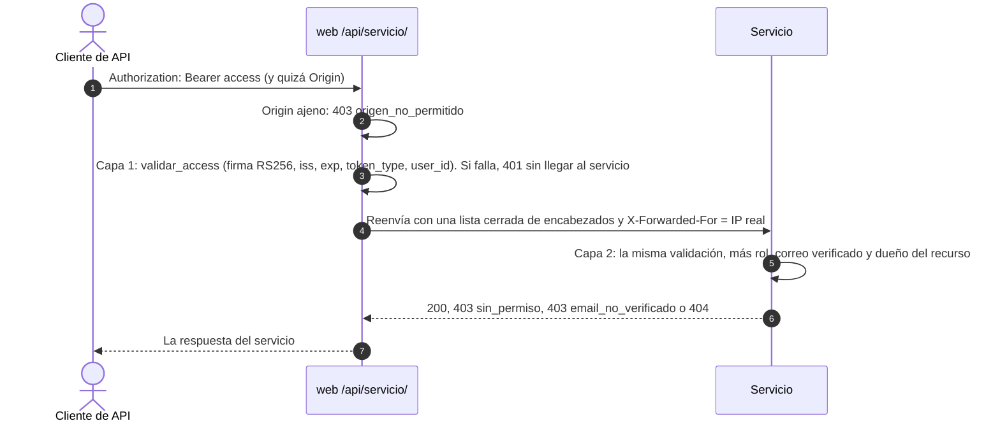
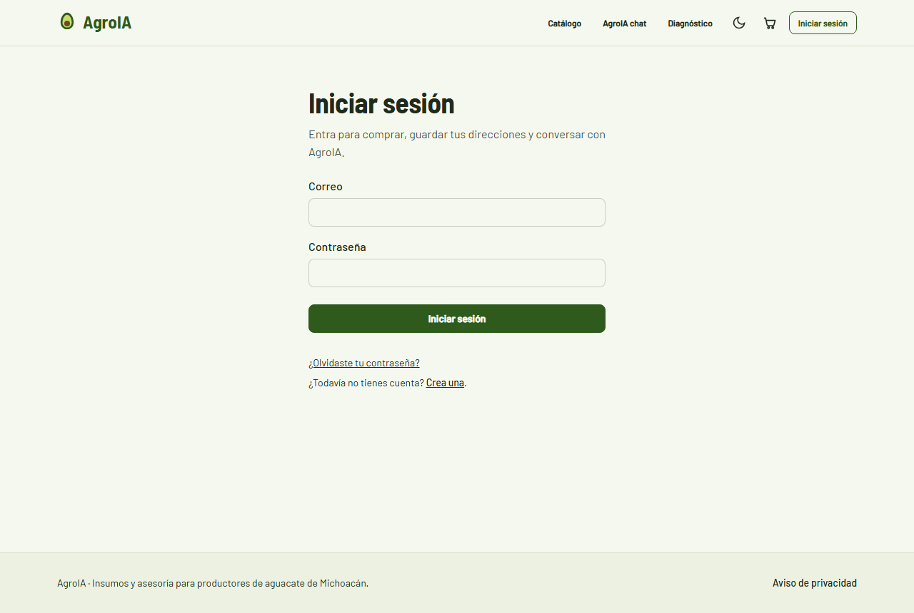
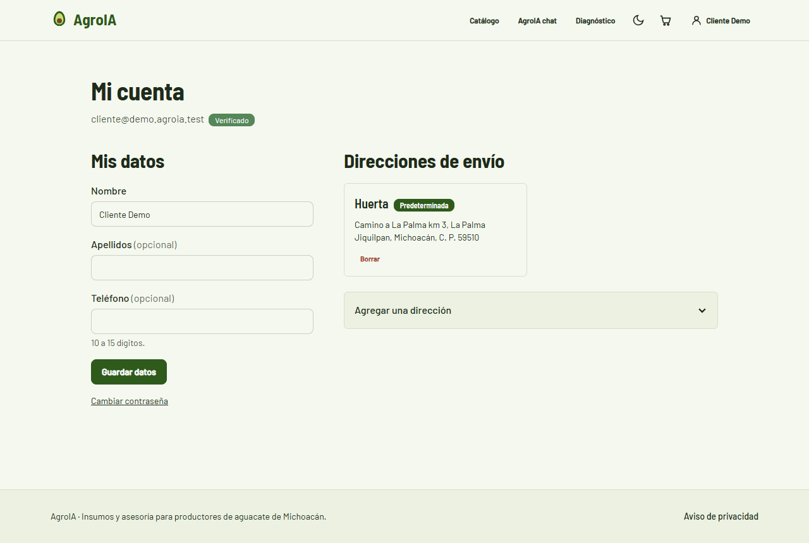
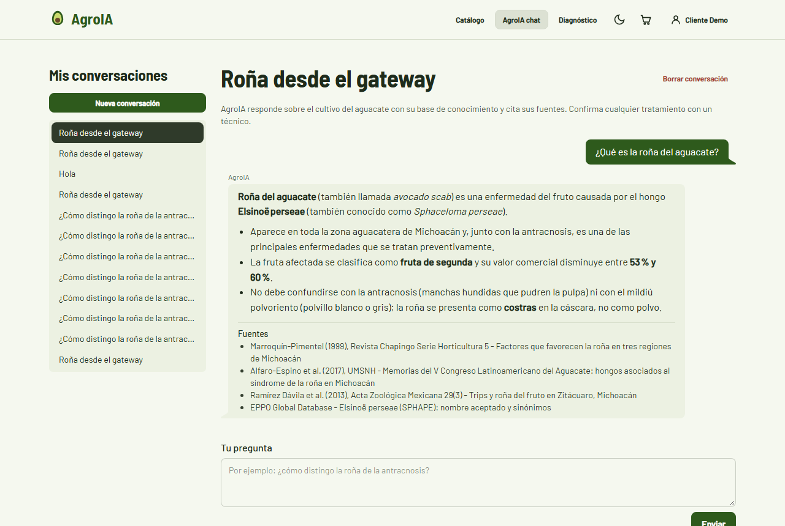
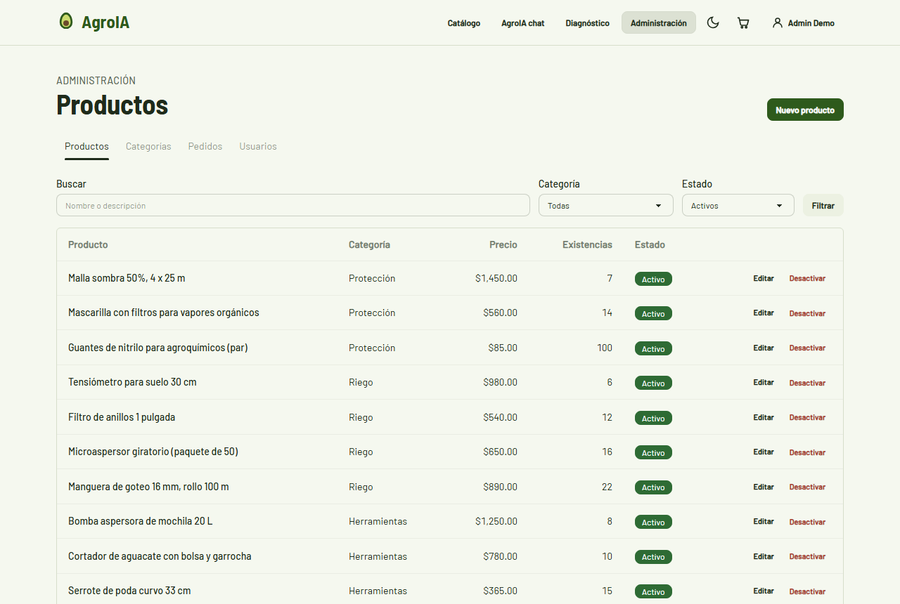
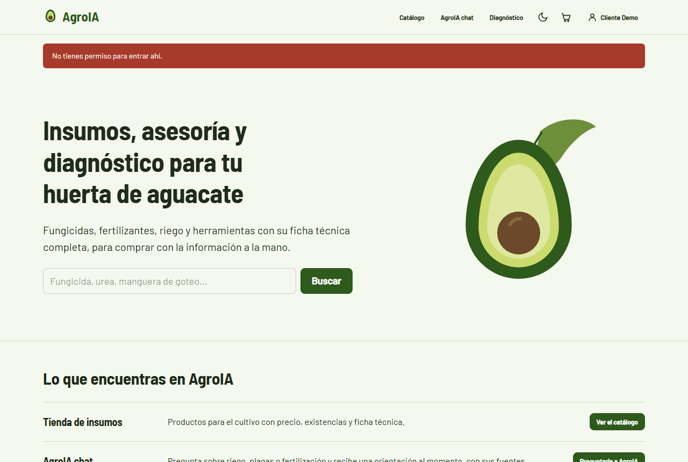

# AgroIA-Web · Entregable 3

**Seguridad: autenticación JWT, API Gateway y control de acceso por roles**

Ingeniería en Sistemas Computacionales · TecNM Campus Jiquilpan
Equipo: Isis Lizbeth Vázquez Avalos · Danna Geraldine Ávila García · Bryan Gael Esquivel Pérez
Fecha: 20 de noviembre de 2026

## Resumen

En esta entrega AgroIA-Web pasó de tener las APIs abiertas a pruebas a un sistema con identidad completa:

- **svc-usuarios** emite los tokens: access de 15 minutos y refresh de 7 días, firmados con RS256, con rotación y blacklist. También verifica el correo, recupera y cambia contraseñas, cambia roles dejando registro, limita los intentos y bloquea cuentas.
- **Cada microservicio valida el token por su cuenta** con la llave pública, sin consultar a svc-usuarios, y decide el acceso con *permission classes* de DRF según el rol (`cliente` o `administrador`) y la verificación del correo.
- **`web` es el API Gateway:** el único punto de entrada del navegador. Guarda los tokens en la sesión del servidor, los renueva solo, y expone un proxy `/api/<servicio>/` que valida el token antes de reenviar. Tiene CORS, Content-Security-Policy y todas las pantallas: cuenta, tienda, chat con AgroIA, diagnóstico y panel de administrador.
- **Buenas prácticas:** secretos fuera del código, límite de intentos en login, registro y recuperación, bloqueo de cuentas, validación estricta de entradas y un log de seguridad en todos los servicios.

La autenticación funciona de extremo a extremo y se comprobó con una **matriz de accesos automatizada** (106 casos de actor y endpoint a través del gateway, 100 % de coincidencia), la colección de Postman (118 peticiones y 198 aserciones) y 789 pruebas automatizadas. Al cierre se repitió el análisis estático con Semgrep y CodeQL sobre todo el código.

## Arquitectura de seguridad

### Cómo viaja el token

```mermaid
sequenceDiagram
    autonumber
    actor N as Navegador
    participant W as web (gateway)
    participant S as Sesión en web_db
    participant U as svc-usuarios
    participant T as svc-tienda (u otro servicio)

    Note over N,U: Inicio de sesión
    N->>W: POST /iniciar-sesion/ (correo, contraseña, token CSRF)
    W->>U: POST /api/v1/auth/login/ con X-Forwarded-For = IP real del navegador
    U->>U: Límite de 10 logins por minuto por IP y bloqueo por correo + IP (axes)
    U-->>W: access (15 min) y refresh (7 días), firmados con la llave privada RS256
    W->>S: Guarda access, refresh, id, nombre y rol
    W-->>N: Solo la cookie sessionid (HttpOnly, SameSite=Lax). Ningún token

    Note over N,T: Petición protegida
    N->>W: GET /carrito/ (cookie)
    W->>W: Capa 1: hay sesión (@login_requerido) y, en el panel, rol (@rol_requerido)
    W->>S: Lee el access
    W->>T: GET /api/v1/carrito/ con Authorization: Bearer access
    T->>T: Capa 2: firma con la llave pública, iss, exp, token_type, user_id, rol
    T-->>W: 200 con el carrito del usuario del token
    W-->>N: Página HTML

    Note over W,U: Renovación automática (el access venció)
    W->>T: Authorization: Bearer access vencido
    T-->>W: 401 token_invalido
    W->>U: POST /api/v1/auth/token/renovar/ con el refresh
    U->>U: Firma, blacklist, cuenta activa y token_version; el refresh usado entra a la blacklist
    U-->>W: Par nuevo con los claims recalculados
    W->>S: Guarda el par nuevo
    W->>T: Repite la petición con el access nuevo
    T-->>W: 200
```

Para clientes que no son navegador (Postman, una app), el gateway expone el proxy `/api/<servicio>/<ruta>`, que valida el token **antes** de reenviar:



- **En el navegador el token nunca existe:** los JWT se guardan en la sesión del servidor (`web_db`) y el navegador solo tiene la cookie `sessionid`. Ni JavaScript ni el HTML ven un token.
- **Hacia los servicios** viaja en `Authorization: Bearer <access>`, siempre puesto por el gateway (pantallas) o por el cliente de API (proxy).
- **El proxy nunca usa la sesión:** solo acepta el encabezado `Authorization`. Una petición a `/api/` con una cookie válida y sin ese encabezado es anónima, así que ningún sitio ajeno puede usar la sesión de un usuario a través del proxy.
- **El contrato completo** (claims, duraciones, errores, cómo reemplazar svc-usuarios por el módulo del grupo) está en [`contrato-identidad.md`](contrato-identidad.md).

### Cómo se valida en cada capa

| Capa | Dónde | Qué revisa | Si falla |
| --- | --- | --- | --- |
| Gateway, pantallas | `@login_requerido` y `@rol_requerido` ([`decoradores.py`](../web/apps/cuentas/decoradores.py)) | Que haya sesión y, en el panel, que el rol sea `administrador` | Al login con `?next=`, o al inicio con «No tienes permiso para entrar ahí» |
| Gateway, proxy `/api/` | [`apps/proxy/views.py`](../web/apps/proxy/views.py) con [`agroia_comun.tokens.validar_access`](../comun/agroia_comun/tokens.py) | `Origin`; firma RS256, emisor (`JWT_ISSUER`), vencimiento, `token_type == "access"` y `user_id` UUID | 403 `origen_no_permitido`; 401 `no_autenticado` o `token_invalido` |
| Servicios Django | [`AutenticacionJWT`](../comun/agroia_comun/autenticacion.py) y [`permisos.py`](../comun/agroia_comun/permisos.py) de `comun` | Lo mismo que el proxy, más el rol, el correo verificado y el dueño del recurso | 401; 403 `sin_permiso` o `email_no_verificado`; 404 si el recurso es de otro |
| svc-ia (FastAPI) | [`app/seguridad.py`](../svc-ia/app/seguridad.py) con PyJWT | Las mismas reglas que los servicios Django | 401 o 403 |
| svc-usuarios, al renovar | [`servicios.py`](../svc-usuarios/apps/usuarios/servicios.py) | Además: blacklist, cuenta activa y `token_version` contra la base | 401 `refresh_invalido` |

La segunda capa nunca se quita (defensa en profundidad): un servicio no confía en que la petición pasó por el gateway. Los roles los decide cada servicio, porque el gateway no conoce las reglas de negocio de cada endpoint.

### Roles

Solo hay dos roles, `cliente` y `administrador`, en el claim `rol` del token. Además, comprar exige el claim `email_verificado`.

| Acción | Anónimo | Cliente sin verificar | Cliente verificado | Administrador |
| --- | --- | --- | --- | --- |
| Ver el catálogo | Sí | Sí | Sí | Sí, también los desactivados |
| Registrarse, iniciar sesión, recuperar la contraseña | Sí | — | — | — |
| Mi cuenta y direcciones | No | Las suyas | Las suyas | Las suyas |
| Carrito | No | Sí | Sí | Sí |
| Comprar (crear un pedido) y pagarlo | No | No (403 `email_no_verificado`) | Sí | No (403 `sin_permiso`: solo clientes) |
| Ver pedidos | No | Los suyos | Los suyos | Todos |
| Cambiar el estado de un pedido | No | No | No | Sí |
| Crear, editar y desactivar productos y categorías | No | No | No | Sí |
| Chat con AgroIA y sus conversaciones | No | Las suyas | Las suyas | Solo las suyas (son privadas) |
| Diagnóstico por imagen e historial | No | Los suyos | Los suyos | Todos |
| Listar usuarios y cambiar roles | No | No | No | Sí, sin quitarse su propio rol (409) |

Un recurso de otro usuario responde 404, no 403, para no revelar que existe. Las clases de permiso son `IsAuthenticated`, `EsCliente`, `EsAdministrador`, `EsDuenoOAdmin` y `CorreoVerificado` (en [`comun/agroia_comun/permisos.py`](../comun/agroia_comun/permisos.py)); cada vista elige las suyas, por ejemplo [`PedidoViewSet.get_permissions`](../svc-tienda/apps/pedidos/views.py).

### Buenas prácticas aplicadas

| Práctica | Qué se hizo |
| --- | --- |
| Secretos fuera del código | Todo por variables de entorno (`.env`, que no se sube; plantilla en `.env.example`). Las llaves JWT se generan con `infra/generar_llaves.py` en `infra/llaves/` (ignorada) y se montan como *secrets* de Docker: la privada **solo** en svc-usuarios. Con `DJANGO_DEBUG=False`, los servicios no arrancan con la `DJANGO_SECRET_KEY` de ejemplo ni svc-usuarios con el correo de consola |
| CORS | `django-cors-headers` solo para `/api/`, orígenes en `CORS_ALLOWED_ORIGINS` (vacío por defecto, sin comodín ni credenciales cruzadas). Un `Origin` ajeno recibe 403 `origen_no_permitido` |
| CSP y encabezados | `Content-Security-Policy` sin `unsafe-inline` ni `unsafe-eval` (HTMX y Alpine en su versión CSP, servidos desde el propio sitio), `X-Frame-Options: DENY`, `X-Content-Type-Options: nosniff` y `Referrer-Policy: same-origin`. Cookies `HttpOnly`, `SameSite=Lax` y `Secure` con `DJANGO_DEBUG=False` |
| Límites de intentos | DRF con caché en Redis: login 10 por minuto por IP; registro 5 por hora; recuperar y reenviar verificación 3 por hora por IP y por correo; cambiar contraseña 5 por hora por usuario. Responden 429 `demasiados_intentos` con `Retry-After` |
| Bloqueo de cuentas | django-axes: al quinto fallo con el mismo correo desde la misma IP, 403 `cuenta_bloqueada_temporalmente` durante 15 minutos, también para correos que no existen (no revela cuentas) |
| Log de seguridad | Una línea JSON por evento en el logger `seguridad` de cada servicio: logins, bloqueos, renovaciones rechazadas, cambios de contraseña y de rol, y **todo 401 y 403** como `acceso_denegado`. Descarta cualquier dato con contraseñas o tokens |
| IP real | El gateway pone en `X-Forwarded-For` la IP de la conexión y no reenvía la que mande el cliente; los servicios confían en un solo proxy. Los puertos directos de los servicios solo se publican en `127.0.0.1` |
| Validación de entradas | Serializers de DRF con tipos y largos máximos (contraseñas de hasta 128 caracteres, validadores de Django), mensajes genéricos en login y recuperación, el `?next=` solo hacia este sitio, el proxy rechaza rutas con `.` o `..`, la foto de diagnóstico se valida por su firma y no por el nombre, y las respuestas del agente pasan por `markdown_seguro`, que escapa todo el HTML (53 pruebas de XSS) |

## Cumplimiento de las actividades

| Actividad | Cómo se cumple | Evidencia |
| --- | --- | --- |
| **1. Autenticación con JWT:** access y refresh con expiración, rotación y blacklist | svc-usuarios con simplejwt y RS256: access de 15 minutos, refresh de 7 días, `ROTATE_REFRESH_TOKENS` y `BLACKLIST_AFTER_ROTATION`. `logout` mete el refresh a la blacklist; `logout-todo` y los cambios de contraseña suben `token_version`, que se revisa al renovar | [`config/settings.py`](../svc-usuarios/config/settings.py) (`SIMPLE_JWT`), [`tokens.py`](../svc-usuarios/apps/usuarios/tokens.py), [`servicios.py`](../svc-usuarios/apps/usuarios/servicios.py), [`test_autenticacion.py`](../svc-usuarios/apps/usuarios/tests/test_autenticacion.py); Postman, carpeta «Autenticación»; matriz, fila «Renovar el token» |
| **2. Propagación de identidad:** cada microservicio valida el JWT y aplica *permission classes* según el rol | El token lleva `user_id` (UUID), `rol`, `email_verificado` y `token_version`, sin datos personales. Los servicios Django lo validan con `AutenticacionJWT` de `comun` y svc-ia con PyJWT, con la llave pública y sin consultar a svc-usuarios | [`contrato-identidad.md`](contrato-identidad.md), [`autenticacion.py`](../comun/agroia_comun/autenticacion.py), [`permisos.py`](../comun/agroia_comun/permisos.py), [`svc-ia/app/seguridad.py`](../svc-ia/app/seguridad.py), [`comun/tests/test_autenticacion.py`](../comun/tests/test_autenticacion.py), [`svc-ia/tests/test_seguridad.py`](../svc-ia/tests/test_seguridad.py) |
| **3. API Gateway:** punto de entrada único que enruta y centraliza la validación | `web` es el único servicio para el navegador. Enruta las pantallas a los servicios con el token de la sesión y renovación automática, y el proxy `/api/<servicio>/` valida el token (primera capa) antes de reenviar | [`apps/proxy/`](../web/apps/proxy/views.py), [`clientes/api.py`](../web/clientes/api.py), [`test_proxy.py`](../web/apps/proxy/tests/test_proxy.py), [`test_sesion.py`](../web/apps/cuentas/tests/test_sesion.py); Postman, carpeta «Gateway»; [avance del gateway](avances/e3-gateway.md) |
| **4. Control de acceso y roles (RBAC básico)** con *permission classes* de DRF | `EsCliente`, `EsAdministrador`, `EsDuenoOAdmin` y `CorreoVerificado`, elegidas por acción en cada vista; el panel del gateway además pide el rol con `@rol_requerido` | [Tabla de roles](#roles); [`comun/tests/test_permisos.py`](../comun/tests/test_permisos.py); [matriz de accesos](entregable-3/matriz-accesos.md); captura [«No tienes permiso»](#capturas) |
| **5. Buenas prácticas:** secretos, CORS, rate limiting, validación de entradas y log de seguridad | Ver [Buenas prácticas aplicadas](#buenas-prácticas-aplicadas) | [`test_limites.py`](../svc-usuarios/apps/usuarios/tests/test_limites.py), [`web/tests/test_seguridad.py`](../web/tests/test_seguridad.py), [`comun/tests/test_seguridad.py`](../comun/tests/test_seguridad.py), [`test_markdown_xss.py`](../web/apps/agroia/tests/test_markdown_xss.py); [ejemplo del log](#ejemplo-del-log-de-seguridad); [revisión estática](#revisión-estática) |
| **6. Sprint en Jira** | Se documenta después de esta entrega | — |

| Entregable | Dónde |
| --- | --- |
| **1. Autenticación JWT de extremo a extremo** entre el gateway y los microservicios | [Matriz de accesos](entregable-3/matriz-accesos.md) (todo a través del gateway), Postman «Autenticación» y «Gateway», y las [capturas](#capturas) |
| **2. Documento breve de arquitectura de seguridad** | La sección [Arquitectura de seguridad](#arquitectura-de-seguridad) de este documento; el detalle está en el [contrato de identidad](contrato-identidad.md) |
| **3. Evidencia de pruebas de seguridad** con casos de acceso permitido y denegado | [Evidencia de pruebas de seguridad](#evidencia-de-pruebas-de-seguridad) |

## Evidencia de pruebas de seguridad

### Matriz de accesos

[`infra/matriz_seguridad.py`](../infra/matriz_seguridad.py) prueba contra el sistema levantado, a través del gateway, ocho actores (anónimo, cliente sin verificar, cliente verificado, administrador, token vencido, token firmado con otra llave, refresh en la blacklist y origen no permitido) en los endpoints representativos de cada servicio. También prueba el bloqueo por intentos fallidos y el exceso de logins y de recuperaciones. Crea los recursos que necesita y los borra al final.

Corrida del 20 de noviembre de 2026, en 119 s, después de Postman y de `reiniciar_limites`:

| Concepto | Casos |
| --- | --- |
| Combinaciones probadas | 106 |
| Acceso permitido (2xx esperado) | 26 |
| Acceso denegado (4xx esperado) | 80 |
| Coinciden con lo esperado (código HTTP y código de error) | **106 de 106 (100 %)** |

Código obtenido por actor (✓ coincide con lo esperado; — no aplica):

| Endpoint | Anónimo | Sin verificar | Cliente | Admin | Token vencido | Otra llave | Refresh en blacklist | Origen ajeno |
| --- | --- | --- | --- | --- | --- | --- | --- | --- |
| Iniciar sesión | — | 200 ✓ | 200 ✓ | 200 ✓ | — | — | — | 403 ✓ |
| Renovar el token | — | — | 200 ✓ | — | — | — | 401 ✓ | — |
| Catálogo (público) | 200 ✓ | 200 ✓ | 200 ✓ | 200 ✓ | 401 ✓ | 401 ✓ | 401 ✓ | 403 ✓ |
| Crear producto | 401 ✓ | 403 ✓ | 403 ✓ | 201 ✓ | 401 ✓ | 401 ✓ | 401 ✓ | 403 ✓ |
| Ver carrito | 401 ✓ | 200 ✓ | 200 ✓ | 200 ✓ | 401 ✓ | 401 ✓ | 401 ✓ | 403 ✓ |
| Crear pedido | 401 ✓ | 403 ✓ | 201 ✓ | 403 ✓ | 401 ✓ | 401 ✓ | 401 ✓ | 403 ✓ |
| Cambiar estado de un pedido | 401 ✓ | 403 ✓ | 403 ✓ | 200 ✓ | 401 ✓ | 401 ✓ | 401 ✓ | 403 ✓ |
| Listar usuarios | 401 ✓ | 403 ✓ | 403 ✓ | 200 ✓ | 401 ✓ | 401 ✓ | 401 ✓ | 403 ✓ |
| Cambiar rol | 401 ✓ | 403 ✓ | 403 ✓ | 200 ✓ | 401 ✓ | 401 ✓ | 401 ✓ | 403 ✓ |
| Conversación propia | 401 ✓ | 200 ✓ | 200 ✓ | 200 ✓ | 401 ✓ | 401 ✓ | 401 ✓ | 403 ✓ |
| Conversación ajena | 401 ✓ | 404 ✓ | 404 ✓ | 404 ✓ | 401 ✓ | 401 ✓ | 401 ✓ | 403 ✓ |
| Foto de diagnóstico propia | 401 ✓ | 200 ✓ | 200 ✓ | 200 ✓ | 401 ✓ | 401 ✓ | 401 ✓ | 403 ✓ |
| Foto de diagnóstico ajena | 401 ✓ | 404 ✓ | 404 ✓ | 200 ✓ | 401 ✓ | 401 ✓ | 401 ✓ | 403 ✓ |
| Pregunta al agente | 401 ✓ | 200 ✓ | 200 ✓ | 200 ✓ | 401 ✓ | 401 ✓ | 401 ✓ | 403 ✓ |

Límites de intentos, en la misma corrida:

| Caso | Resultado |
| --- | --- |
| Login fallido con el mismo correo | Intentos 1 a 4: 401 `credenciales_invalidas`; intento 5: 403 `cuenta_bloqueada_temporalmente` ✓ |
| Exceso de logins (10 por minuto por IP) | 429 `demasiados_intentos` en el login 11 del minuto, con `Retry-After: 59` ✓ |
| Exceso de recuperaciones (3 por hora por IP) | 429 `demasiados_intentos` con `Retry-After` ✓ |

Cómo leerla:
- **Los 401 y el 403 de origen los decide el gateway:** esas peticiones no llegan al servicio. El catálogo es público, pero un token que viene se valida igual.
- **Los 403 de rol o de correo y los 404 los decide cada servicio.** Las conversaciones son privadas también para el administrador (404). Los diagnósticos, en cambio, los puede ver (200).
- **Limpieza:** la matriz borró el producto, el pedido, las conversaciones y los diagnósticos que creó. Devolvió el carrito del cliente como estaba y cerró sus sesiones.

Tabla completa: [`entregable-3/matriz-accesos.md`](entregable-3/matriz-accesos.md).

### Postman

La colección [`docs/postman/`](postman/) inicia sesión sola y se corrió completa dos veces seguidas con Newman 6.2.1: **118 peticiones y 198 aserciones, 0 fallas en cada una**. La segunda corrida empezó 65 s después del inicio de la primera (21 s después de que terminó); no se repitió con el minuto completo porque cada corrida hace dos registros y el límite es de 5 por hora por IP. Las carpetas de seguridad:

- **«Autenticación»:** login de las cuentas de demostración a través del gateway, renovación con rotación, reúso del refresh anterior (401), verificación con un token alterado, recuperación y restablecimiento con un enlace inválido.
- **«Gateway»:** catálogo público, carrito y pedido a través del proxy, chat con AgroIA, y los casos denegados en el gateway: sin token, token inválido, origen no permitido y servicio inexistente.
- **«Seguridad»:** sin token, token vencido, token de otra llave, refresh usado como access, rol equivocado, compra sin correo verificado, logout y refresh en la blacklist, cinco intentos fallidos (bloqueo) y exceso de logins (429 con `Retry-After`).

### Pruebas automatizadas

Totales del 20 de noviembre de 2026, dentro de los contenedores. Por cada endpoint se prueba el caso correcto, una validación que falla y, con `AUTH_ACTIVA=True`, el acceso sin token (401) y con rol equivocado (403).

| Servicio | Pruebas | Lo de seguridad | `ruff check` y `ruff format` |
| --- | --- | --- | --- |
| web | 258 | Proxy, sesión y renovación, decoradores, CORS y origen, CSP, que el JWT no llegue al navegador, `?next=`, XSS del chat | sin errores |
| svc-usuarios | 158 | Login, renovación, blacklist, logout, recuperación, cambio de contraseña y de rol, límites y bloqueo, log sin datos sensibles, y los comandos de prueba (solo con `DEBUG=True`) | sin errores |
| svc-tienda | 160 | 401 y 403 por endpoint, compra con correo sin verificar, pedidos ajenos, y que la limpieza conserve el catálogo de demostración | sin errores |
| svc-contenido | 85 | Conversaciones y diagnósticos ajenos, fotos solo para el dueño o el administrador, y la limpieza de datos de prueba | sin errores |
| svc-ia | 63 | Validación del JWT con PyJWT, rol, registro de accesos denegados | sin errores |
| comun | 65 | Autenticación, permisos, validación del token del proxy, log de seguridad, configuración segura | sin errores |
| **Total** | **789** | | |

`spectacular --validate --fail-on-warn` también pasa en los cuatro servicios Django.

### Revisión estática

| Herramienta | Cuándo y alcance | Resultado |
| --- | --- | --- |
| insecure-defaults, Semgrep 1.183.0, CodeQL 2.25.6 y `check --deploy` | 19 de noviembre de 2026: svc-usuarios, comun y svc-ia | Sin hallazgos de gravedad alta; 2 medios y 3 bajos corregidos, el resto aceptado. Detalle en la [revisión de seguridad](avances/e3-identidad.md#revisión-de-seguridad) |
| Semgrep 1.183.0, las mismas reglas que el 19 de noviembre (`p/security-audit`, `p/secrets`, `p/python`, `p/django`, `p/fastapi`, `p/dockerfile`, `p/docker-compose`, Trail of Bits y elttam): 327 reglas | 20 de noviembre de 2026, al cierre: todo el código (los cinco servicios, `comun`, `infra` y `docker-compose.yml`), sin pruebas ni migraciones | 276 archivos, 30 resultados, ninguno nuevo de gravedad alta. 18 son los ya aceptados o descartados en la revisión anterior (contenedores como root, Redis y MongoDB sin TLS, `unvalidated-password`, enlaces de los correos); los 12 restantes, en `web` y en la matriz, son falsos positivos o decisiones de diseño ([detalle](#falsos-positivos-de-semgrep-al-cierre)) |
| CodeQL 2.25.6, `python-security-extended` (49 reglas) | 20 de noviembre de 2026, al cierre: 172 archivos de Python | 7 alertas en `web`, todas revisadas: falsos positivos ([detalle](#falsos-positivos-de-codeql-al-cierre)) |

## Ejemplo del log de seguridad

Líneas reales de `docker compose logs` durante una corrida de la matriz del 20 de noviembre de 2026 (la fecha está en UTC). Los correos son de prueba, del dominio de demostración. Cada servicio escribe una línea JSON por evento en el logger `seguridad`, y en ninguna aparece una contraseña ni un token: en 2293 líneas de log de esa media hora hubo 0 coincidencias con `eyJ` (el inicio de un JWT) y con las contraseñas usadas.

**Login fallido** (svc-usuarios). El correo se guarda solo si tiene formato de correo, por si alguien escribió su contraseña en ese campo:

```json
{"evento": "login_fallido", "fecha": "2026-11-20T21:58:50+00:00", "servicio": "svc-usuarios", "ip": "172.18.0.1", "metodo": "POST", "ruta": "/api/v1/auth/login/", "usuario_id": null, "email": "bloqueo-0419f7e0@demo.agroia.test"}
```

**Bloqueo** al quinto intento con el mismo correo desde la misma IP (svc-usuarios):

```json
{"evento": "cuenta_bloqueada", "fecha": "2026-11-20T21:58:50+00:00", "servicio": "svc-usuarios", "ip": "172.18.0.1", "metodo": "POST", "ruta": "/api/v1/auth/login/", "usuario_id": null, "email": "bloqueo-0419f7e0@demo.agroia.test"}
```

**Acceso denegado en el servicio:** un cliente intenta crear un producto (svc-tienda) y el cliente sin verificar intenta comprar:

```json
{"evento": "acceso_denegado", "fecha": "2026-11-20T21:57:16+00:00", "servicio": "svc-tienda", "ip": "172.18.0.1", "metodo": "POST", "ruta": "/api/v1/productos/", "usuario_id": "d1f36202-c0d6-4d89-91c9-15326684516d", "estado": 403, "error": "sin_permiso"}
{"evento": "acceso_denegado", "fecha": "2026-11-20T21:57:16+00:00", "servicio": "svc-tienda", "ip": "172.18.0.1", "metodo": "POST", "ruta": "/api/v1/pedidos/", "usuario_id": "533d5c26-fecf-4a66-b603-0f4054d62ea5", "estado": 403, "error": "email_no_verificado"}
```

**Acceso denegado en el gateway:** un token vencido, y una petición desde un origen no permitido. Ninguna llega al servicio:

```json
{"evento": "acceso_denegado", "fecha": "2026-11-20T21:57:15+00:00", "servicio": "web", "ip": "172.18.0.1", "metodo": "GET", "ruta": "/api/tienda/productos/", "usuario_id": null, "estado": 401, "error": "token_invalido", "capa": "gateway"}
{"evento": "origen_no_permitido", "fecha": "2026-11-20T21:57:15+00:00", "servicio": "web", "ip": "172.18.0.1", "metodo": "POST", "ruta": "/api/usuarios/auth/login/", "usuario_id": null, "origen": "https://sitio-ajeno.example"}
```

La `ip` es la del navegador o de Postman vista a través de Docker (`172.18.0.1`), no la del contenedor del gateway: así funcionan el límite por IP y el bloqueo de axes detrás del gateway.

## Cómo levantar y probar

Requisitos: Docker Desktop, Python 3.12 y una llave gratuita de Groq. Detalle en el [README](../README.md#levantar-el-proyecto-por-primera-vez).

```powershell
# 1. Variables de entorno: copiar el ejemplo y cambiar contraseñas, DJANGO_SECRET_KEY y GROQ_API_KEY
Copy-Item .env.example .env

# 2. Llaves JWT (quedan en infra/llaves/, que no se sube al repo) y el venv de la raíz
py -3.12 -m venv venv; .\venv\Scripts\Activate.ps1; pip install -r requirements-dev.txt
python infra/generar_llaves.py

# 3. Levantar los diez contenedores y cargar los datos de demostración
docker compose up --build -d
docker compose run --rm agente python -m ingesta.cargar
docker compose exec svc-tienda python manage.py cargar_datos_demo
docker compose exec svc-usuarios python manage.py cargar_usuarios_demo

# 4. Probar, en este orden (detalle en el README, «Correr las pruebas de seguridad»)
docker compose exec svc-usuarios python manage.py reiniciar_limites
newman run docs/postman/AgroIA-Web.postman_collection.json -e docs/postman/local.postman_environment.json --working-dir docs/postman
Start-Sleep -Seconds 60
python infra/matriz_seguridad.py                     # matriz de accesos (unos 2 minutos)

# 5. Limpiar los datos de prueba (svc-usuarios al final)
$ids = docker compose exec -T svc-usuarios python manage.py limpiar_datos_prueba --listar-ids
docker compose exec svc-tienda python manage.py limpiar_datos_prueba --usuarios $ids
docker compose exec svc-contenido python manage.py limpiar_datos_prueba --usuarios $ids
docker compose exec svc-usuarios python manage.py limpiar_datos_prueba

docker compose exec svc-usuarios pytest              # igual en cada servicio
```

En el navegador: http://localhost:8000/iniciar-sesion/ con `cliente@demo.agroia.test` o `admin@demo.agroia.test` y la contraseña de demostración `solo-demo-no-usar-en-produccion` (esas cuentas solo se pueden crear con `DJANGO_DEBUG=True`).

**Límites y datos de prueba:** los límites de intentos no se suben para las pruebas. Dos comandos de desarrollo, que solo corren con `DJANGO_DEBUG=True`, preparan y limpian el entorno sin tocar la lógica de seguridad:

- **`reiniciar_limites`** (svc-usuarios) vacía los contadores de intentos en Redis y los bloqueos de django-axes, para no esperar a que venzan las ventanas de 1 minuto o 1 hora.
- **`limpiar_datos_prueba`** (svc-usuarios, svc-tienda y svc-contenido) borra lo que dejan Postman y la matriz. Eso incluye:
  - los productos y categorías con sufijo de timestamp;
  - los pedidos, carritos, conversaciones, diagnósticos con su foto y eventos de bitácora de las cuentas demo;
  - los usuarios que registran las pruebas.

  No toca el catálogo de demostración, las cuentas demo ni la base de conocimiento del agente. Se puede correr varias veces y dice cuánto borró.

Entre Postman y la matriz hay que esperar un minuto (10 logins por minuto). La matriz agota el límite de recuperación, así que va después de Postman.

## Capturas

Con las cuentas de demostración, sin errores de JavaScript ni violaciones de la CSP en la consola.

| Iniciar sesión | Mi cuenta |
| --- | --- |
|  |  |

| Chat con AgroIA | Panel de administrador |
| --- | --- |
|  |  |

Un cliente que entra por URL a `/administracion/` vuelve al inicio con «No tienes permiso para entrar ahí»:



## Riesgos aceptados y pendientes

### Riesgos aceptados

| Riesgo | Por qué se acepta | Cuándo se resuelve |
| --- | --- | --- |
| Un access ya emitido sirve hasta 15 minutos después de `logout`, de un cambio de rol o de la desactivación de la cuenta, y el token no lleva `aud` | Los servicios validan sin consultar la base; lo que sí se corta de inmediato es la renovación | Entrega 4, si hace falta: publicar en Redis los `jti` revocados o el `token_version` |
| Saber si un correo está registrado (el registro avisa `email_registrado`; con SMTP real, recuperar tardaría más si la cuenta existe) | Lo pide el documento de requerimientos y está limitado a 5 registros por hora por IP | Entrega 4: correos en segundo plano con eventos |
| Contenedores como root y servidores de desarrollo (`runserver`, `uvicorn --reload`) | Imágenes de desarrollo con el código montado | Entrega 5 |
| Redis y MongoDB sin contraseña ni TLS | Solo están en la red interna de Docker y sus puertos se publican en `127.0.0.1` | Entrega 5 |
| Sin HTTPS, HSTS ni cookies `Secure` en local (avisos de `check --deploy`) | No hay HTTPS en desarrollo; las cookies ya pasan a `Secure` con `DJANGO_DEBUG=False` | Entrega 5 |
| `X-Forwarded-For` falsificable desde un puerto directo | Los puertos 8001 a 8005 solo existen en `127.0.0.1` para desarrollo, y el gateway pone la IP real | Entrega 5: solo se publica `web` |

### Falsos positivos de Semgrep al cierre

| Regla | Dónde | Por qué no aplica |
| --- | --- | --- |
| `django-no-csrf-token` ×3 | `cuentas/registro.html`, `diagnostico/inicio.html`, `panel/producto.html` | Los tres formularios tienen `` en la línea siguiente a `<form>`; la regla no lo ve porque la etiqueta ocupa varias líneas o la sigue un `include` |
| `open-redirect` ×2 y `directly-returned-format-string` | `cuentas/views.py`, `cuentas/decoradores.py` | Los mismos casos que CodeQL: redirigen a `request.path` o arman la URL del login; no es una respuesta con texto del usuario |
| `var-in-href` ×2 | `componentes/error.html`, `componentes/estado_vacio.html` | `enlace` siempre viene de `` o de `request.get_full_path`, que empiezan con `/`; nunca de un dato del usuario |
| `avoid-mark-safe` | `agroia/templatetags/markdown_seguro.py` | Se marca como seguro después de escapar todo el HTML y convertir solo un subconjunto fijo de Markdown; lo cubren 53 pruebas de XSS y la verificación en el navegador |
| `no-csrf-exempt` | `proxy/views.py` | El proxy nunca usa la sesión, solo `Authorization`, así que no hay nada que un sitio ajeno pueda aprovechar con CSRF (hay una prueba de que la cookie sola da 401) |
| `unverified-jwt-decode` | `infra/matriz_seguridad.py` | A propósito: copia los claims del token del cliente para firmarlos con otra llave y probar que el gateway los rechaza |
| `dangerous-subprocess-use-tainted-env-args` | `infra/matriz_seguridad.py` | La variable `DOCKER` la pone quien corre el script en su propia máquina, para limpiar con `docker compose exec`; no es una entrada externa |

### Falsos positivos de CodeQL al cierre

| Regla | Dónde | Por qué no aplica |
| --- | --- | --- |
| `py/url-redirection` ×3 | `web/apps/cuentas/decoradores.py`, `cuentas/views.py`, `catalogo/views.py` | El destino es `request.path` (la ruta la fija Django, no el usuario) o la página de login con un `?next=` codificado. Los `next` que llegan del usuario pasan por `url_has_allowed_host_and_scheme` antes de redirigir |
| `py/log-injection` ×3 | `web/clientes/api.py`, `web/clientes/tienda.py` | El servicio sale de una lista cerrada y las rutas de Django no aceptan saltos de línea (`/catalogo/<slug>/` solo letras, números y guiones; se comprobó que `%0A` responde 404) |
| `py/partial-ssrf` | `web/clientes/api.py` | Es la función del proxy: el host sale de la lista cerrada de servicios y la ruta no admite `.`, `..` ni barras invertidas, así que solo se alcanzan rutas de la API de ese servicio |

### Pendientes

- **Entrega 4 · Eventos:** el chat y el diagnóstico pasan a eventos por Redis (hoy el gateway espera al agente de forma síncrona, hasta 50 s), los correos se envían en segundo plano y, si hace falta, se revoca el access antes de que venza.
- **Entrega 5 · Despliegue:** solo se publica `web`; contenedores sin root, gunicorn y uvicorn sin `--reload`, HTTPS con HSTS y cookies seguras, contraseña y TLS en Redis y MongoDB, SMTP real e imágenes en Cloud Storage.
- **Modelo de visión:** `POST /diagnostico/` responde 503 hasta que exista; la pantalla y el guardado ya están listos.
- **2FA:** preparado en el login (501 `2fa_no_disponible`), sin implementar.
- **Jira:** cargar el sprint de la Entrega 3.
