# AgroIA-Web · Entregable 4

**Comunicación asíncrona con Redis Streams: eventos entre servicios e IA como worker**

Ingeniería en Sistemas Computacionales · TecNM Campus Jiquilpan
Equipo: Isis Lizbeth Vázquez Avalos · Danna Geraldine Ávila García · Bryan Gael Esquivel Pérez
Fecha: 26 de noviembre de 2026

## Resumen

En esta entrega los servicios dejaron de esperarse entre sí para todo lo que no necesita una respuesta inmediata:

- **Redis Streams es el bróker.** Lo usa una librería propia en `comun` con productores, grupos de consumidores, reintentos con espera creciente, latido, stream de fallidos, reproceso y descarte. El núcleo no depende de Django, así que también lo usa svc-ia.
- **Eventos de negocio:** svc-usuarios (registro, verificación, rol, contraseña, sesiones) y svc-tienda (pedido creado y cada cambio de estado, también el pago) publican después del commit. svc-contenido los guarda en la bitácora, en MongoDB.
- **Correos en segundo plano:** un consumidor propio de svc-usuarios los envía. Con eso se cerró el riesgo B5 de la Entrega 3: la recuperación de contraseña tardaba distinto según si el correo existía.
- **IA asíncrona:** el chat y el diagnóstico publican la solicitud (202). **svc-ia trabaja como worker** (`svc-ia-worker`, 2 hilos): llama al agente y publica el resultado, y svc-contenido lo guarda en MongoDB. La página consulta el estado con HTMX.
- **Correlación de punta a punta:** el gateway pone un `X-Correlacion-Id` en cada petición, viaja en cada evento y aparece en los logs de todos los contenedores y en la bitácora.

**Resultados de la corrida final** (26 de noviembre de 2026, con la cuota de Groq disponible):

| Prueba | Resultado |
| --- | --- |
| Pruebas automatizadas | 1124 de 1124 |
| Postman | 258 de 258 aserciones |
| Prueba de punta a punta en Docker | 62 de 62, cada acción dispara eventos que afectan a otros servicios, incluida la IA |
| Matriz de accesos | 186 de 186, sin filas marcadas por servicio externo |

**Trabajo adicional:** widget flotante de AgroIA, rediseño visual «Altura» y panel de administración con bitácora y estado de los eventos.

**Contenedores:** 13, que son los 5 servicios, los 3 procesos de eventos, el agente y su base, PostgreSQL, MongoDB y Redis.

## Cumplimiento de las actividades

| Actividad | Cómo se cumple | Evidencia |
| --- | --- | --- |
| **1. Diseño de eventos:** qué operaciones son asíncronas | Avisos entre servicios, correos, solicitudes y resultados de la IA. Lo que la respuesta necesita al momento queda síncrono (login, stock, pago, aceptar la pregunta con 202) | [Catálogo de eventos](#catálogo-de-eventos) y [qué quedó síncrono](#qué-quedó-síncrono-y-por-qué); [`eventos.md`](eventos.md) |
| **2. Redis como bróker** con productores y consumidores | Redis Streams con un grupo por servicio consumidor; tres contenedores consumidores | [Productores y consumidores](#productores-y-consumidores); [diagrama](#diagrama-del-flujo-de-eventos) |
| **3. Llamada a la IA asíncrona** | svc-contenido publica `ia_pregunta_solicitada`; `svc-ia-worker` la procesa y publica `ia_respuesta_generada`; `svc-contenido-eventos` la guarda en MongoDB | [Flujo asíncrono de la IA](#flujo-asíncrono-de-la-ia); [logs por correlación](entregable-4/evidencia-logs.md) |
| **4. Reintentos, timeouts, manejo de errores y fallidos** | Reintentos con espera creciente y política por stream, timeouts en Redis, en el agente y en MongoDB, vencimiento, idempotencia, latido, stream de fallidos, reproceso y descarte | [Confiabilidad](#reintentos-timeouts-y-fallidos); escenarios 4, 7 y 9 de la [prueba de punta a punta](entregable-4/resultados-pruebas.md#prueba-de-punta-a-punta) |
| **5. Pruebas de integración:** una acción dispara eventos que afectan a otros servicios, incluida la IA | `infra/prueba_eventos.py` contra el sistema levantado: registro → bitácora, pedido → bitácora, correo, pregunta → worker → MongoDB, agente caído, concurrencia y diagnóstico | [Pruebas de integración](#pruebas-de-integración) y [`resultados-pruebas.md`](entregable-4/resultados-pruebas.md) |
| **6. Scrum** de 1 o 2 sprints con métricas de velocidad | Sprint 4 con 7 historias y 63 puntos (propuesta), o dividido en dos sprints de 29 y 34 | [`scrum.md`](entregable-4/scrum.md) |

| Entregable | Dónde |
| --- | --- |
| **1. Diagrama del flujo de eventos** | [Diagrama del flujo de eventos](#diagrama-del-flujo-de-eventos) |
| **2. Código de productores y consumidores con Redis** | [Productores y consumidores](#productores-y-consumidores), con la ruta de cada uno |
| **3. Evidencia del flujo asíncrono de IA** (logs, capturas o video) | [Evidencia](#evidencia): [logs por correlación](entregable-4/evidencia-logs.md), [capturas](#capturas) y [video](#video) |

## Por qué Redis Streams

| Necesidad | Pub/sub | Celery | RQ | **Streams + grupos** |
| --- | --- | --- | --- | --- |
| No perder eventos si el consumidor está caído | No: se pierden si nadie escucha | Sí | Sí | Sí: quedan en el stream y el grupo sigue en su posición |
| Confirmar cada evento | No | Sí | Sí | Sí: pendiente hasta el `XACK` |
| Reintentos y registro de los que fallan | No | Integrado | Integrado | Lo hace nuestra librería con la lista de pendientes y el stream de fallidos |
| Recuperar lo que dejó a medias un consumidor caído | No | Con matices | Con matices | Sí: otro consumidor lo reclama (`XCLAIM`) cuando su dueño deja de renovarlo |
| Un evento que escuchan varios servicios | Sí | No: son tareas para un destinatario | No | Sí: un grupo por servicio |
| Productor desacoplado del consumidor | Sí | No: llama tareas por su nombre en Python | No: además serializa con pickle | Sí: JSON con un sobre común, que también lee svc-ia (FastAPI) |
| Dependencias nuevas | Ninguna | celery, kombu, billiard, vine | rq | **Ninguna:** `redis==8.1.0`, que ya usábamos |

**El costo de elegir Streams:** los reintentos, los fallidos y el reproceso los implementa la librería, y la entrega es «al menos una vez», así que cada consumidor es idempotente. Celery y RQ resuelven reintentos, pero acoplan al productor con el código del consumidor, y Celery agrega cuatro dependencias. Pub/sub pierde lo que se publica mientras el consumidor está caído.

Redis corre con persistencia (`appendonly`) y `noeviction`, en la base lógica 1, separada de la caché del límite de intentos.

## Catálogo de eventos

Todos viajan en un **sobre común**: `id` (UUID, la llave de la idempotencia), `tipo`, `version`, `fecha`, `origen`, `correlacion_id` y `datos`. El catálogo (`comun/agroia_comun/eventos/catalogo.py`) valida cada tipo y sus campos al publicar, incluidas las listas cerradas (rol, estado, método de pago, códigos de la IA).

| Evento | Productor → consumidor | Datos | Stream |
| --- | --- | --- | --- |
| `usuario_registrado` | svc-usuarios → svc-contenido (bitácora) | `usuario_id`, `rol` | `usuarios` |
| `correo_verificado` | svc-usuarios → svc-contenido | `usuario_id`, `via` | `usuarios` |
| `rol_cambiado` | svc-usuarios → svc-contenido | `usuario_id`, `rol_anterior`, `rol_nuevo`, `cambiado_por` | `usuarios` |
| `password_cambiada` | svc-usuarios → svc-contenido | `usuario_id`, `motivo` (nunca la contraseña) | `usuarios` |
| `sesiones_cerradas` | svc-usuarios → svc-contenido | `usuario_id` | `usuarios` |
| `correo_solicitado` | svc-usuarios → svc-usuarios (consumidor de correos) | `usuario_id`, `tipo_correo` (el token del enlace lo genera el consumidor) | `correos` |
| `pedido_creado` | svc-tienda → svc-contenido | `pedido_id`, `usuario_id`, `total`, `productos`, `unidades`, `metodo_pago` (sin dirección ni nombres) | `tienda` |
| `pedido_estado_cambiado` | svc-tienda → svc-contenido | `pedido_id`, `usuario_id`, `estado_anterior`, `estado_nuevo`, `total`, `cambiado_por` | `tienda` |
| `ia_pregunta_solicitada` | svc-contenido → svc-ia (worker) | `solicitud_id`, `usuario_id`, `conversacion_id`, `pregunta`\*, `historial`\*, `vence_en` | `ia-solicitudes` |
| `ia_respuesta_generada` | svc-ia → svc-contenido | `solicitud_id`, `usuario_id`, `conversacion_id`, `respuesta`\*, `fuentes` | `ia-resultados` |
| `ia_respuesta_fallida` | svc-ia → svc-contenido | ids y `codigo` (`agente_no_disponible`, `pregunta_invalida`, `vencida`, `servicio_no_disponible`) | `ia-resultados` |
| `diagnostico_solicitado` | svc-contenido → svc-ia | `solicitud_id`, `diagnostico_id`, `usuario_id`, `vence_en` (nunca la imagen) | `ia-solicitudes` |
| `diagnostico_generado` | svc-ia → svc-contenido | ids, `clase`, `confianza`, `probabilidades`, `modelo_version` | `ia-resultados` |
| `diagnostico_fallido` | svc-ia → svc-contenido | ids y `codigo` (`modelo_no_disponible` y otros) | `ia-resultados` |

\* **No registrables:** nunca aparecen en los logs ni en el stream de fallidos.

**El pago no es un evento aparte:** es la transición `pendiente → pagado` y publica un `pedido_estado_cambiado`. Todas las transiciones pasan por una sola función de svc-tienda (`_cambiar_estado_bloqueado`), que es la única que publica.

### Qué quedó síncrono y por qué

| Operación | Por qué |
| --- | --- |
| Login, renovación y validación del JWT | La respuesta los necesita |
| Crear el pedido validando y descontando stock | Es una transacción con `select_for_update()`: el usuario debe saber al momento si alcanzó el stock |
| Pagar (simulado), carrito, catálogo, leer conversaciones e historial | El usuario espera el resultado en pantalla |
| Aceptar la pregunta o la foto (202) y consultar su estado | Es lo que la pantalla necesita para mostrar «AgroIA está escribiendo…»; lo lento va por evento |
| Registro, verificación de correo y cambio de rol | Responden al momento y, además, publican su evento |

## Diagrama del flujo de eventos

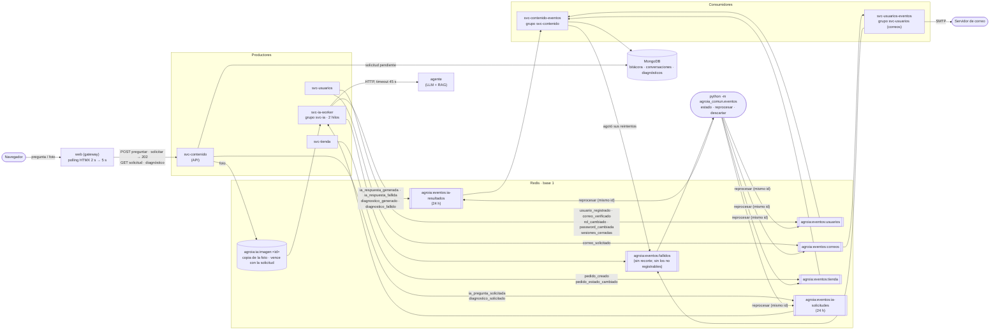

El navegador solo habla con `web`, y `web` nunca toca Redis: la pregunta y la foto entran por svc-contenido, que es dueño de la conversación y del diagnóstico.

## Productores y consumidores

**La librería** está en [`comun/agroia_comun/eventos/`](../comun/agroia_comun/eventos/):

| Archivo | Qué hace |
| --- | --- |
| `productor.py` | `publicar`: valida contra el catálogo, `XADD` con timeout de 2 s y no rompe la operación si Redis no responde |
| `en_django.py` | `publicar_al_confirmar` (con `transaction.on_commit`) y la correlación de la petición |
| `consumidor.py` | `Consumidor` y `correr_en_hilos` |
| `catalogo.py` | Tipos, streams, campos permitidos y política por stream |
| `sobre.py` | El sobre común |
| `operacion.py` | `estado`, `reprocesar` y `descartar` |
| `__main__.py` | La línea de comandos `python -m agroia_comun.eventos` |

**Productores:**

| Productor | Código | Qué publica |
| --- | --- | --- |
| svc-usuarios | [`apps/usuarios/servicios.py`](../svc-usuarios/apps/usuarios/servicios.py) | Eventos de usuarios y `correo_solicitado`, con `publicar_al_confirmar` |
| svc-tienda | [`apps/pedidos/servicios.py`](../svc-tienda/apps/pedidos/servicios.py) | `pedido_creado` y `pedido_estado_cambiado` (solo en `_cambiar_estado_bloqueado`) |
| svc-contenido (API) | [`apps/conversaciones/servicios.py`](../svc-contenido/apps/conversaciones/servicios.py), [`apps/diagnosticos/servicios.py`](../svc-contenido/apps/diagnosticos/servicios.py) | `ia_pregunta_solicitada` y `diagnostico_solicitado` |
| svc-ia-worker | [`svc-ia/app/worker.py`](../svc-ia/app/worker.py) | Los resultados de la IA: generada o fallida |

**Consumidores** (cada uno en su propio contenedor, con la misma imagen que su servicio y otro comando):

| Contenedor | Grupo | Código | Qué hace |
| --- | --- | --- | --- |
| `svc-contenido-eventos` | `svc-contenido` | [`management/commands/consumir_eventos.py`](../svc-contenido/apps/bitacora/management/commands/consumir_eventos.py), con los manejadores de [`bitacora/eventos.py`](../svc-contenido/apps/bitacora/eventos.py), [`conversaciones/eventos.py`](../svc-contenido/apps/conversaciones/eventos.py) y [`diagnosticos/eventos.py`](../svc-contenido/apps/diagnosticos/eventos.py) | Guarda los eventos de negocio en la bitácora (índice único de `evento_id`) y los resultados de la IA en la conversación o el diagnóstico |
| `svc-usuarios-eventos` | `svc-usuarios` | [`management/commands/consumir_eventos.py`](../svc-usuarios/apps/usuarios/management/commands/consumir_eventos.py) y [`usuarios/eventos.py`](../svc-usuarios/apps/usuarios/eventos.py) | Envía los correos; genera el token del enlace al procesar |
| `svc-ia-worker` | `svc-ia` | [`svc-ia/app/worker.py`](../svc-ia/app/worker.py) (`python -m app.worker`, `IA_WORKER_HILOS` = 2) | Atiende preguntas y diagnósticos, llama al agente o al clasificador y publica el resultado |

## Flujo asíncrono de la IA

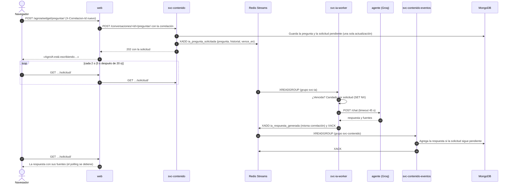

1. **web → svc-contenido.** svc-contenido guarda la pregunta y la solicitud (`pendiente`, con `vence_en`) en una sola actualización condicionada: no puede haber otra pendiente ni la conversación puede estar llena. Publica `ia_pregunta_solicitada` con los últimos 10 mensajes y responde **202**. Si Redis no responde, la solicitud queda `fallido` con `servicio_no_disponible` y la pantalla ofrece «Reintentar» al momento.
2. **svc-ia-worker:**
   - si la solicitud venció, publica la fallida sin llamar al agente;
   - toma un candado por solicitud y llama al agente con un timeout de 45 s;
   - publica `ia_respuesta_generada`, o reintenta según el error (ver abajo).
3. **svc-contenido-eventos** guarda la respuesta en la conversación (MongoDB) solo si la solicitud sigue pendiente. Una respuesta tardía se descarta y se registra `respuesta_tardia`, sin el texto.
4. **La pantalla consulta el estado** con HTMX (`hx-trigger="load delay:2s"`, 5 s después de 20 s). La respuesta final ya no trae `hx-trigger` y el polling se detiene. Sin JavaScript, un `<meta refresh>` dentro de `<noscript>`.
5. **«Reintentar»** pide otra respuesta para la última pregunta, sin repetirla.

**El diagnóstico por imagen** sigue el mismo camino. La foto viaja como una copia temporal en Redis (`agroia:ia:imagen:<id>`), que vence con la solicitud y el worker borra al procesarla. Hoy no hay modelo de visión: el worker publica `diagnostico_fallido` con `modelo_no_disponible` y la pantalla lo explica. El clasificador de prueba solo funciona con `DEBUG=True` y todo lo que da va marcado como prueba.

**El widget flotante** usa exactamente este flujo, con la conversación del widget en la sesión del gateway.

## Reintentos, timeouts y fallidos

| Mecanismo | Cómo funciona |
| --- | --- |
| **Reintentos** | Un evento cuyo manejador falla queda pendiente y se reintenta con espera creciente, contada desde el fallo: 2, 4, 8, 16 y 32 s en la política general (5 reintentos); **5 y 10 s en las solicitudes de IA** (2 reintentos: el usuario está esperando). Se configuran por stream con variables de entorno |
| **Errores que no se reintentan** | Un sobre ilegible o de una versión más nueva va directo a fallidos. En la IA, un 4xx distinto de 429 o una respuesta vacía publica la fallida al momento (`pregunta_invalida`): repetirlo gasta tokens y da lo mismo |
| **Timeouts** | Redis 2 s por operación (lectura bloqueante de 5 s); agente 45 s; MongoDB 5 s; SMTP 10 s; llamadas HTTP entre servicios con `SERVICIOS_TIMEOUT` (10 s). Si Redis no responde, el consumidor espera 2, 4, 8… hasta 30 s sin caerse |
| **Vencimiento** | Una solicitud de IA vence a los 180 s (`IA_SOLICITUD_VENCE_SEGUNDOS`): svc-contenido la marca `fallido` con `vencida` al leerla, sin depender de un evento |
| **Idempotencia** | Llave `agroia:procesados:<grupo>:<evento_id>` (7 días), escrita solo después de que el manejador terminó bien. Además, cada manejador es idempotente por sí mismo: índice único de `evento_id` en la bitácora, respuesta condicionada a su `solicitud_id` y candado por solicitud en el worker |
| **Latido** | Mientras el manejador corre, un hilo renueva la propiedad del mensaje cada segundo (`XCLAIM … JUSTID`). Solo se reclama lo que lleva más de 3 latidos sin renovarse, o sea, cuyo dueño murió. Así una respuesta lenta del agente no se procesa dos veces |
| **Fallidos** | Al agotar los reintentos, el gancho `al_agotar` avisa al usuario (la IA publica la fallida) y el evento se copia a `agroia:eventos:fallidos` con el motivo, el grupo y los intentos. **Sin los campos no registrables** (`datos_omitidos`) |
| **Reproceso** | `python -m agroia_comun.eventos reprocesar --id <id>` vuelve a publicar el sobre con su mismo id. Los grupos que ya lo habían aplicado lo saltan por idempotencia. Los de `datos_omitidos` no se pueden reprocesar: la pregunta se repite con «Reintentar» |
| **Descarte** | `descartar --id <id>` borra un fallido ya revisado y registra `fallidos_descartados` con los ids |
| **Apagado limpio** | Con SIGTERM, el consumidor termina el evento en curso y sale con código 0. `svc-ia-worker` tiene 60 s de gracia |
| **Estado** | `python -m agroia_comun.eventos estado` y la pantalla del panel (`/administracion/eventos/`, solo lectura) muestran streams, grupos, pendientes, retraso, consumidores y fallidos |

## Seguridad de los eventos

- **Campos no registrables:** `pregunta`, `historial` y `respuesta` viajan en el evento, pero nunca aparecen en los logs ni en el stream de fallidos. Los streams de la IA se recortan por antigüedad: 24 h, con `XADD MINID` exacto. El panel muestra de los fallidos solo el nombre de la excepción.
- **Sin datos personales de más:** los eventos llevan ids, no correos, nombres ni direcciones. El token del correo lo genera el consumidor y nunca viaja en el evento. Los logs del gateway registran la ruta como patrón (`restablecer/<str:uid>/<str:token>/`), nunca la ruta real ni la query string.
- **Correlación validada:** `CorrelacionMiddleware` de `comun`, en el gateway y en cada servicio, acepta un `X-Correlacion-Id` solo si es un UUID; si no, genera uno. El worker la hereda del sobre. Al armar el sobre, `correlacion_valida` también la normaliza: si no es un UUID, pone uno nuevo. Ningún texto arbitrario llega a los logs como correlación.
- **Límite de preguntas por usuario:** 10 por minuto y 30 por hora, compartido entre preguntar, reintentar y solicitar un diagnóstico. Responde 429 con `Retry-After` antes de guardar nada. Los contadores son atómicos (`incr` en Redis), para que un solo usuario no agote la cuota de Groq de todos.
- **Cierre del riesgo B5 de la Entrega 3:** la recuperación de contraseña ya no envía el correo dentro de la petición. Con un servidor de correo que no responde, antes respondía **504 en 10 016 ms** si el correo existía y 200 en 57 ms si no. Después: 200 en 15 ms y 200 en 17 ms (`infra/medir_recuperacion.py`).
- **Redis:** `noeviction` (rechaza escrituras antes que borrar eventos sin procesar) y la base 1 separada de la caché. Contraseña y TLS quedan para la Entrega 5.

## Pruebas de integración

La prueba de integración es [`infra/prueba_eventos.py`](../infra/prueba_eventos.py). Corre contra el sistema levantado, detiene y arranca contenedores, y limpia lo que crea.

**Corrida final: 62 de 62.**

| # | Escenario | Comprobaciones |
| --- | --- | --- |
| 1 | Registro por el gateway → `usuario_registrado` → bitácora | 2 |
| 2 | Apagado limpio del consumidor | 3 |
| 3 | Consumidor caído: lo publicado se procesa al volver | 3 |
| 4 | MongoDB detenido → reintentos → fallidos → `reprocesar` | 7 |
| 5 | Registro → correo → verificación → pedido → pago, con una correlación | 12 |
| 6 | La correlación en los logs, sin tokens | 4 |
| 7 | Correo que falla → fallidos → reproceso con un token nuevo | 6 |
| 8 | Pregunta → svc-ia-worker → agente real → MongoDB | 8 |
| 9 | Agente detenido → reintentos → fallida → «Reintentar» | 8 |
| 10 | 5 preguntas a la vez, de 2 en 2, sin entregas de más | 4 |
| 11 | Diagnóstico sin modelo y con el clasificador de prueba | 5 |

**Resultados de la corrida final** (26 de noviembre de 2026): [`entregable-4/resultados-pruebas.md`](entregable-4/resultados-pruebas.md).

| Prueba | Resultado |
| --- | --- |
| Pruebas automatizadas | 1124 de 1124: web 359, svc-usuarios 194, svc-tienda 185, svc-contenido 150, svc-ia 87, comun 137, infra 12 |
| Postman | 159 peticiones, 258 de 258 aserciones |
| Prueba de punta a punta | 62 de 62 |
| Matriz de accesos | 186 de 186, con 0 filas marcadas por servicio externo: [`entregable-4/matriz-accesos.md`](entregable-4/matriz-accesos.md) |

Las pruebas unitarias de los eventos usan Redis simulado (`fakeredis`) y MongoDB simulado (`mongomock`): no dependen de otros contenedores.

## Evidencia

### Logs por correlación

En [`entregable-4/evidencia-logs.md`](entregable-4/evidencia-logs.md) están, ordenadas, las líneas de cada contenedor que llevan la misma `correlacion_id`:

- **una pregunta real:** web → `evento_publicado` de svc-contenido → `evento_procesado` del worker → `evento_procesado` de svc-contenido-eventos;
- **un fallo con reintento:** agente detenido, reintentos, fallida y «Reintentar» al volver;
- **un flujo de negocio:** registro → verificación → pedido → pago;
- **el diagnóstico sin modelo.**

Se revisaron a mano: no tienen tokens, enlaces de verificación ni de recuperación, correos ni el texto de las preguntas o las respuestas.

### Capturas

En [`entregable-4/img/`](entregable-4/img/):

| Pregunta pendiente | Respuesta |
| --- | --- |
| 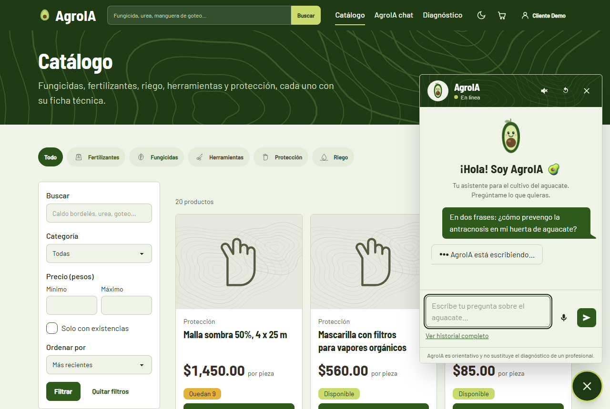 | 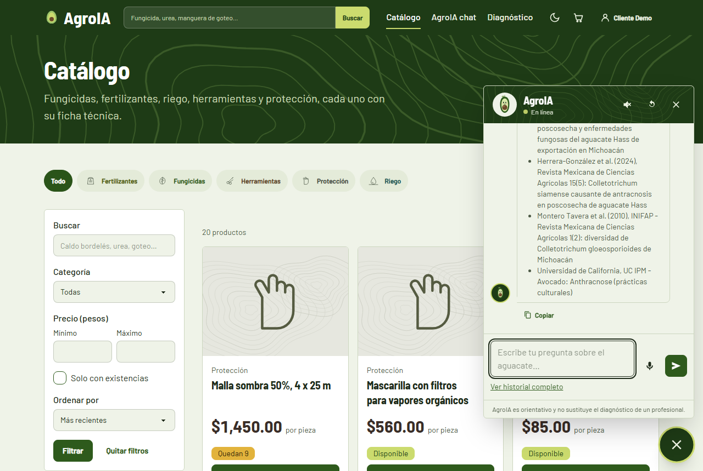 |

| Agente detenido: fallida con «Reintentar» | Después de reintentar |
| --- | --- |
| 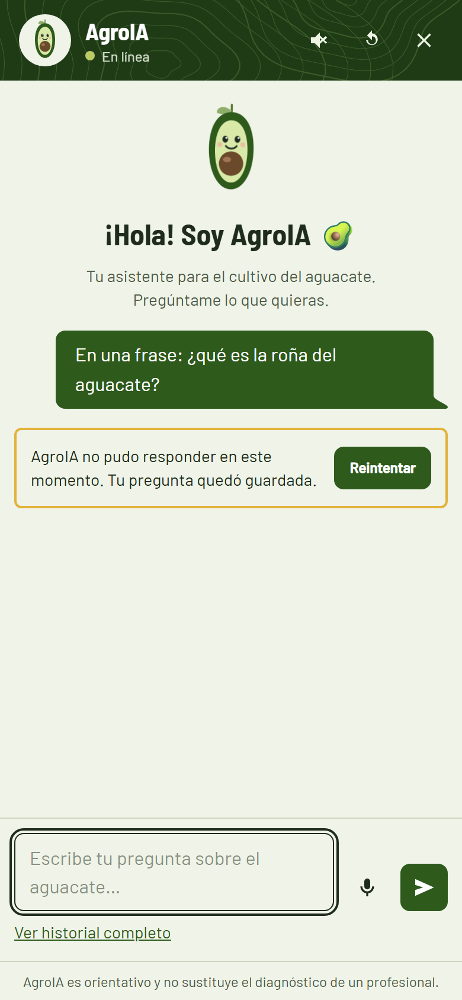 | 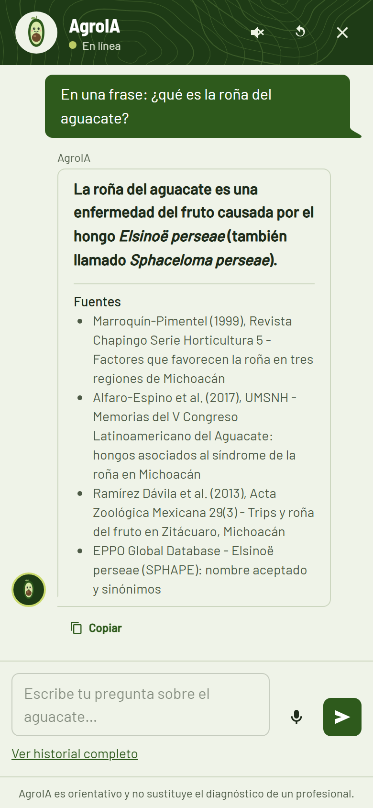 |

| Límite de preguntas (429) | Diagnóstico sin modelo |
| --- | --- |
| 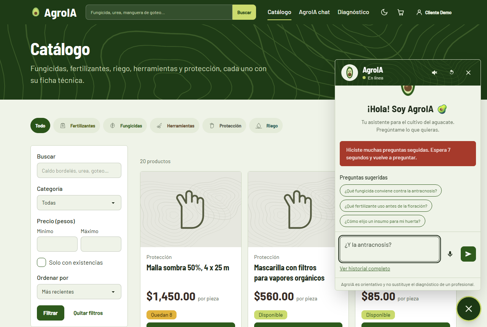 | 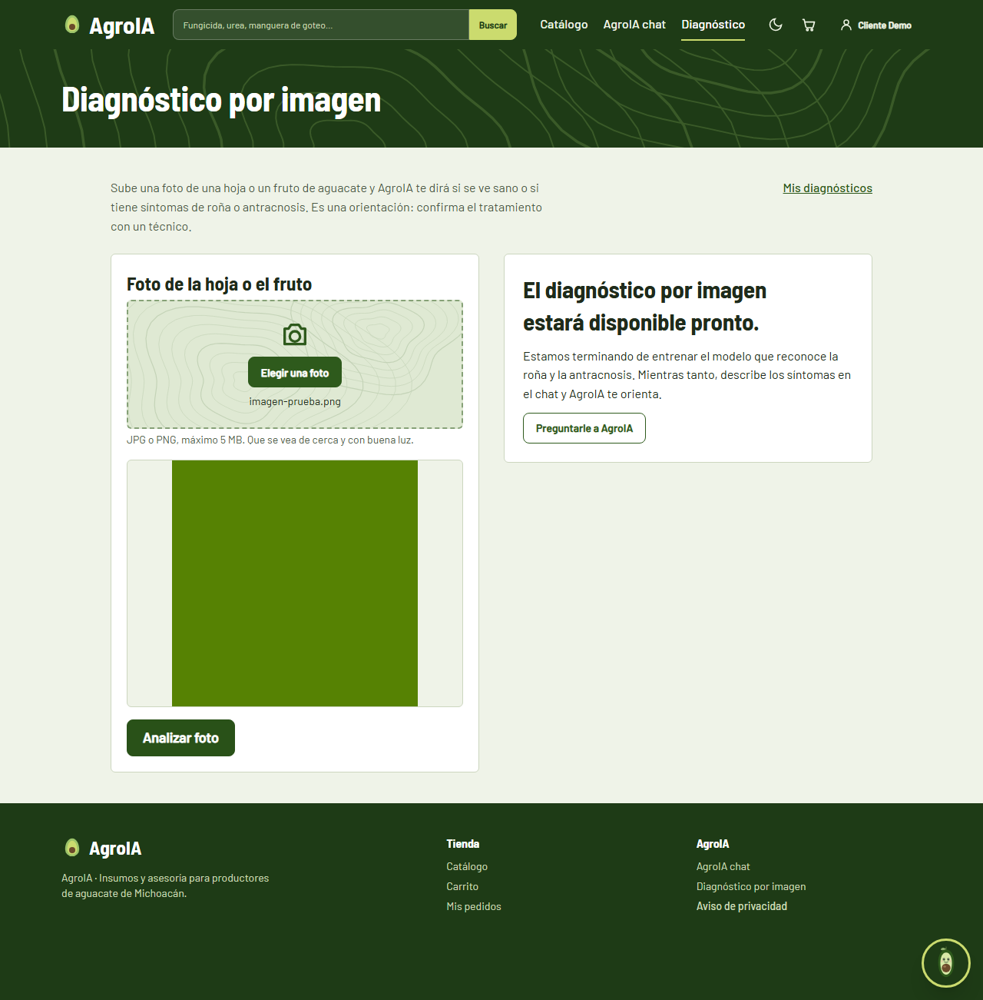 |

**Bitácora del panel filtrada por la correlación** del pedido y del pago. La bitácora guarda los eventos de negocio. Los de la IA no se guardan ahí: llevan datos no registrables y su rastro está en los logs, en la conversación y en el estado de los eventos.

| Correlación del pedido | Correlación del pago |
| --- | --- |
| 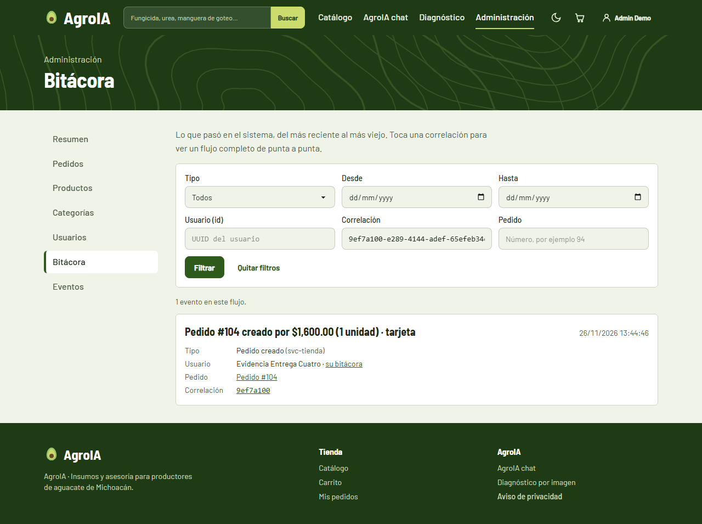 | 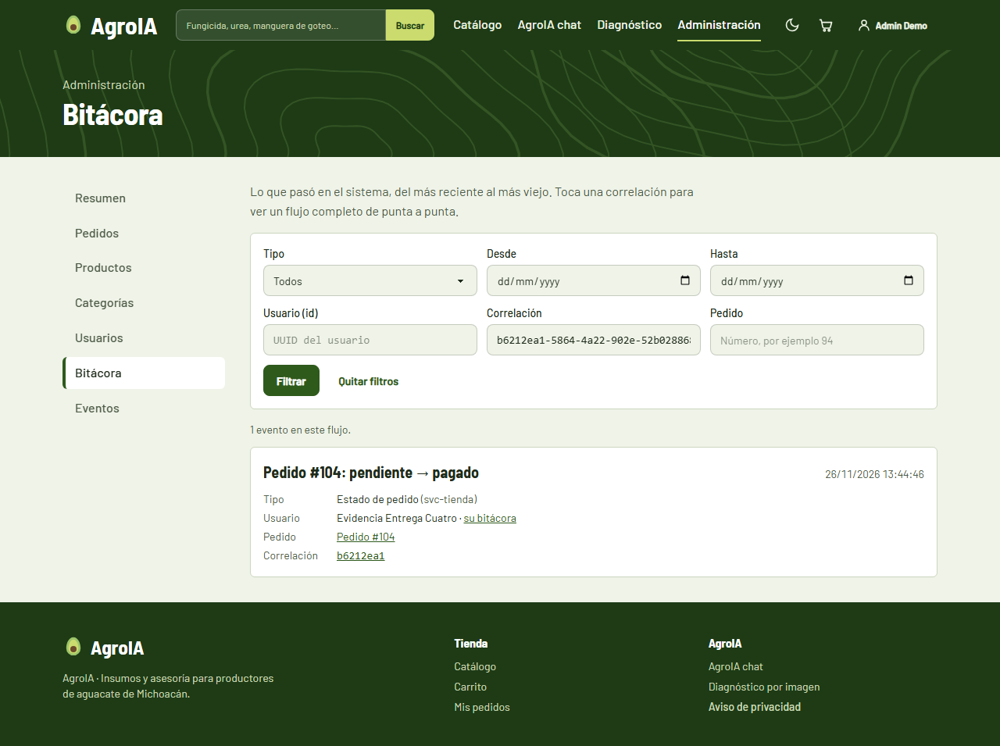 |

| Estado de los eventos (panel) | `python -m agroia_comun.eventos estado` |
| --- | --- |
| 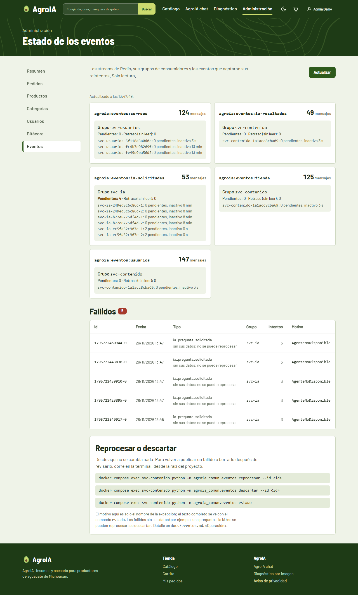 | 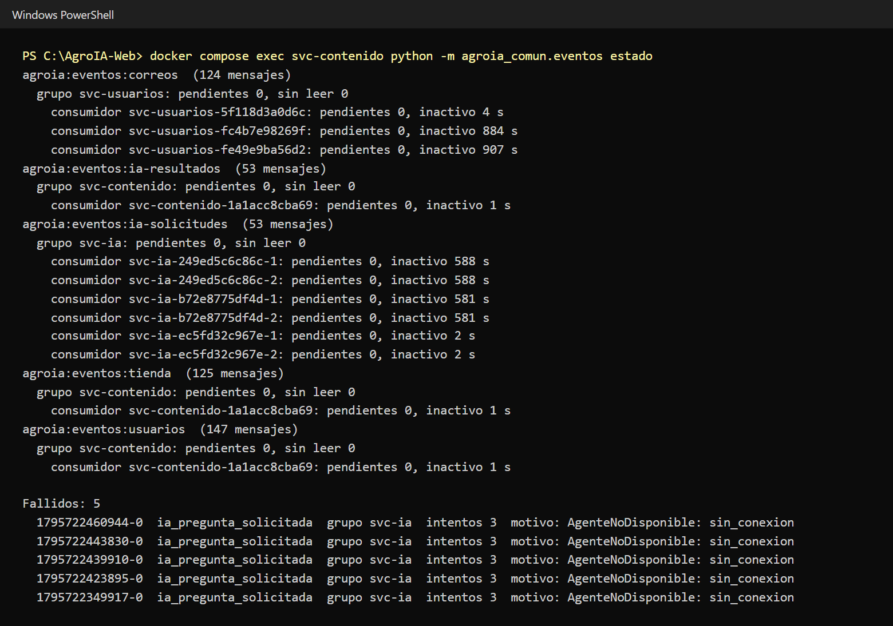 |

La captura del comando es su salida real, puesta en una ventana de terminal para que se lea. Las dos se tomaron con las preguntas de las pruebas de fallo todavía en fallidos: así se ve el registro de fallidos. Después se revisaron y se descartaron.

Más capturas: el estado de los eventos en móvil ([`estado-eventos-movil.png`](entregable-4/img/estado-eventos-movil.png)), la bitácora del pago en móvil ([`bitacora-pago-movil.png`](entregable-4/img/bitacora-pago-movil.png)) y la del registro ([`bitacora-registro-escritorio.png`](entregable-4/img/bitacora-registro-escritorio.png)).

### Video

**Enlace del video narrado:** _(pendiente: el equipo lo graba con el [guion](entregable-4/guion-video.md) y pega aquí el enlace)_.

El [guion](entregable-4/guion-video.md) cubre, en 3 a 5 minutos:

- la pregunta en el widget, con una terminal mostrando los logs en vivo;
- el agente detenido, la fallida y «Reintentar»;
- el estado de los eventos y la bitácora en el panel;
- el comando `estado` y el descarte de un fallido.

## Scrum

En [`entregable-4/scrum.md`](entregable-4/scrum.md), **como propuesta para revisar en equipo** antes de pasarla a Jira:

- **Opción de un sprint:** Sprint 4, del 21 al 26 de noviembre de 2026, con 7 historias de usuario y sus criterios de aceptación. Estimación en Fibonacci: **63 puntos de velocidad**.
- **Opción de dos sprints:** «Eventos e IA asíncrona» (29 puntos) y «Experiencia y cierre» (34 puntos).

Las fechas salen de la bitácora y de los PR #13 a #18.

## Trabajo adicional

| Trabajo | Qué es | Avance |
| --- | --- | --- |
| **Widget flotante de AgroIA** | El chat en todas las páginas, con el mismo flujo asíncrono y la conversación en la sesión. Dictado por voz detrás de un aviso, con `Permissions-Policy`. Accesible con el teclado y con lector de pantalla | [`avances/e4-widget-agroia.md`](avances/e4-widget-agroia.md) |
| **Rediseño «Altura»** | Identidad visual con las curvas de nivel de la Meseta Purépecha. Contraste AA en 50 pares de color en tema claro y oscuro. Revisado en 108 pantallas sin errores de consola ni de la CSP | [`avances/diseno-front.md`](avances/diseno-front.md) |
| **Panel de administración** | Resumen con ventas por fecha de pago (`pagado_en`, en hora de México), **bitácora legible con la correlación** y **estado de los eventos** sin datos, con filtros, detalle de usuario y confirmaciones | [`avances/panel-admin.md`](avances/panel-admin.md) |

Los avances de la parte de eventos están en:

- [`avances/e4-eventos-base.md`](avances/e4-eventos-base.md);
- [`avances/e4-eventos-negocio.md`](avances/e4-eventos-negocio.md);
- [`avances/e4-ia-asincrona.md`](avances/e4-ia-asincrona.md).

## Cómo levantar y probar

Requisitos: Docker Desktop, Python 3.12 y una llave gratuita de Groq. Detalle en el [README](../README.md#levantar-el-proyecto-por-primera-vez).

```powershell
Copy-Item .env.example .env                       # cambiar contraseñas, DJANGO_SECRET_KEY y GROQ_API_KEY
py -3.12 -m venv venv; .\venv\Scripts\Activate.ps1; pip install -r requirements-dev.txt
python infra/generar_llaves.py
docker compose up --build -d                      # 13 contenedores
docker compose run --rm agente python -m ingesta.cargar
docker compose exec svc-tienda python manage.py cargar_datos_demo
docker compose exec svc-usuarios python manage.py cargar_usuarios_demo

# Pruebas, en este orden (ver entregable-4/resultados-pruebas.md)
newman run docs/postman/AgroIA-Web.postman_collection.json -e docs/postman/local.postman_environment.json --working-dir docs/postman
python infra/prueba_eventos.py
python infra/matriz_seguridad.py

# Estado de los eventos
docker compose exec svc-contenido python -m agroia_comun.eventos estado
```

En el navegador, http://localhost:8000, con `cliente@demo.agroia.test` o `admin@demo.agroia.test` y la contraseña de demostración `solo-demo-no-usar-en-produccion`. Esas cuentas solo existen con `DJANGO_DEBUG=True`.

## Riesgos aceptados y pendientes

### Riesgos aceptados

| Riesgo | Por qué se acepta | Cuándo se resuelve |
| --- | --- | --- |
| Un evento se pierde si Redis está caído al publicar, o si el proceso muere entre el commit y el `XADD` | Hoy los eventos de negocio solo alimentan la bitácora. Queda la línea `evento_no_publicado` con el sobre, para republicarlo a mano | Patrón *outbox* cuando un evento perdido tenga consecuencias de negocio |
| La pregunta puede quedar más de 24 h en el archivo AOF de Redis, hasta que se reescribe | Es un archivo local de desarrollo; `BGREWRITEAOF` lo limpia al momento | Entrega 5, con Memorystore |
| Cuota gratuita de Groq: límite de tokens por minuto y cuota diaria | El worker usa 2 hilos y reintenta. La matriz marca aparte las filas sin agente, sin contarlas como falla. Las corridas completas se planean al inicio del día | Una llave de pago permite subir `IA_WORKER_HILOS` |
| Redis y MongoDB sin contraseña ni TLS; contenedores como root; servidores de desarrollo | Solo en la red interna de Docker, con sus puertos en `127.0.0.1` | Entrega 5 |
| Un access emitido sirve hasta 15 minutos después de un logout o un cambio de rol | Los servicios validan sin consultar la base; la renovación sí se corta | Si hace falta: publicar las revocaciones por eventos |

### Pendientes para la Entrega 5

- **Despliegue:**
  - solo se publica `web`; los puertos 8001 a 8005 y los de las bases quedan para desarrollo;
  - contenedores sin root; gunicorn y uvicorn sin `--reload`;
  - HTTPS con HSTS y cookies seguras;
  - contraseña y TLS en Redis y MongoDB;
  - SMTP real;
  - imágenes en Cloud Storage (ya usan `default_storage`).
- **Volver a aceptar el aviso de privacidad:** el aviso subió a la versión 2026-11 y los usuarios existentes conservan la 2026-10. Falta que svc-usuarios entregue la versión aceptada y un endpoint para aceptar la vigente, la pantalla «Actualizamos el aviso de privacidad» en web con su middleware, decidir qué pasa si no la acepta y que `cargar_usuarios_demo` guarde la versión vigente. Detalle en el plan de la [definición técnica](definicion-tecnica.md#plan-de-construcción).
- **Cuota de Groq:** llave de pago o un modelo de respaldo para las corridas completas y para más hilos en el worker.
- **Modelo de visión:** el diagnóstico responde `modelo_no_disponible` hasta que exista; el flujo asíncrono ya está listo.
- **Outbox** para los eventos de negocio, si dejan de ser solo de auditoría.
- **Jira:** cargar el Sprint 4 con los puntos acordados.
