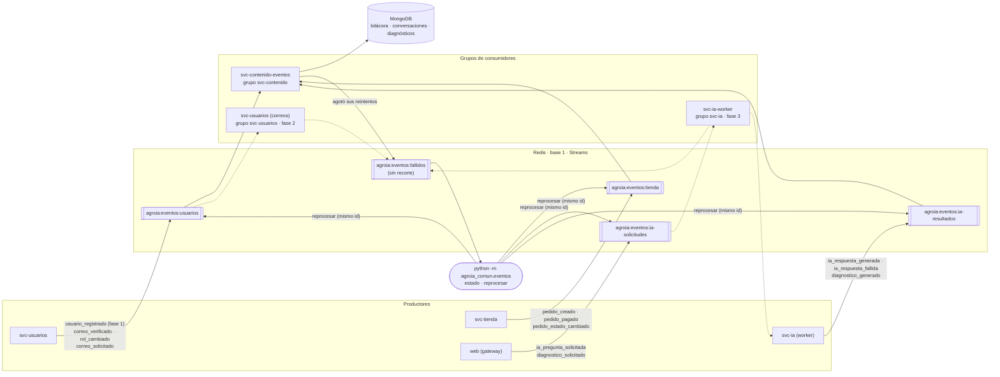

# Eventos entre servicios

Noviembre de 2026 · Entrega 4

Qué operaciones se comunican de forma asíncrona, con qué mecanismo y con qué reglas. El código está en [`comun/agroia_comun/eventos/`](../comun/agroia_comun/eventos/); los avances, en [`avances/e4-eventos-base.md`](avances/e4-eventos-base.md).

## Mecanismo: Redis Streams con grupos de consumidores

Cada servicio que produce eventos los agrega a un *stream* de Redis. Cada servicio que reacciona tiene un **grupo de consumidores** con su nombre: el grupo recibe cada evento una vez, lo confirma (`XACK`) al terminar y, mientras no lo confirme, el evento queda en su lista de pendientes.

| Necesidad (lo que pide la Entrega 4) | Pub/sub | Celery | RQ | **Streams + grupos** |
| --- | --- | --- | --- | --- |
| No perder eventos si el consumidor está caído | No: se pierden si nadie escucha | Sí | Sí | Sí: quedan en el stream y el grupo sigue en su posición |
| Confirmar cada evento | No | Sí | Sí | Sí: pendiente hasta el `XACK` |
| Reintentos y registro de los que fallan | No | Integrado | Integrado | Lo hace nuestra librería con la lista de pendientes y el stream de fallidos |
| Recuperar lo que dejó a medias un consumidor caído | No | Con matices (tiempo de visibilidad) | Con matices | Sí: después de la espera, otro consumidor lo reclama (`XCLAIM`) |
| Un evento que escuchan varios servicios | Sí | No: son tareas para un solo destinatario | No | Sí: un grupo por servicio |
| Productor desacoplado del consumidor | Sí | No: llama tareas por su nombre en Python | No: además serializa con pickle | Sí: JSON con un sobre común |
| Dependencias nuevas | Ninguna | celery, kombu, billiard, vine | rq | Ninguna: `redis==8.1.0`, que ya usábamos |

Se eligió **Streams**. El costo: los reintentos con espera creciente, el stream de fallidos y el reproceso los implementa la librería de `comun`, y la entrega es «al menos una vez», así que cada consumidor debe ser idempotente.

## Qué es asíncrono y qué no

**Asíncrono:** lo que el usuario no necesita esperar, lo que le importa a otro servicio y lo que es lento.

- Avisar a otros servicios que algo pasó (usuario registrado, pedido creado o pagado, cambio de rol), para la bitácora y lo que se agregue después.
- Las solicitudes a la IA, que tardan de 2 a 30 s: el gateway deja de esperar al agente.
- Guardar el resultado de la IA en svc-contenido.
- Enviar correos (fase 2): además de no hacer esperar, iguala el tiempo de respuesta de la recuperación exista o no la cuenta (riesgo aceptado B5 de la Entrega 3).

**Síncrono, a propósito:**

| Operación | Por qué |
| --- | --- |
| Login, renovación y validación del JWT | La respuesta los necesita |
| Crear el pedido validando y descontando stock | Es una transacción con `select_for_update()`; el usuario debe saber al momento si alcanzó el stock |
| Pagar (simulado), carrito, catálogo, leer conversaciones e historial | El usuario espera el resultado en la pantalla |
| Registro, verificación de correo y cambio de rol | Responden al momento, y además publican su evento |

## El sobre común

Todos los eventos viajan en el mismo sobre, guardado como un solo campo `sobre` (JSON) del mensaje:

```json
{
  "id": "09cfb85e-9440-482e-9d8a-e091fd7bbbd8",
  "tipo": "usuario_registrado",
  "version": 1,
  "fecha": "2026-11-22T17:00:48.980+00:00",
  "origen": "svc-usuarios",
  "correlacion_id": "43a7d964-fc8b-4a61-8005-1fdf68af7e47",
  "datos": {"usuario_id": "faf48e59-d672-4873-94a8-b3d7bc306d97", "rol": "cliente"}
}
```

| Campo | Qué es |
| --- | --- |
| `id` | UUID del evento. Lo genera quien publica y **se conserva al reprocesar**: es la llave de la idempotencia |
| `tipo`, `version` | Del catálogo. Un consumidor que recibe una versión más nueva que la de su catálogo la manda a fallidos en lugar de aplicarla mal |
| `fecha` | Cuándo se publicó (UTC) |
| `origen` | Servicio que lo publicó |
| `correlacion_id` | Sigue un flujo entre servicios (por ejemplo, la pregunta del chat y su respuesta) |
| `datos` | Solo los campos que el catálogo permite para ese tipo |

**Reglas de los datos:**
- Nunca llevan tokens, contraseñas ni datos personales que no hagan falta (correo, nombre, teléfono, dirección): se identifica al usuario por `usuario_id`. El catálogo rechaza cualquier campo que no esté declarado, así que no se cuela un dato por accidente.
- Un tipo puede marcar campos como **no registrables**: viajan en el stream, pero ningún log los escribe (ni `evento_publicado`, ni `evento_no_publicado`, ni ningún otro). Hoy no hay ninguno; en la fase 3 lo serán `pregunta` e `historial`.

**`correlacion_id`:** el gateway la pone en el encabezado `X-Correlacion-Id` de cada petición a los servicios, y los servicios la copian al sobre. **Solo se acepta si es un UUID válido; si no, se genera uno nuevo** (en el gateway y en cada servicio: `correlacion_valida()`). Hoy los servicios ya la validan; que el gateway la genere y la reenvía es de la fase 2 (el proxy `/api/` todavía no la pasa).

## Streams y grupos

Todo en la **base lógica 1** de Redis (`EVENTOS_REDIS_URL`), separada de la caché del límite de intentos (base 0), y con el prefijo `agroia:`.

| Stream | Productor | Grupos (consumidores) | Recorte |
| --- | --- | --- | --- |
| `agroia:eventos:usuarios` | svc-usuarios | `svc-contenido` (bitácora); en la fase 2, `svc-usuarios` (correos) | ~10 000 mensajes |
| `agroia:eventos:tienda` | svc-tienda | `svc-contenido` (bitácora) | ~10 000 |
| `agroia:eventos:ia-solicitudes` | web | `svc-ia` (worker) | ~10 000 |
| `agroia:eventos:ia-resultados` | svc-ia | `svc-contenido` (guarda) | ~10 000 |
| `agroia:eventos:fallidos` | La librería, cuando un evento agota sus reintentos | Nadie: se revisa con `estado` y se reprocesa | **Sin recorte** |

El de fallidos no se recorta: cada fallido es un problema que alguien tiene que revisar, y es chico. Se vacía con `reprocesar` o a mano después de revisarlo.

## Catálogo de eventos

| Evento | Fase | Productor → consumidores | Datos | Si falla |
| --- | --- | --- | --- | --- |
| `usuario_registrado` | **1 (hecho)** | svc-usuarios → svc-contenido | `usuario_id`, `rol` | El registro ya respondió 201. El consumidor reintenta; si se agotan los reintentos, va a fallidos y se reprocesa |
| `correo_verificado` | 2 | svc-usuarios → svc-contenido | `usuario_id` | Igual: solo afecta la bitácora |
| `rol_cambiado` | 2 | svc-usuarios → svc-contenido | `usuario_id`, `rol_anterior`, `rol_nuevo`, `cambiado_por` | Igual. El rol ya cambió (y `CambioRol` lo registra en svc-usuarios) |
| `correo_solicitado` | 2 | svc-usuarios → svc-usuarios (su propio consumidor de correos) | `usuario_id`, `tipo_correo` (`verificacion`, `recuperacion`, `password_cambiada`) | Reintenta el envío; si se agota, va a fallidos y el usuario puede pedir reenvío |
| `pedido_creado` | 2 | svc-tienda → svc-contenido | `pedido_id`, `usuario_id`, `total` (texto decimal), `productos` (cantidad) | El pedido ya existe; solo afecta la bitácora |
| `pedido_pagado` | 2 | svc-tienda → svc-contenido | `pedido_id`, `usuario_id`, `total` | Igual |
| `pedido_estado_cambiado` | 2 | svc-tienda → svc-contenido | `pedido_id`, `usuario_id`, `estado_anterior`, `estado_nuevo` | Igual |
| `ia_pregunta_solicitada` | 3 | web → svc-ia | `solicitud_id`, `usuario_id`, `conversacion_id`, `pregunta`, `historial` (últimas 10). **`pregunta` e `historial` no registrables** | svc-ia reintenta; al agotarse, publica `ia_respuesta_fallida` y el chat ofrece «Reintentar» |
| `ia_respuesta_generada` | 3 | svc-ia → svc-contenido | `solicitud_id`, `conversacion_id`, `usuario_id`, `respuesta`, `fuentes`. **`respuesta` no registrable** | Reintenta guardarla; si se agota, va a fallidos y se reprocesa |
| `ia_respuesta_fallida` | 3 | svc-ia → svc-contenido | `solicitud_id`, `conversacion_id`, `usuario_id`, `codigo` (`agente_no_disponible`…) | Queda el estado de error de la solicitud |
| `diagnostico_solicitado` | 3 | web → svc-ia | `solicitud_id`, `usuario_id` y una **referencia** a la imagen, nunca la imagen | Hoy el modelo no existe y se responde 503 |
| `diagnostico_generado` | 3 | svc-ia → svc-contenido | `solicitud_id`, `usuario_id`, `clase`, `confianza`, `probabilidades`, `modelo_version`, referencia a la imagen | Reintenta guardarlo; si se agota, va a fallidos |

**`correo_solicitado`: los tokens de los enlaces nunca viajan en el evento.** El evento lleva solo el `usuario_id` y el tipo de correo; el consumidor de svc-usuarios genera el token de verificación o de recuperación al enviar, a partir del usuario. En la recuperación con un correo que no existe **no se publica nada**, pero la respuesta es la misma y tarda lo mismo (ya no depende de mandar el correo).

## Diagrama del flujo de eventos



En la fase 1 solo existe la línea de `usuario_registrado` hasta la bitácora, con su stream de fallidos y el reproceso; lo punteado llega en las fases 2 y 3.

## Publicar

`publicar(tipo, datos, origen=…)` valida el tipo y los datos contra el catálogo (un error ahí **sí** se lanza: es de programación), arma el sobre y hace `XADD` con un timeout de 2 s. En los servicios Django se usa `publicar_al_confirmar()`, que publica con `transaction.on_commit`: si la transacción se revierte, no se publica nada.

**Si Redis no responde, publicar no rompe la operación:** el usuario ya quedó registrado (o el pedido creado), la respuesta no cambia y se registra `evento_no_publicado` con el sobre completo (sin los campos no registrables), para poder republicarlo a mano.

**Riesgo aceptado:** el evento se pierde si Redis está caído al publicar, o si el proceso muere justo después del commit y antes del `XADD`. Solo queda la línea del log.

**Mejora pendiente, el patrón *outbox*:** cada servicio Django guardaría el evento en una tabla propia dentro de la misma transacción de la operación, y un proceso aparte lo publicaría a Redis con reintentos hasta lograrlo. Así ningún evento se pierde. Cuesta una migración por servicio productor y un proceso más; se deja para cuando un evento perdido tenga consecuencias de negocio (hoy solo afectan la bitácora).

## Consumir

`Consumidor(grupo, manejadores).correr()` lee de a un evento y, por cada uno:

1. Si el sobre no se puede leer, o trae una versión más nueva que la del catálogo de este servicio, va directo a fallidos: reintentar no lo arregla.
2. Si el tipo no tiene manejador en ese grupo, lo confirma y registra `evento_ignorado`.
3. Si ya está la llave `agroia:procesados:<grupo>:<evento_id>`, ya se aplicó: lo confirma sin llamar al manejador (`evento_duplicado`).
4. Llama al manejador. Si termina bien, en una transacción de Redis escribe la llave de procesado (vence en 7 días) y confirma (`evento_procesado`). **La llave se escribe solo después de que el manejador terminó bien.**
5. Si el manejador falla, no confirma: el evento queda pendiente y se registra `evento_reintentado`. Se vuelve a intentar cuando lleva sin confirmarse `espera_base × 2^(entregas − 1)` segundos: 2, 4, 8, 16 y 32 s con la configuración por defecto.
6. Al pasar de `EVENTOS_MAX_REINTENTOS` (5) reintentos, lo copia al stream de fallidos con el motivo, el grupo y el número de intentos, lo confirma y registra `evento_fallido`.

La misma revisión de pendientes **recupera lo que dejó a medias un consumidor caído**: pasada la espera, cualquier consumidor del grupo reclama el mensaje con `XCLAIM`.

**Idempotencia, en dos niveles:**
- La llave de procesados evita aplicar dos veces un evento que llega repetido (por ejemplo, al reprocesar uno que otro grupo ya había aplicado).
- **Todo manejador debe ser idempotente por sí mismo**, porque la llave no cubre dos casos: que el proceso muera entre el manejador y la llave (el evento se vuelve a entregar y el manejador se llama otra vez), y que pasen más de 7 días (la llave vence). En la bitácora lo resuelve un índice único de `evento_id`: guardar el mismo evento dos veces deja un solo documento.

**Timeouts:** cada operación con Redis tiene `socket_timeout` de 2 s; la lectura bloqueante espera 5 s y su cliente corta a los 7. Si Redis no responde, el consumidor registra `consumidor_sin_redis` y espera 2, 4, 8… hasta 30 s antes de volver a intentar, sin caerse. Cada manejador pone sus propios timeouts a lo que llame (MongoDB corta a los 5 s).

**Apagado limpio:** con SIGTERM o SIGINT (`docker compose stop`), el consumidor termina el evento en curso y sale con código 0. Como lee de a uno, no deja eventos leídos sin empezar.

## Log de eventos

Cada servicio escribe una línea JSON por suceso en el logger `eventos`: `evento_publicado`, `evento_no_publicado`, `evento_procesado`, `evento_duplicado`, `evento_ignorado`, `evento_reintentado`, `evento_fallido`, `evento_reprocesado`, `consumidor_iniciado`, `consumidor_deteniendo`, `consumidor_detenido` y `consumidor_sin_redis`. Llevan el id, el tipo, el origen, la correlación, el grupo, el intento y el motivo del error (recortado a 300 caracteres), **nunca los datos** (salvo `evento_no_publicado`, sin los no registrables).

## Infraestructura

- **Redis con persistencia:** `--appendonly yes --appendfsync everysec` y el volumen `redis_datos`. Los eventos sobreviven a un reinicio (se pierde a lo más el último segundo).
- **`maxmemory-policy noeviction`, explícita:** si la memoria se llena, Redis rechaza las escrituras en lugar de borrar llaves. Con otra política (por ejemplo `allkeys-lru`) podría borrar eventos sin procesar, porque comparten instancia con la caché del límite de intentos. Rechazar una escritura se nota (`evento_no_publicado`); perder un evento en silencio, no.
- **Un contenedor por consumidor:** misma imagen y código que su servicio, otro comando, con `restart: unless-stopped`. Hoy: `svc-contenido-eventos` (`python manage.py consumir_eventos`). En la fase 3 se suma `svc-ia-worker`.
- **Variables:** `EVENTOS_REDIS_URL` (`redis://redis:6379/1`), `EVENTOS_MAX_REINTENTOS` (5), `EVENTOS_ESPERA_BASE` (2 s), `EVENTOS_REDIS_TIMEOUT` (2 s) y `EVENTOS_BLOQUEO_MS` (5000).

## Operación

```powershell
# Streams, grupos, pendientes, sin leer, consumidores y los últimos fallidos
docker compose exec svc-contenido python -m agroia_comun.eventos estado

# Volver a publicar fallidos (con el mismo id del sobre)
docker compose exec svc-contenido python -m agroia_comun.eventos reprocesar --id 1795366848980-0
docker compose exec svc-contenido python -m agroia_comun.eventos reprocesar --todos

# Prueba de punta a punta (registro → bitácora, consumidor caído, apagado, fallido y reproceso)
python infra/prueba_eventos.py
```

Los comandos funcionan en cualquier contenedor que tenga `comun`, también en svc-ia.

## Pendientes para la fase 3

- **Cómo se entera web del resultado de la IA.** Un grupo de consumidores en web entrega cada mensaje a un solo proceso, pero el usuario puede estar esperando en otro proceso del gateway. Alternativas:
  1. web consulta el estado de la solicitud en svc-contenido (que ya guarda el resultado);
  2. un consumidor escribe el estado de cada solicitud en una llave de Redis con vencimiento (por ejemplo `agroia:solicitudes:<id>`, 15 minutos) y web la consulta.
- **La imagen del diagnóstico** no puede viajar en el evento (hasta 5 MB). Alternativas:
  1. guardarla temporalmente en Redis con vencimiento y mandar solo la llave;
  2. que svc-contenido la guarde primero (diagnóstico pendiente) y el evento lleve solo su id.
- **El *outbox*** (ver «Publicar»), si un evento perdido llega a tener consecuencias.
