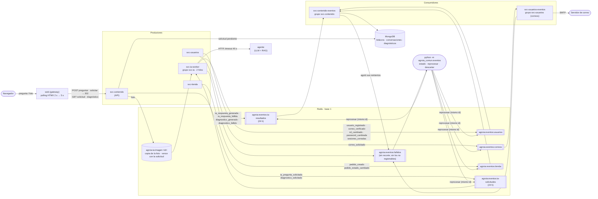

# Eventos entre servicios

Noviembre de 2026 · Entrega 4 (fase 1: base; fase 2: eventos de negocio; fase 3: IA asíncrona)

Qué operaciones se comunican de forma asíncrona, con qué mecanismo y con qué reglas. El código está en [`comun/agroia_comun/eventos/`](../comun/agroia_comun/eventos/); los avances, en [`avances/e4-eventos-base.md`](avances/e4-eventos-base.md), [`avances/e4-eventos-negocio.md`](avances/e4-eventos-negocio.md) y [`avances/e4-ia-asincrona.md`](avances/e4-ia-asincrona.md).

## Mecanismo: Redis Streams con grupos de consumidores

Cada servicio que produce eventos los agrega a un *stream* de Redis. Cada servicio que reacciona tiene un **grupo de consumidores** con su nombre: el grupo recibe cada evento una vez, lo confirma (`XACK`) al terminar y, mientras no lo confirme, el evento queda en su lista de pendientes.

| Necesidad (lo que pide la Entrega 4) | Pub/sub | Celery | RQ | **Streams + grupos** |
| --- | --- | --- | --- | --- |
| No perder eventos si el consumidor está caído | No: se pierden si nadie escucha | Sí | Sí | Sí: quedan en el stream y el grupo sigue en su posición |
| Confirmar cada evento | No | Sí | Sí | Sí: pendiente hasta el `XACK` |
| Reintentos y registro de los que fallan | No | Integrado | Integrado | Lo hace nuestra librería con la lista de pendientes y el stream de fallidos |
| Recuperar lo que dejó a medias un consumidor caído | No | Con matices (tiempo de visibilidad) | Con matices | Sí: después de la espera, otro consumidor lo reclama (`XCLAIM`) |
| Un evento que escuchan varios servicios | Sí | No: son tareas para un solo destinatario | No | Sí: un grupo por servicio |
| Productor desacoplado del consumidor | Sí | No: llama tareas por su nombre en Python | No: además serializa con pickle | Sí: JSON con un sobre común |
| Dependencias nuevas | Ninguna | celery, kombu, billiard, vine | rq | Ninguna: `redis==8.1.0`, que ya usábamos |

Se eligió **Streams**. El costo: los reintentos con espera creciente, el stream de fallidos y el reproceso los implementa la librería de `comun`, y la entrega es «al menos una vez», así que cada consumidor debe ser idempotente.

## Qué es asíncrono y qué no

**Asíncrono:** lo que el usuario no necesita esperar, lo que le importa a otro servicio y lo que es lento.

- Avisar a otros servicios que algo pasó (usuario registrado, pedido creado o pagado, cambio de rol), para la bitácora y lo que se agregue después.
- Las solicitudes a la IA (preguntas y diagnósticos), que tardan de 2 a 30 s: el gateway ya no espera al agente (fase 3, ver «IA asíncrona»).
- Guardar el resultado de la IA en svc-contenido.
- Enviar correos (fase 2): además de no hacer esperar, iguala el tiempo de respuesta de la recuperación exista o no la cuenta (riesgo aceptado B5 de la Entrega 3).

**Síncrono, a propósito:**

| Operación | Por qué |
| --- | --- |
| Login, renovación y validación del JWT | La respuesta los necesita |
| Crear el pedido validando y descontando stock | Es una transacción con `select_for_update()`; el usuario debe saber al momento si alcanzó el stock |
| Pagar (simulado), carrito, catálogo, leer conversaciones e historial | El usuario espera el resultado en la pantalla |
| Aceptar la pregunta o la foto (202) y consultar su estado | Es lo que la pantalla necesita para mostrar «AgroIA está escribiendo…»; lo lento va por evento |
| Registro, verificación de correo y cambio de rol | Responden al momento, y además publican su evento |

## El sobre común

Todos los eventos viajan en el mismo sobre, guardado como un solo campo `sobre` (JSON) del mensaje:

```json
{
  "id": "09cfb85e-9440-482e-9d8a-e091fd7bbbd8",
  "tipo": "usuario_registrado",
  "version": 1,
  "fecha": "2026-11-22T17:00:48.980+00:00",
  "origen": "svc-usuarios",
  "correlacion_id": "43a7d964-fc8b-4a61-8005-1fdf68af7e47",
  "datos": {"usuario_id": "faf48e59-d672-4873-94a8-b3d7bc306d97", "rol": "cliente"}
}
```

| Campo | Qué es |
| --- | --- |
| `id` | UUID del evento. Lo genera quien publica y **se conserva al reprocesar**: es la llave de la idempotencia |
| `tipo`, `version` | Del catálogo. Un consumidor que recibe una versión más nueva que la de su catálogo la manda a fallidos en lugar de aplicarla mal |
| `fecha` | Cuándo se publicó (UTC) |
| `origen` | Servicio que lo publicó |
| `correlacion_id` | Sigue un flujo entre servicios (por ejemplo, la pregunta del chat y su respuesta) |
| `datos` | Solo los campos que el catálogo permite para ese tipo |

**Reglas de los datos:**
- Nunca llevan tokens, contraseñas ni datos personales que no hagan falta (correo, nombre, teléfono, dirección): se identifica al usuario por `usuario_id`. El catálogo rechaza cualquier campo que no esté declarado, así que no se cuela un dato por accidente.
- Un tipo puede marcar campos como **no registrables**: viajan en el stream, pero ningún log los escribe (ni `evento_publicado`, ni `evento_no_publicado`, ni ningún otro). Hoy no hay ninguno; en la fase 3 lo serán `pregunta` e `historial`.

**`correlacion_id`: un flujo de punta a punta.**

1. **El gateway la crea:** `CorrelacionMiddleware` (en `comun`) toma la del navegador o cliente de API (`X-Correlacion-Id`) **solo si es un UUID válido**; si no, genera una. Queda en una `ContextVar` mientras dura la petición y se restablece al terminar, también si hubo un error, así que no se arrastra a la siguiente.
2. **El gateway la reenvía validada:** en cada llamada interna (pantallas y proxy `/api/`) la pone en `X-Correlacion-Id`. El proxy no reenvía el valor crudo del cliente.
3. **Cada servicio la vuelve a validar** con el mismo middleware y la usa al publicar: `publicar_al_confirmar` la toma de la `ContextVar`.
4. **El consumidor la pone** con la `correlacion_id` del sobre mientras corre el manejador y la limpia al terminar. Si un manejador publica otro evento, conserva la cadena.
5. **Respuesta:** el gateway devuelve la correlación en `X-Correlacion-Id`, expuesta en CORS.
6. **En los logs:**
   - el gateway escribe una línea `peticion` por petición (logger `peticiones`), con la correlación y la ruta como **patrón**, nunca la ruta real ni la query string, porque hay rutas con tokens (`/restablecer/<uid>/<token>/`, `/verificar-correo/?token=`);
   - el log de seguridad y el de eventos la llevan en todos los servicios;
   - el log de runserver (`django.server`) se descarta en el gateway, y `django.request` escribe el patrón en lugar de la ruta.
7. **En la bitácora:** se puede filtrar por `correlacion_id` para ver todo lo que causó una petición.

svc-ia recibe el encabezado, pero leerlo queda para la fase 3.

## Streams y grupos

Todo en la **base lógica 1** de Redis (`EVENTOS_REDIS_URL`), separada de la caché del límite de intentos (base 0), y con el prefijo `agroia:`.

| Stream | Productor | Grupos (consumidores) | Recorte |
| --- | --- | --- | --- |
| `agroia:eventos:usuarios` | svc-usuarios | `svc-contenido` (bitácora) | ~10 000 mensajes |
| `agroia:eventos:correos` | svc-usuarios | `svc-usuarios` (consumidor de correos, contenedor `svc-usuarios-eventos`): una cola de trabajo interna, que la bitácora no lee | ~10 000 |
| `agroia:eventos:tienda` | svc-tienda | `svc-contenido` (bitácora) | ~10 000 |
| `agroia:eventos:ia-solicitudes` | svc-contenido | `svc-ia` (worker, contenedor `svc-ia-worker`) | **24 h** y ~10 000 |
| `agroia:eventos:ia-resultados` | svc-ia (worker) | `svc-contenido` (guarda en la conversación o el diagnóstico) | **24 h** y ~10 000 |
| `agroia:eventos:fallidos` | La librería, cuando un evento agota sus reintentos | Nadie: se revisa con `estado` y se reprocesa | **Sin recorte** |

El de fallidos no se recorta: cada fallido es un problema que alguien tiene que revisar, y es chico. Se vacía con `reprocesar` (lo vuelve a publicar) o con `descartar` (lo borra sin publicarlo) después de revisarlo.

Los dos de la IA se recortan **también por antigüedad**, porque llevan preguntas y respuestas: ver «Cuánto duran los datos en Redis».

## Catálogo de eventos

| Evento | Fase | Productor → consumidores | Datos | Si falla |
| --- | --- | --- | --- | --- |
| `usuario_registrado` | **1 (hecho)** | svc-usuarios → svc-contenido | `usuario_id`, `rol` | El registro ya respondió 201. El consumidor reintenta; si se agotan los reintentos, va a fallidos y se reprocesa |
| `correo_verificado` | **2 (hecho)** | svc-usuarios → svc-contenido | `usuario_id`, `via` (`enlace` o `recuperacion`: restablecer la contraseña también verifica). Solo si pasó de no verificado a verificado | Igual: solo afecta la bitácora |
| `rol_cambiado` | **2 (hecho)** | svc-usuarios → svc-contenido | `usuario_id`, `rol_anterior`, `rol_nuevo`, `cambiado_por` (UUID del administrador). Nada si el rol no cambió | Igual. El rol ya cambió (y `CambioRol` lo registra en svc-usuarios) |
| `password_cambiada` | **2 (hecho)** | svc-usuarios → svc-contenido | `usuario_id`, `motivo` (`cambio` o `recuperacion`). Nunca la contraseña | Igual |
| `sesiones_cerradas` | **2 (hecho)** | svc-usuarios → svc-contenido | `usuario_id` (por `logout-todo`) | Igual |
| `correo_solicitado` | **2 (hecho)** | svc-usuarios → svc-usuarios (consumidor de correos), stream `correos` | `usuario_id`, `tipo_correo` (`verificacion`, `recuperacion` o `aviso_password`) | Reintenta el envío; si se agota, va a fallidos y se reprocesa (con un token nuevo). Ver «Correos en segundo plano» |
| `pedido_creado` | **2 (hecho)** | svc-tienda → svc-contenido | `pedido_id`, `usuario_id`, `total` (texto decimal), `productos` (número de renglones), `unidades` (suma de cantidades), `metodo_pago`. Sin dirección ni nombres | El pedido ya existe; solo afecta la bitácora |
| `pedido_estado_cambiado` | **2 (hecho)** | svc-tienda → svc-contenido | `pedido_id`, `usuario_id`, `estado_anterior`, `estado_nuevo`, `total`, `cambiado_por` (el cliente al pagar, el administrador en las demás) | Igual |
| `ia_pregunta_solicitada` | **3 (hecho)** | svc-contenido → svc-ia, stream `ia-solicitudes` | `solicitud_id`, `usuario_id`, `conversacion_id`, `pregunta`, `historial` (últimos 10 mensajes), `vence_en`. **`pregunta` e `historial` no registrables** | El worker reintenta (2 veces, 5 y 10 s); al agotarse publica `ia_respuesta_fallida` con `agente_no_disponible` y el chat ofrece «Reintentar» |
| `ia_respuesta_generada` | **3 (hecho)** | svc-ia → svc-contenido, stream `ia-resultados` | `solicitud_id`, `usuario_id`, `conversacion_id`, `respuesta`, `fuentes`. **`respuesta` no registrable** | svc-contenido reintenta guardarla (política general); si se agota, va a fallidos |
| `ia_respuesta_fallida` | **3 (hecho)** | svc-ia → svc-contenido | `solicitud_id`, `usuario_id`, `conversacion_id`, `codigo` (`agente_no_disponible`, `pregunta_invalida`, `vencida` o `servicio_no_disponible`) | La solicitud queda `fallido` con su código |
| `diagnostico_solicitado` | **3 (hecho)** | svc-contenido → svc-ia | `solicitud_id`, `diagnostico_id`, `usuario_id`, `vence_en`. **Nunca la imagen:** va en una copia temporal en Redis (ver «IA asíncrona») | Igual que la pregunta; al agotarse, `diagnostico_fallido` con `clasificador_fallo` |
| `diagnostico_generado` | **3 (hecho)** | svc-ia → svc-contenido | `solicitud_id`, `diagnostico_id`, `usuario_id`, `clase` (`sano`, `rona` o `antracnosis`), `confianza`, `probabilidades`, `modelo_version` | svc-contenido reintenta guardarlo; si se agota, va a fallidos |
| `diagnostico_fallido` | **3 (hecho)** | svc-ia → svc-contenido | `solicitud_id`, `diagnostico_id`, `usuario_id`, `codigo` (`modelo_no_disponible`, `imagen_no_disponible`, `imagen_invalida`, `clasificador_fallo`, `vencida` o `servicio_no_disponible`) | El diagnóstico queda `fallido` y se borra su foto |

**Cada valor de texto que es una lista cerrada** (rol, estado, tipo de correo, método de pago, `via`, `motivo`, la clase y los códigos de la IA) se valida en el catálogo: un valor fuera de la lista no se publica.

**El pago no es un evento aparte.** Es la transición `pendiente → pagado` y publica un `pedido_estado_cambiado` más. Todas las transiciones (pagar, y los cambios del administrador) pasan por una sola función de svc-tienda, `_cambiar_estado_bloqueado`, que es el único lugar que publica. Así una transición nunca publica dos eventos, por el camino que sea. Los consumidores filtran por `estado_nuevo`.

**Lo síncrono sigue síncrono:** crear el pedido valida y descuenta stock en su transacción, y cancelar devuelve el stock en la suya; los eventos se publican después del commit.

### Correos en segundo plano

Correos que envía svc-usuarios, todos por evento:

| Correo | Cuándo | Token |
| --- | --- | --- |
| Verificación | Registro y «reenviar verificación» (solo si la cuenta existe, está activa y sin verificar) | `TimestampSigner`, 24 h |
| Recuperación | «Recuperar contraseña» (solo si la cuenta existe y está activa) | `default_token_generator`, 1 h, de un solo uso |
| Aviso de contraseña cambiada | Restablecer y cambiar contraseña | — |

No hay ningún correo síncrono: el login con 2FA responde 501, y la sección 12 de los requerimientos usa TOTP con una app, no un código por correo.

- **Los tokens nunca viajan en el evento.** El evento lleva solo `usuario_id` y `tipo_correo`; el consumidor genera el token al enviar. Si el evento se reprocesa más tarde, el token es nuevo y vigente.
- **El consumidor revisa antes de enviar** si todavía toca: la verificación no sale si el correo ya está verificado, y ningún correo sale a una cuenta desactivada. El aviso usa la fecha del sobre (cuándo cambió la contraseña), no la del envío.
- **Si el envío falla,** se lanza `ErrorDeEnvio`, que nombra solo la clase del error y no el destinatario. El consumidor reintenta y, al agotar los reintentos, el evento va a fallidos y se puede reprocesar.
- **Idempotencia:** la tabla `CorreoEnviado` de svc-usuarios guarda el `evento_id` de cada correo procesado, enviado u omitido. El mismo evento dos veces no manda dos correos.
- **El hueco de SMTP:** si el proceso muere después de que el servidor de correo aceptó el mensaje y antes de guardar `CorreoEnviado`, al reentregarse el evento el correo sale otra vez. Con SMTP no se puede cerrar: no hay forma de saber si el servidor lo aceptó sin guardar algo después. Un correo repetido es molesto pero inofensivo, porque el token anterior sigue sirviendo o vence solo.
- **En desarrollo, el log del consumidor muestra los correos completos:** con el backend de consola, el correo (con su enlace) se imprime en el log de `svc-usuarios-eventos`, como antes en el de svc-usuarios. Así se copia el enlace al probar. Con `DJANGO_DEBUG=False` svc-usuarios no arranca con ese backend (corrección M1 de la Entrega 3).
- **Recuperación con un correo que no existe:** no se publica nada y la respuesta es la misma. Como el correo ya no se envía dentro de la petición, también tarda lo mismo, y con eso se cierra el riesgo B5 de la Entrega 3. Lo midió `infra/medir_recuperacion.py` con un servidor de correo que no responde:

  | | Correo que existe | Correo que no existe |
  | --- | --- | --- |
  | Antes (envío en la petición) | **504**, 10 016 ms (el gateway corta esperando al SMTP) | 200, 57 ms |
  | Después (envío por evento) | 200, 15 ms | 200, 17 ms |

  Medianas, cada una de 3 peticiones antes y de 5 después. Después se usó una conexión nueva por petición y se alternó cuál iba primero, porque al reutilizar la conexión una de las dos sumaba unos 40 ms que no tenían que ver con la cuenta.

## Diagrama del flujo de eventos



Todo funciona: fase 1 (`usuario_registrado`), fase 2 (eventos de negocio y correos) y fase 3 (IA asíncrona). La pregunta y la foto entran por svc-contenido, que es dueño de la conversación y del diagnóstico: web no publica ni lee Redis.

## IA asíncrona

### Pregunta al agente

1. **web → svc-contenido** `POST /api/v1/conversaciones/<id>/preguntar/` con `{"texto": …}`. En una sola actualización de MongoDB, condicionada a que la conversación no tenga una solicitud `pendiente` ni haya llegado al límite de mensajes, guarda la pregunta y la solicitud (`id` UUID, `estado: pendiente`, `creada_en`, `vence_en`). Publica `ia_pregunta_solicitada` con los últimos 10 mensajes como historial y responde **202** con la solicitud. Si no se puede publicar (Redis caído), la solicitud queda `fallido` con `servicio_no_disponible` y la pantalla ofrece «Reintentar» al momento.
2. **svc-ia-worker** (grupo `svc-ia`) recibe el evento:
   - Si ya pasó `vence_en`, no llama al agente: publica la fallida con `vencida`.
   - Toma el candado `agroia:ia:candado:<solicitud_id>` con `SET NX` (`procesando`, vence en `AGENTE_TIMEOUT + 15` s, por si el worker muere). Si dice `hecho`, ya se respondió y no hace nada. Si está `procesando`, lanza `Ocupado`.
   - Llama al agente con su timeout (45 s). Bien: publica `ia_respuesta_generada` y marca el candado `hecho` (24 h).
   - **Errores que se reintentan:** tiempo agotado, sin conexión, 5xx (el agente responde 503 ante cualquier falla del LLM, también el límite de Groq) y 429. Suelta el candado y lanza el error: la librería reintenta a los 5 y 10 s, y al agotar, `al_agotar` publica `ia_respuesta_fallida` con `agente_no_disponible`.
   - **Los que no:** otro 4xx o una respuesta vacía o mal formada. Repetirlos gasta tokens y da lo mismo: publica la fallida con `pregunta_invalida` al momento.
3. **svc-contenido-eventos** guarda la respuesta en la conversación con una sola actualización condicionada a que la solicitud siga `pendiente` y no haya ya un mensaje con ese `solicitud_id`. Si la conversación se llenó mientras tanto, la solicitud queda `fallido` con `conversacion_llena`.
4. **La pantalla consulta el estado** con `GET …/solicitud/`: HTMX con `hx-trigger="load delay:2s"` y la vista calcula el siguiente intervalo (2 s los primeros 20 s, después 5 s). La respuesta final (`listo` o `fallido`) ya no trae `hx-trigger` y el polling se detiene. No hay scripts en línea. Sin JavaScript, la página trae `<noscript><meta http-equiv="refresh" content="5">` mientras está pendiente.
5. **«Reintentar»** (`POST …/reintentar/`) pide otra respuesta a la última pregunta sin repetirla: una solicitud nueva con otro id.

**Vencimiento:** `IA_SOLICITUD_VENCE_SEGUNDOS` (180). svc-contenido marca `fallido` con `vencida` la solicitud vencida al leerla, así no depende de que llegue un evento. **Una respuesta que llega tarde** (la solicitud ya venció o falló) se descarta y se registra `respuesta_tardia` con los ids, sin el texto.

**Polling y límites:** una espera completa de 180 s son unas 40 consultas (10 cada 2 s y 32 cada 5 s). Los GET del estado no tienen límite; las pruebas hacen 90 (web) y 100 (svc-contenido) consultas seguidas sin un 429.

**Límite de solicitudes por usuario.** El límite de tokens del LLM (Groq) es de toda la aplicación, así que un solo usuario podía agotarlo y dejar sin chat a los demás. svc-contenido limita `preguntar`, `reintentar` y `diagnosticos/solicitar` con un presupuesto compartido por usuario: `IA_SOLICITUDES_POR_MINUTO` (10) e `IA_SOLICITUDES_POR_HORA` (30), con los contadores en la caché de Redis (base 0, como el límite de intentos de svc-usuarios). Al pasarse responde 429 `demasiados_intentos` con `Retry-After` **antes de la vista**: no se guarda la pregunta ni se publica nada, la conversación queda como estaba y su polling sigue. La pantalla dice «Hiciste muchas preguntas seguidas. Espera N segundos y vuelve a preguntar» y **conserva el texto escrito** (el gateway responde con `X-Conservar-Pregunta` y el componente `chat` no vacía el campo). Un «Reintentar» rechazado vuelve a mostrar su botón con el aviso. Si se rechaza la primera pregunta de una conversación nueva, se borra la conversación vacía. Cuenta con un contador por usuario y por ventana fija (el minuto y la hora de reloj) con `incr`, que en Redis es atómico: peticiones simultáneas del mismo usuario no se pisan (con el historial de los throttles de DRF sí, y entraban más de 10; lo encontró la corrida de Postman, que manda 10 a la vez). Una petición rechazada devuelve su cuenta con `decr`, así que no gasta el presupuesto de la hora. El costo de las ventanas fijas: en el cambio de minuto se pueden hacer hasta 20 en pocos segundos; la de una hora lo sigue acotando. `reiniciar_limites` de svc-contenido vacía los contadores.

**Concurrencia: 2 hilos por defecto.** `IA_WORKER_HILOS` vale 2. Con 3 se midió que la llave gratuita de Groq no aguanta 3 llamadas a la vez: rechaza algunas (`RateLimitError`) y el agente tarda de 11 a 39 s en responder 503, así que la espera crece aunque el worker reintente a los 5 s del fallo. Con 2 hilos, 5 preguntas a la vez se atienden de 2 en 2 y ninguna se entrega de más (ver el paso 10 en [`avances/e4-ia-asincrona.md`](avances/e4-ia-asincrona.md)). **Con una llave de pago se puede subir la variable**: el worker no cambia, solo atiende más a la vez.

**El widget flotante** (en todas las páginas, [avance](avances/e4-widget-agroia.md)) usa exactamente este flujo: pregunta con `POST /agroia/widget/preguntar/` del gateway, que crea la conversación del widget con el primer mensaje y llama al mismo `preguntar` de svc-contenido (con su límite por usuario), y consulta el estado con las mismas vistas y parciales. Una marca en la sesión del gateway (`widget_pendiente`) le dice a cada página que hay una pregunta esperando: el polling sigue al cambiar de página sin pedir nada a svc-contenido mientras no haga falta. La vista del estado manda `HX-Trigger: agroia-respuesta` al llegar la respuesta o la fallida, para el aviso del widget.

### Diagnóstico por imagen

1. **web → svc-contenido** `POST /api/v1/diagnosticos/solicitar/` con la foto (JPG o PNG, máx. 5 MB, firma comprobada). svc-contenido la guarda con `default_storage`, crea el diagnóstico `pendiente` y deja una **copia temporal de la foto en Redis**, `agroia:ia:imagen:<solicitud_id>`, que vence a los `IA_SOLICITUD_VENCE_SEGUNDOS`. Publica `diagnostico_solicitado` solo con ids y responde **202**.
2. **svc-ia-worker** lee la copia, comprueba la firma y clasifica. Hoy no hay modelo: publica `diagnostico_fallido` con `modelo_no_disponible`. **Borra la copia en cuanto la procesa**, con resultado o con error.
3. **svc-contenido-eventos** guarda el resultado, o marca `fallido` y **borra la foto guardada** (no tiene sentido conservarla sin diagnóstico).
4. La pantalla consulta `GET /api/v1/diagnosticos/<id>/` con el mismo polling. El historial solo lista los diagnósticos `listo`.

¿Por qué una copia en Redis y no la ruta del archivo? svc-ia no comparte almacenamiento con svc-contenido (cada servicio es dueño de lo suyo) y en la Entrega 5 el almacenamiento pasa a Cloud Storage. La copia evita darle a svc-ia acceso al almacenamiento de svc-contenido.

**Clasificador de prueba.** Para probar el flujo completo sin modelo: `IA_CLASIFICADOR_PRUEBA=1`, que **solo se acepta con `DEBUG=True`** (svc-ia no arranca si no). Reparte las probabilidades a partir del hash de la imagen, siempre igual para la misma foto, y marca `modelo_version: "prueba-no-es-un-modelo"`. svc-contenido devuelve `es_prueba: true` y la pantalla muestra «Resultado de prueba: no es un diagnóstico real». Nunca se presenta un resultado inventado como real.

### Endpoints síncronos de svc-ia

`POST /agente/preguntar/` y `POST /diagnostico/` siguen funcionando **por compatibilidad** (Postman, la matriz de accesos y quien quiera probar el agente directo), con el mismo contrato. La aplicación ya no los usa: el chat y el diagnóstico van por eventos.

### Correlación

La correlación de la petición del navegador llega hasta el resultado: web la reenvía a svc-contenido, que la pone en el sobre de la solicitud. El worker la hereda del sobre al procesar (`con_correlacion`), así que el resultado que publica lleva la misma, y el consumidor de svc-contenido la ve al guardar. La API de svc-ia (FastAPI) también valida `X-Correlacion-Id` con un middleware y la incluye en su log `seguridad`. `infra/prueba_eventos.py` (paso 8) la encuentra en los logs de web, svc-contenido, svc-ia-worker y svc-contenido-eventos.

## Cuánto duran los datos en Redis

Lo que guarda Redis de la IA y cuánto dura:

| Dato | Dónde | Cuánto dura |
| --- | --- | --- |
| Pregunta e historial | Sobre en `ia-solicitudes` | Hasta 24 h: cada publicación recorta con `XADD MINID` exacto lo de más de 24 h, además de `MAXLEN ~10 000` |
| Respuesta | Sobre en `ia-resultados` | Hasta 24 h, igual |
| Copia de la foto | `agroia:ia:imagen:<id>` | Hasta que el worker la procesa (segundos), y como máximo `IA_SOLICITUD_VENCE_SEGUNDOS` (180 s) |
| Candado de la solicitud | `agroia:ia:candado:<id>` (solo ids) | `procesando` hasta `AGENTE_TIMEOUT + 15` s; `hecho`, 24 h |
| Llave de procesado, contador de fallos | `agroia:procesados:…`, `agroia:fallos:…` (solo ids) | 7 días y lo que dure el reintento |
| Fallidos de la IA | `agroia:eventos:fallidos` | Hasta que alguien los revise, **sin pregunta, historial ni respuesta** (`datos_omitidos`) |

**El recorte es exacto a propósito.** Con `MINID ~` (aproximado) Redis solo borra nodos internos completos del stream, y uno chico (unos cientos de mensajes) puede no recortarse nunca. Con el exacto, cada publicación borra todo lo de más de 24 h. **Ojo:** el recorte ocurre al publicar; si nadie publica en días, lo viejo queda hasta la siguiente publicación.

**El archivo AOF.** Con `appendonly yes`, Redis escribe cada operación en su archivo (volumen `redis_datos`), también el `XADD` con la pregunta. Al borrar un mensaje se agrega el borrado, pero la escritura original sigue en el archivo **hasta que Redis lo reescribe** (`BGREWRITEAOF`, automático cuando el archivo crece al doble de su tamaño después de la última reescritura y pasa de 64 MB). Así que una pregunta puede quedar en el disco más de 24 h. Para borrarla de inmediato: `docker compose exec redis redis-cli BGREWRITEAOF`. La foto también pasa por el AOF (el `SET` de la copia). Es un riesgo aceptado en desarrollo; en la Entrega 5 se revisará con Memorystore.

## Publicar

`publicar(tipo, datos, origen=…)` valida el tipo y los datos contra el catálogo (un error ahí **sí** se lanza: es de programación), arma el sobre y hace `XADD` con un timeout de 2 s. En los servicios Django se usa `publicar_al_confirmar()`, que publica con `transaction.on_commit`: si la transacción se revierte, no se publica nada.

**Si Redis no responde, publicar no rompe la operación:** el usuario ya quedó registrado (o el pedido creado), la respuesta no cambia y se registra `evento_no_publicado` con el sobre completo (sin los campos no registrables), para poder republicarlo a mano.

**Riesgo aceptado:** el evento se pierde si Redis está caído al publicar, o si el proceso muere justo después del commit y antes del `XADD`. Solo queda la línea del log.

**Mejora pendiente, el patrón *outbox*:** cada servicio Django guardaría el evento en una tabla propia dentro de la misma transacción de la operación, y un proceso aparte lo publicaría a Redis con reintentos hasta lograrlo. Así ningún evento se pierde. Cuesta una migración por servicio productor y un proceso más; se deja para cuando un evento perdido tenga consecuencias de negocio (hoy solo afectan la bitácora).

## Consumir

`Consumidor(grupo, manejadores).correr()` lee de a un evento y, por cada uno:

1. Si el sobre no se puede leer, o trae una versión más nueva que la del catálogo de este servicio, va directo a fallidos: reintentar no lo arregla.
2. Si el tipo no tiene manejador en ese grupo, lo confirma y registra `evento_ignorado`.
3. Si ya está la llave `agroia:procesados:<grupo>:<evento_id>`, ya se aplicó: lo confirma sin llamar al manejador (`evento_duplicado`).
4. Llama al manejador. Si termina bien, en una transacción de Redis escribe la llave de procesado (vence en 7 días) y confirma (`evento_procesado`). **La llave se escribe solo después de que el manejador terminó bien.**
5. Si el manejador falla, no confirma: el evento queda pendiente, suma un fallo en `agroia:fallos:<grupo>:<stream>:<id>` y se registra `evento_reintentado`. Se vuelve a intentar `espera_base × 2^(fallos − 1)` segundos **después del fallo** (no de la entrega): 2, 4, 8, 16 y 32 s con la política general; 5 y 10 s en las solicitudes de IA.
6. Al pasar del máximo de reintentos de su stream, llama al gancho `al_agotar` del tipo si lo tiene (el worker de IA publica ahí la fallida, para que el usuario no espere al vencimiento), lo copia al stream de fallidos con el motivo, el grupo y el número de intentos, lo confirma y registra `evento_fallido`.

La misma revisión de pendientes **recupera lo que dejó a medias un consumidor caído**: cualquier consumidor del grupo reclama con `XCLAIM` el mensaje cuyo dueño **dejó de renovarlo**.

**Latido mientras se procesa (fase 3).** Antes, el reclamo solo miraba cuánto llevaba el mensaje sin confirmarse: un manejador más lento que la espera (una respuesta del agente de 30 s contra una espera de 5 s, o un SMTP de 10 s contra 2 s) podía ser reclamado por otro hilo y procesarse dos veces, gastando otro intento. Ahora, mientras el manejador corre, un hilo renueva la propiedad cada `EVENTOS_LATIDO` (1 s) con `XCLAIM … JUSTID` al mismo consumidor (no cuenta una entrega más). Solo se reclama lo que lleva más de 3 latidos sin renovarse, es decir, cuyo dueño murió. La prueba `test_un_manejador_lento_con_dos_hilos_se_procesa_una_vez_sin_intentos_de_mas` de comun lo comprueba con 2 hilos.

**¿Les pasaba a los correos y a la bitácora?** En teoría sí: con 2 réplicas de `svc-usuarios-eventos` y un SMTP de 10 s, la otra réplica podía reclamar el correo a los 2 s y enviarlo dos veces (la tabla `CorreoEnviado` se escribe al final). En la práctica no pasaba, porque cada uno corre con un solo proceso y una réplica, y nadie más del grupo reclamaba. El latido lo corrige para todos los streams, sin cambiar los consumidores.

**`Ocupado`.** Si el manejador lanza `Ocupado` (el worker de IA, cuando otro hilo tiene la misma solicitud en `procesando`), no cuenta como intento: se registra `evento_ocupado` y se vuelve a mirar después de la ventana del latido.

**Política por stream.** `politica(stream)` da el máximo de reintentos, la espera base y la retención. Las solicitudes de IA usan 2 reintentos con 5 s de base (más no sirve: el usuario está esperando). Se cambia con `EVENTOS_<STREAM>_MAX_REINTENTOS` y `EVENTOS_<STREAM>_ESPERA_BASE` (por ejemplo `EVENTOS_IA_SOLICITUDES_MAX_REINTENTOS`); los demás streams siguen con `EVENTOS_MAX_REINTENTOS` y `EVENTOS_ESPERA_BASE`.

**Varios hilos.** `correr_en_hilos(fabricar, hilos)` corre varios consumidores del mismo grupo en un proceso, cada uno con su nombre (`<hostname>-<n>`). El hilo principal atiende SIGTERM y espera a que todos terminen lo que tienen en curso. Lo usa el worker de IA (`IA_WORKER_HILOS`, 2; ver «Concurrencia: 2 hilos por defecto»).

**Consumidores viejos.** Cada contenedor recreado se registra con otro nombre. Al arrancar, el consumidor borra del grupo a los que no tienen pendientes y llevan más de `EVENTOS_INACTIVO_PARA_BORRAR` (600 s) inactivos, y registra `consumidor_viejo_borrado`.

**Idempotencia, en dos niveles:**
- La llave de procesados evita aplicar dos veces un evento que llega repetido (por ejemplo, al reprocesar uno que otro grupo ya había aplicado).
- **Todo manejador debe ser idempotente por sí mismo**, porque la llave no cubre dos casos: que el proceso muera entre el manejador y la llave (el evento se vuelve a entregar y el manejador se llama otra vez), y que pasen más de 7 días (la llave vence). En la bitácora lo resuelve un índice único de `evento_id`: guardar el mismo evento dos veces deja un solo documento. En la conversación, la respuesta se agrega con una sola actualización condicionada a que no exista ya un mensaje con ese `solicitud_id`. En el worker de IA, un candado por solicitud (ver «IA asíncrona»).

**Timeouts:** cada operación con Redis tiene `socket_timeout` de 2 s; la lectura bloqueante espera 5 s y su cliente corta a los 7. Si Redis no responde, el consumidor registra `consumidor_sin_redis` y espera 2, 4, 8… hasta 30 s antes de volver a intentar, sin caerse. Cada manejador pone sus propios timeouts a lo que llame (MongoDB corta a los 5 s).

**Apagado limpio:** con SIGTERM o SIGINT (`docker compose stop`), el consumidor termina el evento en curso y sale con código 0. Como lee de a uno, no deja eventos leídos sin empezar. `svc-ia-worker` tiene `stop_grace_period: 60s`, porque una llamada al agente puede tardar hasta `AGENTE_TIMEOUT` (45 s).

**Los fallidos no guardan los campos no registrables.** Al copiar un evento a fallidos se quitan (`pregunta`, `historial`, `respuesta`) y se marca `datos_omitidos` con sus nombres. **El costo:** esos eventos no se pueden reprocesar; `reprocesar` los rechaza con el motivo «datos omitidos». En la práctica no hace falta: una pregunta fallida ya se avisó al usuario (`al_agotar`) y se repite con «Reintentar», que publica una solicitud nueva con el texto guardado en la conversación. Una vez revisados, se borran con `descartar`.

## Log de eventos

Cada servicio escribe una línea JSON por suceso en el logger `eventos`: `evento_publicado`, `evento_no_publicado`, `evento_procesado`, `evento_duplicado`, `evento_ignorado`, `evento_reintentado`, `evento_fallido`, `evento_reprocesado`, `evento_ocupado`, `al_agotar_fallo`, `consumidor_iniciado`, `consumidor_deteniendo`, `consumidor_detenido`, `consumidor_sin_redis` y `consumidor_viejo_borrado`. La IA suma `worker_iniciado`, `ia_sin_reintento`, `respuesta_tardia`, `respuesta_no_cabe` y `solicitud_no_coincide`, siempre con ids y nunca con el texto. Llevan el id, el tipo, el origen, la correlación, el grupo, el intento y el motivo del error (recortado a 300 caracteres), **nunca los datos** (salvo `evento_no_publicado`, sin los no registrables). `evento_procesado`, `evento_reintentado` y `evento_ocupado` traen además quién lo atendió (`consumidor`, que en el worker de IA termina en el número de hilo), cuándo empezó (`inicio`, con milisegundos), cuánto tardó el manejador (`duracion_ms`) y cuántas veces lo entregó Redis (`entregas`, de `XPENDING`). Si cada `entregas` es igual a su `intento`, ningún mensaje se reclamó mientras otro lo procesaba. `fallidos_descartados` registra cuántos se borraron y sus ids.

## Infraestructura

- **Redis con persistencia:** `--appendonly yes --appendfsync everysec` y el volumen `redis_datos`. Los eventos sobreviven a un reinicio (se pierde a lo más el último segundo).
- **`maxmemory-policy noeviction`, explícita:** si la memoria se llena, Redis rechaza las escrituras en lugar de borrar llaves. Con otra política (por ejemplo `allkeys-lru`) podría borrar eventos sin procesar, porque comparten instancia con la caché del límite de intentos. Rechazar una escritura se nota (`evento_no_publicado`); perder un evento en silencio, no.
- **Un contenedor por consumidor:** misma imagen y código que su servicio, otro comando (`python manage.py consumir_eventos`), con `restart: unless-stopped`. Son tres: `svc-contenido-eventos` (bitácora y resultados de la IA), `svc-usuarios-eventos` (correos) y `svc-ia-worker` (`python -m app.worker`, misma imagen que svc-ia, con `IA_WORKER_HILOS` hilos).
- **`svc-usuarios-eventos` monta la llave privada JWT en solo lectura (`:ro`):** la configuración de svc-usuarios no arranca sin ella, porque es el mismo servicio, pero este proceso no firma tokens.
- **Variables:** `EVENTOS_REDIS_URL` (`redis://redis:6379/1`), `EVENTOS_MAX_REINTENTOS` (5), `EVENTOS_ESPERA_BASE` (2 s), `EVENTOS_<STREAM>_MAX_REINTENTOS` y `EVENTOS_<STREAM>_ESPERA_BASE` (política de un stream), `EVENTOS_LATIDO` (1 s), `EVENTOS_INACTIVO_PARA_BORRAR` (600 s), `EVENTOS_REDIS_TIMEOUT` (2 s) y `EVENTOS_BLOQUEO_MS` (5000). Para los correos, `EMAIL_TIMEOUT` (10 s). Para la IA, `IA_SOLICITUD_VENCE_SEGUNDOS` (180, svc-contenido), `AGENTE_TIMEOUT` (45 s), `IA_WORKER_HILOS` (2) e `IA_CLASIFICADOR_PRUEBA` (solo con `DEBUG=True`).

## Operación

```powershell
# Streams, grupos, pendientes, sin leer, consumidores y los últimos fallidos
docker compose exec svc-contenido python -m agroia_comun.eventos estado

# Volver a publicar fallidos (con el mismo id del sobre)
docker compose exec svc-contenido python -m agroia_comun.eventos reprocesar --id 1795366848980-0
docker compose exec svc-contenido python -m agroia_comun.eventos reprocesar --todos

# Prueba de punta a punta: registro → bitácora, consumidor caído, apagado, fallido y
# reproceso, el flujo de negocio con su correlación, un correo que falla y se reprocesa,
# y la IA (agente real, agente caído, 5 preguntas a la vez y el diagnóstico)
python infra/prueba_eventos.py
python infra/prueba_eventos.py --solo-ia --pasos=10,11

# Borrar fallidos ya revisados sin volver a publicarlos (--todos pide confirmación;
# --si la salta en scripts). Registra fallidos_descartados con los ids
docker compose exec svc-contenido python -m agroia_comun.eventos descartar --id 1795366848980-0
docker compose exec -it svc-contenido python -m agroia_comun.eventos descartar --todos

# Borrar del archivo AOF lo que ya se recortó de los streams
docker compose exec redis redis-cli BGREWRITEAOF

# Tiempo de «recuperar contraseña» con un correo que existe y con uno que no (riesgo B5)
python infra/medir_recuperacion.py
```

**La bitácora** se consulta con `GET /api/v1/bitacora/` (solo administrador), con los filtros `tipo`, `usuario_id`, `correlacion_id`, `desde` y `hasta`.

Los comandos funcionan en cualquier contenedor que tenga `comun`, también en svc-ia.

## Pendientes

- **Pantalla de bitácora en el panel de administración (opcional, fase 4):** hoy se consulta solo por la API.
- **El *outbox*** (ver «Publicar»), si un evento perdido llega a tener consecuencias.
- **El límite de tokens del agente** sigue siendo de toda la aplicación: el límite por usuario evita que uno solo lo agote, pero con muchos usuarios a la vez la espera crece. Se resuelve con una llave de pago.

### Resuelto en la fase 3

- **Consumidores viejos en `estado`:** se borran al arrancar (ver «Consumir»).
- **Cómo se entera web del resultado de la IA:** consulta el estado de la solicitud en svc-contenido, que ya guarda el resultado (alternativa 1). El estado vive dentro del documento de la conversación o del diagnóstico, sin colección nueva.
- **La imagen del diagnóstico:** una combinación de las dos alternativas. svc-contenido la guarda primero (diagnóstico pendiente) y deja una copia temporal en Redis para el worker; el evento lleva solo ids.
